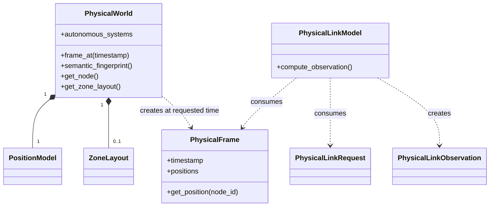
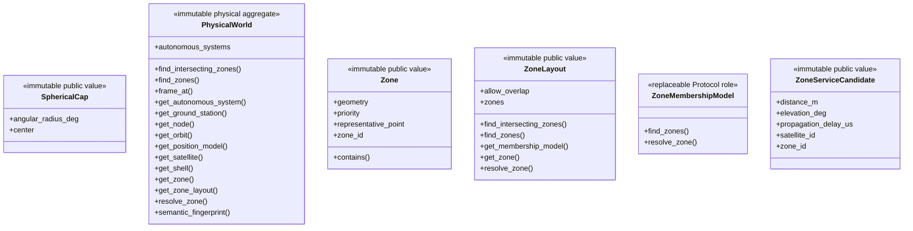

```mermaid
classDiagram
    class DefaultZoneMembershipModel {
        <<reference Model implementation>>
        +find_zones()
        +resolve_zone()
    }
    class GroundStation {
        <<immutable public value>>
        +elevation_m
        +ground_station_id
        +latitude_deg
        +longitude_deg
        +max_simultaneous_satellite_accesses
        +node_id
        +operator
        +station_type
    }
    class GroundStationAccessCandidate {
        <<immutable public value>>
        +distance_m
        +elevation_deg
        +ground_station_id
        +propagation_delay_us
        +satellite_id
    }
    class InterSatelliteLinkCapability {
        <<immutable public value>>
        +maximum_simultaneous_links
    }
    class InterSatelliteLinkCandidate {
        <<immutable public value>>
        +cyclic_plane_separation
        +distance_m
        +endpoint_a
        +endpoint_b
        +propagation_delay_us
        +same_plane
    }
    class LatitudeLongitudeRectangle {
        <<immutable public value>>
        +contains()
        +east_longitude_deg
        +north_latitude_deg
        +representative_center
        +south_latitude_deg
        +west_longitude_deg
    }
    class Orbit {
        <<immutable public value>>
        +altitude_km
        +asn
        +epoch_utc
        +get_satellite()
        +inclination_deg
        +orbit_id
        +right_ascension_deg
        +satellites
        +shell_id
    }
    class PhysicalFrame {
        <<immutable physical frame>>
        +get_position()
        +positions
        +timestamp
    }
```

```mermaid
classDiagram
    class PhysicalLinkModel {
        <<replaceable Protocol role>>
        +compute_observation()
    }
    class PhysicalLinkObservation {
        <<immutable physical observation>>
        +ground_station_access_candidates
        +inter_satellite_candidates
        +timestamp
        +work_counts
        +zone_service_candidates
    }
    class PhysicalLinkRequest {
        <<immutable physical request>>
        +include_ground_station_access
        +include_zone_service
        +inter_satellite_pairs
    }
    class PhysicalLinkWorkCounts {
        <<immutable physical work evidence>>
        +ground_station_pairs_evaluated
        +ground_station_pairs_feasible
        +ground_station_pairs_requested
        +inter_satellite_pairs_evaluated
        +inter_satellite_pairs_feasible
        +inter_satellite_pairs_requested
        +zone_service_pairs_evaluated
        +zone_service_pairs_feasible
        +zone_service_pairs_requested
    }
    class PositionModel {
        <<replaceable Protocol role>>
        +compute_positions()
    }
    class Satellite {
        <<immutable public value>>
        +inter_satellite_link_capability
        +max_simultaneous_ground_station_accesses
        +mean_anomaly_deg
        +node_id
        +orbit_index
        +satellite_id
    }
    class Shell {
        <<immutable public value>>
        +asn
        +get_orbit()
        +orbits
        +shell_id
    }
    class SkyseedAutonomousSystem {
        <<immutable public value>>
        +asn
        +get_ground_station()
        +get_shell()
        +ground_stations
        +shells
    }
```

# PhysicalWorld, PhysicalFrame, physical-link facts, and Zones

This package is the physical-domain owner.

## Local assembly / ownership map

Legend: `*--` is static composition and `..>` is creation or read-only
consumption. Candidate facts never imply operational selection.

PhysicalWorld materializes immutable Autonomous Systems, shells, orbits,
Satellites, GroundStations, capabilities, and optional Zones from Simulator
input. It retains no upstream Emulator object. Its semantic fingerprint is the
Plan and Compiler provenance authority.

PhysicalFrame contains exactly a normalized timestamp and complete immutable
positions. PhysicalWorld owns no Timeline cursor or operational state.

PhysicalLinkRequest bounds the relationship families to evaluate.
PhysicalLinkObservation contains sparse feasible ISL, GroundStation-access,
and Zone-service candidates plus work counts. A candidate is not selected,
acquiring, operational, routed, compiled, or realized state.

`InterSatelliteLinkCapability.maximum_simultaneous_links` is physical static
truth. Canonical S3 uses 4. Desired 2+2 relation mix, K3 candidate scope, and
20-second acquisition reference remain injected Planner policy.

ZoneLayout owns static geographic Zones and one membership Model. Geography
does not imply operational service; Planner owns served/unserved assignment.

Focused tests cover identity, capability, requested-time projection, sparse
physical facts, elevation equivalence, Zone geometry/membership, fingerprints,
and Tool boundaries.

## Detailed public class/member diagrams

These blocks and the exact table below are the maintenance source for every
class owned by this public package. Re-exporting facades do not duplicate the
owner detail.

Legend: `<<...>>` states each public class role and `+` lists its
complete direct public member contract. No connector means no ownership
relationship is asserted by this inventory block.

Legend: `<<...>>` states each public class role and `+` lists its
complete direct public member contract. No connector means no ownership
relationship is asserted by this inventory block.

Legend: `<<...>>` states each public class role and `+` lists its
complete direct public member contract. No connector means no ownership
relationship is asserted by this inventory block.

| Diagram class | Public contract | Required public members |
|---|---|---|
| `DefaultZoneMembershipModel` | `skyseed_v2.simulator.physical.DefaultZoneMembershipModel` | `find_zones()`, `resolve_zone()` |
| `GroundStation` | `skyseed_v2.simulator.physical.GroundStation` | `elevation_m`, `ground_station_id`, `latitude_deg`, `longitude_deg`, `max_simultaneous_satellite_accesses`, `node_id`, `operator`, `station_type` |
| `GroundStationAccessCandidate` | `skyseed_v2.simulator.physical.GroundStationAccessCandidate` | `distance_m`, `elevation_deg`, `ground_station_id`, `propagation_delay_us`, `satellite_id` |
| `InterSatelliteLinkCapability` | `skyseed_v2.simulator.physical.InterSatelliteLinkCapability` | `maximum_simultaneous_links` |
| `InterSatelliteLinkCandidate` | `skyseed_v2.simulator.physical.InterSatelliteLinkCandidate` | `cyclic_plane_separation`, `distance_m`, `endpoint_a`, `endpoint_b`, `propagation_delay_us`, `same_plane` |
| `LatitudeLongitudeRectangle` | `skyseed_v2.simulator.physical.LatitudeLongitudeRectangle` | `contains()`, `east_longitude_deg`, `north_latitude_deg`, `representative_center`, `south_latitude_deg`, `west_longitude_deg` |
| `Orbit` | `skyseed_v2.simulator.physical.Orbit` | `altitude_km`, `asn`, `epoch_utc`, `get_satellite()`, `inclination_deg`, `orbit_id`, `right_ascension_deg`, `satellites`, `shell_id` |
| `PhysicalFrame` | `skyseed_v2.simulator.physical.PhysicalFrame` | `get_position()`, `positions`, `timestamp` |
| `PhysicalLinkModel` | `skyseed_v2.simulator.physical.PhysicalLinkModel` | `compute_observation()` |
| `PhysicalLinkObservation` | `skyseed_v2.simulator.physical.PhysicalLinkObservation` | `ground_station_access_candidates`, `inter_satellite_candidates`, `timestamp`, `work_counts`, `zone_service_candidates` |
| `PhysicalLinkRequest` | `skyseed_v2.simulator.physical.PhysicalLinkRequest` | `include_ground_station_access`, `include_zone_service`, `inter_satellite_pairs` |
| `PhysicalLinkWorkCounts` | `skyseed_v2.simulator.physical.PhysicalLinkWorkCounts` | `ground_station_pairs_evaluated`, `ground_station_pairs_feasible`, `ground_station_pairs_requested`, `inter_satellite_pairs_evaluated`, `inter_satellite_pairs_feasible`, `inter_satellite_pairs_requested`, `zone_service_pairs_evaluated`, `zone_service_pairs_feasible`, `zone_service_pairs_requested` |
| `PositionModel` | `skyseed_v2.simulator.physical.PositionModel` | `compute_positions()` |
| `Satellite` | `skyseed_v2.simulator.physical.Satellite` | `inter_satellite_link_capability`, `max_simultaneous_ground_station_accesses`, `mean_anomaly_deg`, `node_id`, `orbit_index`, `satellite_id` |
| `Shell` | `skyseed_v2.simulator.physical.Shell` | `asn`, `get_orbit()`, `orbits`, `shell_id` |
| `SkyseedAutonomousSystem` | `skyseed_v2.simulator.physical.SkyseedAutonomousSystem` | `asn`, `get_ground_station()`, `get_shell()`, `ground_stations`, `shells` |
| `SphericalCap` | `skyseed_v2.simulator.physical.SphericalCap` | `angular_radius_deg`, `center` |
| `PhysicalWorld` | `skyseed_v2.simulator.physical.PhysicalWorld` | `autonomous_systems`, `find_intersecting_zones()`, `find_zones()`, `frame_at()`, `get_autonomous_system()`, `get_ground_station()`, `get_node()`, `get_orbit()`, `get_position_model()`, `get_satellite()`, `get_shell()`, `get_zone()`, `get_zone_layout()`, `resolve_zone()`, `semantic_fingerprint()` |
| `Zone` | `skyseed_v2.simulator.physical.Zone` | `contains()`, `geometry`, `priority`, `representative_point`, `zone_id` |
| `ZoneLayout` | `skyseed_v2.simulator.physical.ZoneLayout` | `allow_overlap`, `find_intersecting_zones()`, `find_zones()`, `get_membership_model()`, `get_zone()`, `resolve_zone()`, `zones` |
| `ZoneMembershipModel` | `skyseed_v2.simulator.physical.ZoneMembershipModel` | `find_zones()`, `resolve_zone()` |
| `ZoneServiceCandidate` | `skyseed_v2.simulator.physical.ZoneServiceCandidate` | `distance_m`, `elevation_deg`, `propagation_delay_us`, `satellite_id`, `zone_id` |
