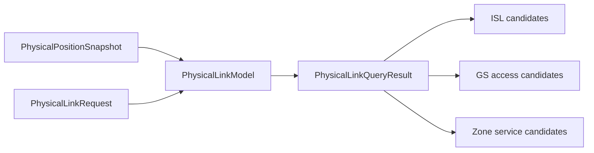

# Physical query values

`PhysicalLinkRequest` bounds requested ISL pairs, GS access and Zone service work.
`PhysicalLinkQueryResult` returns candidates at exactly the input snapshot timestamp.
Candidates report feasibility and optional measures/contact windows; they are not
selected operational connections. Unknown future feasibility remains unknown.

[Physical-link Model](../models/links/README.md) implements the calculation;
[physical contracts](../../../../../docs/development/component-boundaries.md) define
value and timestamp semantics. Optional search limits and prediction are documented
in the [Model contract](../../../../../docs/development/model-interfaces.md).
