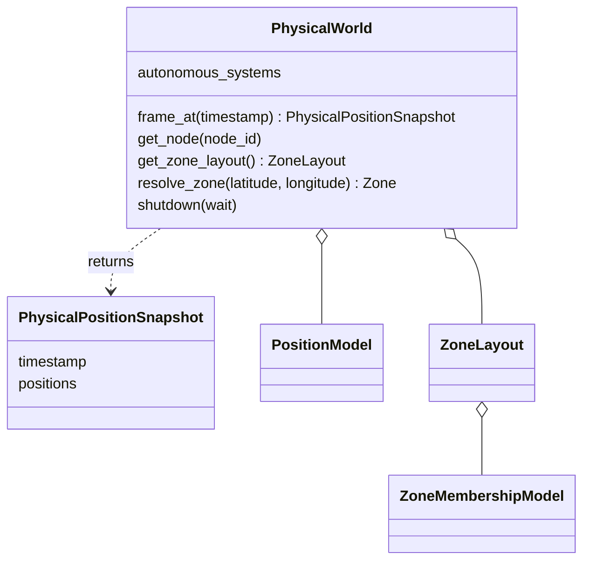

# PhysicalWorld and physical entities

PhysicalWorld materializes immutable AS/Shell/Orbit/Satellite/GroundStation facts
from Simulator input. It holds the exact injected PositionModel and optional
ZoneLayout/membership Model. Lookups validate identity; `frame_at(timestamp)` asks
the PositionModel for one complete ECEF position snapshot. It has no time cursor.

ZoneLayout keeps immutable definitions. Membership and rectangle display geometry
are distinct; custom membership need not expose the default geometry helpers.
The [PhysicalWorld Tool](../../../../../tools/physical_world/README.md) reads stored
frames and public static facts without calling `frame_at()` again.
