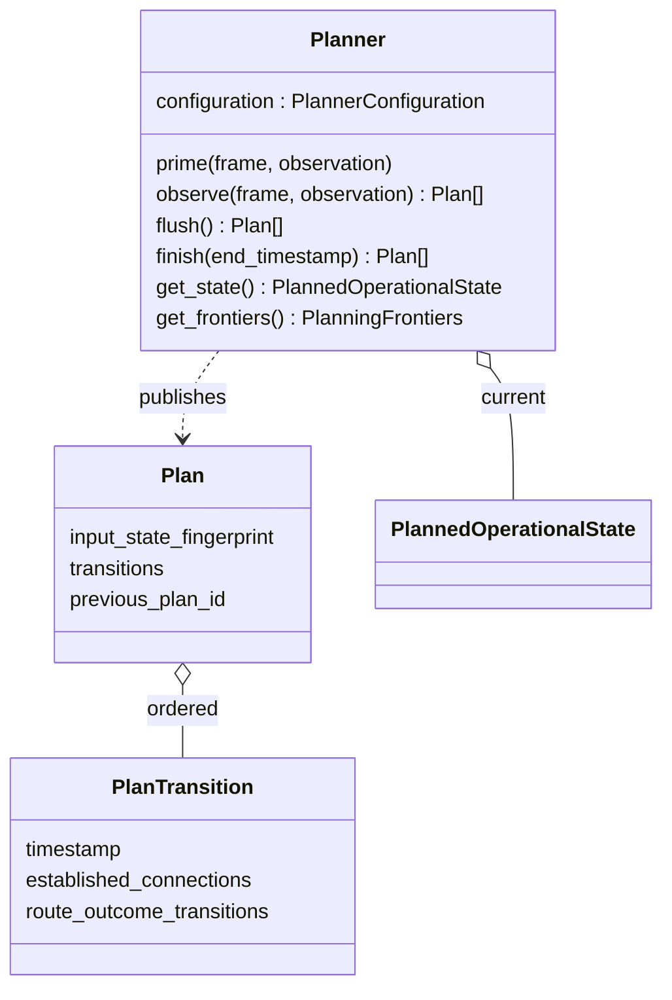

# Planner and formal Plans

Planner owns current connection lifecycle, Zone service, parameters and routing
state. It holds five injected selection/planning roles plus immutable world
facts. Physical feasibility is input; operational selection is its result.

`prime()` advances bounded prehistory without formal output. `observe()` advances
one formal timestamp; dependency changes trigger relevant roles. `flush()` delivers
a bounded Plan while preserving state. `finish()` ends computation explicitly.
Published evidence is released after durable consumption, leaving current state,
necessary preparation state and bounded caches. See [planning semantics](../../../../docs/development/planner-state-and-plans.md).

`_physical_queries.py` shares the injected Models’ potential-pair, prediction and
search advice with the physical cutoff without invoking Planner. It owns no
operational state; Planner supplies retained selection facts during planning.

Connection reservations consume capacity during acquisition; loss cancels preparation.
[GroundStation selection](ground_station/README.md) shares station capacity across
scopes. [Routing](routing/README.md) consumes operational graphs and service choices.
PlanTransition derives semantic dependencies that order events within its timestamp;
they do not choose update timing and are not an injectable Model. [Role navigation](../../../../docs/development/model-interfaces.md) locates defaults
and author replacements without imposing their optimization conventions.
