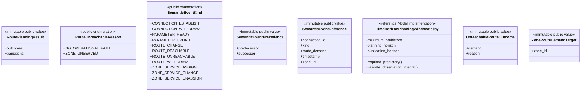
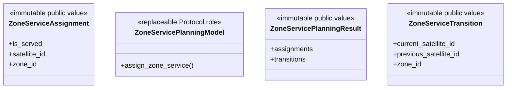

```mermaid
classDiagram
    class AccumulatedDeadbandParameterPlanningModel {
        <<reference Model implementation>>
        +plan_effective_parameters()
    }
    class CandidateDecision {
        <<immutable public value>>
        +decision
        +endpoint_a
        +endpoint_b
        +reason
    }
    class CandidateDecisionKind {
        <<public enumeration>>
        +REJECTED
        +RETAINED
        +SELECTED
        +UNDERFILLED
    }
    class ConnectionParameterObservation {
        <<immutable public value>>
        +connection_id
        +physical_delay_us
    }
    class CoordinationPolicy {
        <<replaceable Protocol role>>
        +coordinate()
    }
    class DefaultCoordinationPolicy {
        <<reference Model implementation>>
        +coordinate()
    }
    class EffectiveConnectionParameters {
        <<immutable public value>>
        +bandwidth_bps
        +delay_us
        +packet_loss_ppm
    }
    class GatewayHopCountRoutePlanningModel {
        <<reference Model implementation>>
        +create_route_demands()
        +plan_route_outcomes()
        +shutdown()
    }
```

```mermaid
classDiagram
    class GroundStationAccessPlanningModel {
        <<replaceable Protocol role>>
        +select_ground_station_accesses()
    }
    class GroundStationRouteDemandTarget {
        <<immutable public value>>
        +ground_station_id
    }
    class HighestElevationZoneServicePlanningModel {
        <<reference Model implementation>>
        +assign_zone_service()
    }
    class InterSatelliteConnectionPlanningModel {
        <<replaceable Protocol role>>
        +create_inter_satellite_candidate_pairs()
        +select_inter_satellite_links()
    }
    class InterSatelliteLifecycleEvidence {
        <<immutable public value>>
        +acquisition_duration
        +candidate
        +operational
        +remaining_acquisition
        +selected_since
    }
    class InterSatelliteSelection {
        <<immutable public value>>
        +decisions
        +selected_candidates
        +underfilled_slots
    }
    class OperationalConnection {
        <<immutable public value>>
        +connection_id
        +endpoint_a_to_b
        +endpoint_b_to_a
    }
    class OperationalConnectionId {
        <<immutable public value>>
        +endpoint_a
        +endpoint_b
        +kind
    }
```

```mermaid
classDiagram
    class OperationalConnectionKind {
        <<public enumeration>>
        +GROUND_STATION_ACCESS
        +INTER_SATELLITE
    }
    class ParameterKindConfiguration {
        <<immutable public value>>
        +bandwidth_bps
        +delay_deadband_us
        +max_staleness
        +packet_loss_ppm
        +persistence
    }
    class ParameterPlanningMemory {
        <<immutable public value>>
        +connection_id
        +effective
        +last_update
        +pending_delay_us
        +pending_since
    }
    class ParameterPlanningModel {
        <<replaceable Protocol role>>
        +plan_effective_parameters()
    }
    class ParameterPlanningResult {
        <<immutable public value>>
        +connections
        +established_connections
        +memory
        +parameter_updated_connections
        +withdrawn_connection_ids
    }
    class Plan {
        <<immutable replay-complete plan>>
        +end_timestamp
        +input_state_fingerprint
        +observation_interval
        +output_state_fingerprint
        +physical_world_fingerprint
        +plan_id
        +previous_plan_id
        +semantic_event_precedences
        +start_timestamp
        +transitions
    }
    class Planner {
        <<stateful semantic Planner owner>>
        +create_physical_link_request()
        +finish()
        +get_frontiers()
        +get_last_transition()
        +get_last_transition_fingerprint()
        +get_published_evidence()
        +get_route_recomputation_count()
        +get_state()
        +get_state_fingerprint()
        +observe()
        +prime()
        +release_published_through()
        +required_prehistory
        +set_route_demands()
        +shutdown()
    }
    class PlanningCandidateHistogram {
        <<immutable public value>>
        +bins
        +name
        +sample_count
    }
```

```mermaid
classDiagram
    class PlanningCandidateSummary {
        <<immutable public value>>
        +feasible_count
        +histograms
    }
    class PlanningFrontiers {
        <<immutable public value>>
        +physical_observation
        +planning
        +publication
    }
    class PlanningFrameEvidence {
        <<immutable detached frame evidence>>
        +ground_station_access_candidate_summary
        +inspection
        +inter_satellite_candidate_summary
        +physical_link_work_counts
        +selected_ground_station_accesses
        +selected_inter_satellite_links
        +selected_zone_service_candidates
        +timestamp
        +zone_service_candidate_summary
    }
    class PlanningHistogramBin {
        <<immutable public value>>
        +count
        +label
    }
    class PlanningInspection {
        <<immutable planning inspection>>
        +acquiring_isls
        +acquisition_completed
        +acquisition_reset
        +acquisition_started
        +feasible_isl_candidates
        +ground_station_accesses
        +operational_isls
        +rejected_isls
        +route_recomputed
        +routes_reachable
        +routes_unreachable
        +selected_isls
        +stages
        +timestamp
        +underfilled_isl_slots
        +zones_served
        +zones_unserved
    }
    class PlanningWindowPolicy {
        <<replaceable Protocol role>>
        +planning_horizon
        +publication_horizon
        +required_prehistory()
        +validate_observation_interval()
    }
    class PlanTransition {
        <<immutable formal semantic transition>>
        +established_connections
        +parameter_updated_connections
        +route_outcome_transitions
        +route_relevant
        +timestamp
        +with_route_outcome_transitions()
        +withdrawn_connection_ids
        +zone_service_transitions
    }
    class PlannedOperationalState {
        <<immutable complete operational state>>
        +operational_connections
        +route_outcomes
        +timestamp
        +zone_service_assignments
    }
```

```mermaid
classDiagram
    class PublishedPlanningEvidence {
        <<immutable detached planning evidence>>
        +frames
        +frontiers
        +inspections
        +plan
        +transition_fingerprints
    }
    class QualityFirstGroundStationAccessPlanningModel {
        <<reference Model implementation>>
        +select_ground_station_accesses()
    }
    class ReachableRouteOutcome {
        <<immutable public value>>
        +demand
        +next_hop
        +path
    }
    class RetainFirstInterSatelliteConfiguration {
        <<immutable public value>>
        +acquisition_duration
        +desired_cross_plane_links
        +desired_same_plane_links
        +maximum_cross_plane_separation
    }
    class RetainFirstInterSatelliteConnectionPlanningModel {
        <<reference Model implementation>>
        +acquisition_duration
        +create_inter_satellite_candidate_pairs()
        +select_inter_satellite_links()
    }
    class RouteDemand {
        <<immutable public value>>
        +source
        +target
    }
    class RouteOutcomeTransition {
        <<immutable public value>>
        +current
        +demand
        +previous
    }
    class RoutePlanningModel {
        <<replaceable Protocol role>>
        +plan_route_outcomes()
        +shutdown()
    }
```

# Network planning

`skyseed_v2.simulator.planning` owns the one authoritative operational Network
Planner. It consumes ordered `PhysicalFrame` and matching
`PhysicalLinkObservation` values and publishes immutable, replay-complete
`Plan` values.

## Local assembly / ownership map

Legend: `-->` is a retained read-only reference, `..>` is input/Model
dependency, and `*--` is owned semantic state or immutable Plan composition.

```mermaid
classDiagram
    class PhysicalWorld
    class PhysicalFrame
    class PhysicalLinkObservation
    class Planner
    class PlannedOperationalState
    class PlanTransition
    class SemanticEventPrecedence
    class Plan
    class InterSatelliteConnectionPlanningModel
    class GroundStationAccessPlanningModel
    class ZoneServicePlanningModel
    class ParameterPlanningModel
    class RoutePlanningModel
    class CoordinationPolicy
    class PlanningWindowPolicy

    Planner "1" --> "1" PhysicalWorld : exact provenance authority
    Planner ..> PhysicalFrame : consumes ordered formal input
    Planner ..> PhysicalLinkObservation : consumes matching physical facts
    Planner "1" *-- "1" PlannedOperationalState : current operational truth
    Plan "1" *-- "1..*" PlanTransition : replay-complete boundaries
    Plan "1" *-- "0..*" SemanticEventPrecedence : ordering only
    Planner ..> InterSatelliteConnectionPlanningModel
    Planner ..> GroundStationAccessPlanningModel
    Planner ..> ZoneServicePlanningModel
    Planner ..> ParameterPlanningModel
    Planner ..> RoutePlanningModel
    Planner ..> CoordinationPolicy
    Planner ..> PlanningWindowPolicy
```



## Ownership

The final dependency direction is:

```text
PhysicalWorld
  -> PhysicalFrame
  -> PhysicalLinkObservation
  -> Planner
  -> PlannedOperationalState
  -> PlanTransition
  -> Plan
  -> Compiler
```

The external incremental producer owns timestamp progression and invokes the
injected physical-link Model. `Planner` does not advance physical time and does
not call the physical-link Model.

`Planner` exclusively owns:

- operational planning state;
- inter-satellite selection and acquisition lifecycle;
- GroundStation and Zone decisions;
- effective-parameter memory;
- Route demands, outcomes, and workers through the injected Route Model;
- physical-observation, planning, and publication frontiers;
- bounded unpublished transitions;
- published state and Plan lineage;
- bounded detached planning evidence.

## Public lifecycle

```python
planner = Planner(
    physical_world=physical_world,
    observation_interval=timedelta(seconds=5),
    inter_satellite_model=inter_satellite_model,
    ground_station_model=ground_station_model,
    zone_service_model=zone_service_model,
    parameter_model=parameter_model,
    route_model=route_model,
    coordination_policy=coordination_policy,
    planning_window_policy=TimeHorizonPlanningWindowPolicy(
        planning_horizon=timedelta(seconds=50),
        publication_horizon=timedelta(seconds=20),
        maximum_prehistory=timedelta(seconds=20),
    ),
)
```

The producer uses this sequence:

1. Read `planner.required_prehistory` and, when non-zero, provide ordered
   pre-formal frames through `prime(frame, observation, formal_start=...)`.
2. For each formal timestamp, ask `create_physical_link_request()`, compute the
   matching physical observation externally, and call `observe(frame,
   observation)`.
3. Consume every newly returned `Plan`.
4. Read and durably serialize `get_published_evidence(plan.plan_id)` when
   inspection is enabled.
5. After successful handoff, call `release_published_through(plan.plan_id)`.
6. At the exact Timeline end call `finish(end_timestamp=...)` and consume the
   flushed tail Plans.
7. Always call `shutdown(wait=True)` to stop Route workers.

Each prime timestamp must be strictly before one fixed formal start and inside
the bounded required-prehistory interval. Prime updates only physical and
selection/acquisition warm state. It never creates a formal transition or a
Plan.

## Model roles

The replaceable public roles are:

- `InterSatelliteConnectionPlanningModel`;
- `GroundStationAccessPlanningModel`;
- `ZoneServicePlanningModel`;
- `ParameterPlanningModel`;
- `RoutePlanningModel`;
- `CoordinationPolicy`;
- `PlanningWindowPolicy`.

Reference implementations are directly injected:

- `RetainFirstInterSatelliteConnectionPlanningModel`;
- `QualityFirstGroundStationAccessPlanningModel`;
- `HighestElevationZoneServicePlanningModel`;
- `AccumulatedDeadbandParameterPlanningModel`;
- `GatewayHopCountRoutePlanningModel`;
- `DefaultCoordinationPolicy`;
- `TimeHorizonPlanningWindowPolicy`.

There is no registry. Replacing one role does not transfer authority over the
other roles.

## Operational state and transitions

`PlannedOperationalState` contains only complete operational outputs for one
timestamp:

- established `OperationalConnection` values with effective parameters;
- explicit Zone assignments, including unserved assignments;
- complete reachable or explicitly unreachable Route outcomes.

`PlanTransition` is the sole per-boundary delta truth. It carries complete
payloads for:

- established Connections;
- withdrawn Connection IDs;
- parameter-updated Connections;
- previous/current Zone service;
- previous/current Route outcomes.

An empty `PlanTransition` is valid and preserves an exact formal activation
boundary.

`apply_plan_transition` is the one authoritative transition replay operation.
`apply_plan` validates the PhysicalWorld fingerprint, input state fingerprint,
every transition, and output state fingerprint. Qualification tests maintain a
separately implemented oracle.

## Event references and precedence

`semantic_event_references(transition)` deterministically derives immutable
`SemanticEventReference` values. The transition remains the payload authority.

`Plan` stores only `SemanticEventPrecedence` edges over references derivable
from its transitions. It does not store a second editable event list. Reference
equality is semantic value equality; Python object identity is irrelevant.

## Plan contract

Every `Plan` contains:

- deterministic `plan_id` and immediate `previous_plan_id` lineage;
- PhysicalWorld, input-state, and output-state fingerprints;
- one explicit positive `observation_interval` in canonical Plan content;
- first and last included formal timestamps;
- strictly ordered, non-overlapping `PlanTransition` values;
- validated semantic precedence edges.

For every Plan, `start_timestamp` equals its first transition timestamp,
`end_timestamp` equals its last transition timestamp, and every adjacent
transition is exactly one `observation_interval` apart. A later Plan begins
exactly one observation interval after the previous Plan ends; no transition
appears in two Plans. The observation interval participates in canonical Plan
identity and is encoded as exact days/seconds/microseconds components.

The bootstrap Plan has no previous Plan or input-state fingerprint and replays
from explicit empty operational state.

## Window semantics

The canonical policy plans 50 seconds ahead of the publication frontier and
publishes the earliest prefix of at most 20 seconds.

For a 10-minute Timeline sampled every 5 seconds:

- the first normal publication occurs after planning through `t=50`;
- Plan 1 contains `t=0,5,10,15,20`;
- Plan 2 contains `t=25,30,35,40` after planning reaches `t=70`;
- normal publication reaches `t=560` after planning reaches `t=590`;
- finish flushes `t=565..580` and `t=585..600`;
- exactly 121 transitions appear in exactly 30 Plans.

The physical-observation and planning frontiers advance on every accepted
formal input. The publication frontier advances only when a Plan is created.

## Fingerprints

The current frozen schemas are:

- `skyseed-v2-physical-world-v1`;
- `skyseed-v2-planned-operational-state-v1`;
- `skyseed-v2-plan-transition-v1`;
- `skyseed-v2-plan-v1`.

All fingerprints and Plan IDs are lowercase SHA-256 values over canonical
JSON semantic material. `PhysicalWorld.semantic_fingerprint()` is the only
authority for static physical identity and is cached once by the immutable
aggregate. Planning and downstream consumers query and compare it; they do not
reimplement it.

## Detached evidence

`PublishedPlanningEvidence` retains one Plan plus bounded per-frame evidence:

- physical work counts and bounded candidate quality/count/reason histograms;
- selected ISLs, selection time, acquisition duration, remaining acquisition,
  and operational status;
- exact selected GroundStation accesses and served Zone candidate facts;
- compact selection, rejection, underfill, service, and Route counters;
- transition fingerprints and all three frontiers.

Feasible and rejected candidate tuples are deliberately not retained. Candidate
summaries use fixed numeric buckets and bounded categorical/reason bins, so
evidence size is driven by exact selected facts rather than the number of
physical pairs evaluated.

Operational parameter, Zone, and Route changes remain in the PlanTransitions.
Offline readers replay them instead of storing a complete state snapshot for
every frame.

`planning.evidence` supplies strict detached codecs for Plans, transitions,
states, and published evidence. The codecs reject unknown fields, unsupported
schemas, malformed values, and fingerprint/Plan-ID mismatches. They return
only mappings, lists, and scalar JSON values; no live Planner or worker object
is serialized.

## Detailed public class/member diagrams

These blocks and the exact table below are the maintenance source for every
class owned by this public package. Re-exporting facades do not duplicate the
owner detail.

Legend: `<<...>>` states each public class role and `+` lists its
complete direct public member contract. No connector means no ownership
relationship is asserted by this inventory block.



Legend: `<<...>>` states each public class role and `+` lists its
complete direct public member contract. No connector means no ownership
relationship is asserted by this inventory block.



Legend: `<<...>>` states each public class role and `+` lists its
complete direct public member contract. No connector means no ownership
relationship is asserted by this inventory block.



Legend: `<<...>>` states each public class role and `+` lists its
complete direct public member contract. No connector means no ownership
relationship is asserted by this inventory block.



Legend: `<<...>>` states each public class role and `+` lists its
complete direct public member contract. No connector means no ownership
relationship is asserted by this inventory block.



Legend: `<<...>>` states each public class role and `+` lists its
complete direct public member contract. No connector means no ownership
relationship is asserted by this inventory block.



Legend: `<<...>>` states each public class role and `+` lists its
complete direct public member contract. No connector means no ownership
relationship is asserted by this inventory block.



| Diagram class | Public contract | Required public members |
|---|---|---|
| `AccumulatedDeadbandParameterPlanningModel` | `skyseed_v2.simulator.planning.AccumulatedDeadbandParameterPlanningModel` | `plan_effective_parameters()` |
| `CandidateDecision` | `skyseed_v2.simulator.planning.CandidateDecision` | `decision`, `endpoint_a`, `endpoint_b`, `reason` |
| `CandidateDecisionKind` | `skyseed_v2.simulator.planning.CandidateDecisionKind` | `REJECTED`, `RETAINED`, `SELECTED`, `UNDERFILLED` |
| `ConnectionParameterObservation` | `skyseed_v2.simulator.planning.ConnectionParameterObservation` | `connection_id`, `physical_delay_us` |
| `CoordinationPolicy` | `skyseed_v2.simulator.planning.CoordinationPolicy` | `coordinate()` |
| `DefaultCoordinationPolicy` | `skyseed_v2.simulator.planning.DefaultCoordinationPolicy` | `coordinate()` |
| `EffectiveConnectionParameters` | `skyseed_v2.simulator.planning.EffectiveConnectionParameters` | `bandwidth_bps`, `delay_us`, `packet_loss_ppm` |
| `GatewayHopCountRoutePlanningModel` | `skyseed_v2.simulator.planning.GatewayHopCountRoutePlanningModel` | `create_route_demands()`, `plan_route_outcomes()`, `shutdown()` |
| `GroundStationAccessPlanningModel` | `skyseed_v2.simulator.planning.GroundStationAccessPlanningModel` | `select_ground_station_accesses()` |
| `GroundStationRouteDemandTarget` | `skyseed_v2.simulator.planning.GroundStationRouteDemandTarget` | `ground_station_id` |
| `HighestElevationZoneServicePlanningModel` | `skyseed_v2.simulator.planning.HighestElevationZoneServicePlanningModel` | `assign_zone_service()` |
| `InterSatelliteConnectionPlanningModel` | `skyseed_v2.simulator.planning.InterSatelliteConnectionPlanningModel` | `create_inter_satellite_candidate_pairs()`, `select_inter_satellite_links()` |
| `InterSatelliteLifecycleEvidence` | `skyseed_v2.simulator.planning.InterSatelliteLifecycleEvidence` | `acquisition_duration`, `candidate`, `operational`, `remaining_acquisition`, `selected_since` |
| `InterSatelliteSelection` | `skyseed_v2.simulator.planning.InterSatelliteSelection` | `decisions`, `selected_candidates`, `underfilled_slots` |
| `OperationalConnection` | `skyseed_v2.simulator.planning.OperationalConnection` | `connection_id`, `endpoint_a_to_b`, `endpoint_b_to_a` |
| `OperationalConnectionId` | `skyseed_v2.simulator.planning.OperationalConnectionId` | `endpoint_a`, `endpoint_b`, `kind` |
| `OperationalConnectionKind` | `skyseed_v2.simulator.planning.OperationalConnectionKind` | `GROUND_STATION_ACCESS`, `INTER_SATELLITE` |
| `ParameterKindConfiguration` | `skyseed_v2.simulator.planning.ParameterKindConfiguration` | `bandwidth_bps`, `delay_deadband_us`, `max_staleness`, `packet_loss_ppm`, `persistence` |
| `ParameterPlanningMemory` | `skyseed_v2.simulator.planning.ParameterPlanningMemory` | `connection_id`, `effective`, `last_update`, `pending_delay_us`, `pending_since` |
| `ParameterPlanningModel` | `skyseed_v2.simulator.planning.ParameterPlanningModel` | `plan_effective_parameters()` |
| `ParameterPlanningResult` | `skyseed_v2.simulator.planning.ParameterPlanningResult` | `connections`, `established_connections`, `memory`, `parameter_updated_connections`, `withdrawn_connection_ids` |
| `Plan` | `skyseed_v2.simulator.planning.Plan` | `end_timestamp`, `input_state_fingerprint`, `observation_interval`, `output_state_fingerprint`, `physical_world_fingerprint`, `plan_id`, `previous_plan_id`, `semantic_event_precedences`, `start_timestamp`, `transitions` |
| `Planner` | `skyseed_v2.simulator.planning.Planner` | `create_physical_link_request()`, `finish()`, `get_frontiers()`, `get_last_transition()`, `get_last_transition_fingerprint()`, `get_published_evidence()`, `get_route_recomputation_count()`, `get_state()`, `get_state_fingerprint()`, `observe()`, `prime()`, `release_published_through()`, `required_prehistory`, `set_route_demands()`, `shutdown()` |
| `PlanningCandidateHistogram` | `skyseed_v2.simulator.planning.PlanningCandidateHistogram` | `bins`, `name`, `sample_count` |
| `PlanningCandidateSummary` | `skyseed_v2.simulator.planning.PlanningCandidateSummary` | `feasible_count`, `histograms` |
| `PlanningFrontiers` | `skyseed_v2.simulator.planning.PlanningFrontiers` | `physical_observation`, `planning`, `publication` |
| `PlanningFrameEvidence` | `skyseed_v2.simulator.planning.PlanningFrameEvidence` | `ground_station_access_candidate_summary`, `inspection`, `inter_satellite_candidate_summary`, `physical_link_work_counts`, `selected_ground_station_accesses`, `selected_inter_satellite_links`, `selected_zone_service_candidates`, `timestamp`, `zone_service_candidate_summary` |
| `PlanningHistogramBin` | `skyseed_v2.simulator.planning.PlanningHistogramBin` | `count`, `label` |
| `PlanningInspection` | `skyseed_v2.simulator.planning.PlanningInspection` | `acquiring_isls`, `acquisition_completed`, `acquisition_reset`, `acquisition_started`, `feasible_isl_candidates`, `ground_station_accesses`, `operational_isls`, `rejected_isls`, `route_recomputed`, `routes_reachable`, `routes_unreachable`, `selected_isls`, `stages`, `timestamp`, `underfilled_isl_slots`, `zones_served`, `zones_unserved` |
| `PlanningWindowPolicy` | `skyseed_v2.simulator.planning.PlanningWindowPolicy` | `planning_horizon`, `publication_horizon`, `required_prehistory()`, `validate_observation_interval()` |
| `PlanTransition` | `skyseed_v2.simulator.planning.PlanTransition` | `established_connections`, `parameter_updated_connections`, `route_outcome_transitions`, `route_relevant`, `timestamp`, `with_route_outcome_transitions()`, `withdrawn_connection_ids`, `zone_service_transitions` |
| `PlannedOperationalState` | `skyseed_v2.simulator.planning.PlannedOperationalState` | `operational_connections`, `route_outcomes`, `timestamp`, `zone_service_assignments` |
| `PublishedPlanningEvidence` | `skyseed_v2.simulator.planning.PublishedPlanningEvidence` | `frames`, `frontiers`, `inspections`, `plan`, `transition_fingerprints` |
| `QualityFirstGroundStationAccessPlanningModel` | `skyseed_v2.simulator.planning.QualityFirstGroundStationAccessPlanningModel` | `select_ground_station_accesses()` |
| `ReachableRouteOutcome` | `skyseed_v2.simulator.planning.ReachableRouteOutcome` | `demand`, `next_hop`, `path` |
| `RetainFirstInterSatelliteConfiguration` | `skyseed_v2.simulator.planning.RetainFirstInterSatelliteConfiguration` | `acquisition_duration`, `desired_cross_plane_links`, `desired_same_plane_links`, `maximum_cross_plane_separation` |
| `RetainFirstInterSatelliteConnectionPlanningModel` | `skyseed_v2.simulator.planning.RetainFirstInterSatelliteConnectionPlanningModel` | `acquisition_duration`, `create_inter_satellite_candidate_pairs()`, `select_inter_satellite_links()` |
| `RouteDemand` | `skyseed_v2.simulator.planning.RouteDemand` | `source`, `target` |
| `RouteOutcomeTransition` | `skyseed_v2.simulator.planning.RouteOutcomeTransition` | `current`, `demand`, `previous` |
| `RoutePlanningModel` | `skyseed_v2.simulator.planning.RoutePlanningModel` | `plan_route_outcomes()`, `shutdown()` |
| `RoutePlanningResult` | `skyseed_v2.simulator.planning.RoutePlanningResult` | `outcomes`, `transitions` |
| `RouteUnreachableReason` | `skyseed_v2.simulator.planning.RouteUnreachableReason` | `NO_OPERATIONAL_PATH`, `ZONE_UNSERVED` |
| `SemanticEventKind` | `skyseed_v2.simulator.planning.SemanticEventKind` | `CONNECTION_ESTABLISH`, `CONNECTION_WITHDRAW`, `PARAMETER_READY`, `PARAMETER_UPDATE`, `ROUTE_CHANGE`, `ROUTE_REACHABLE`, `ROUTE_UNREACHABLE`, `ROUTE_WITHDRAW`, `ZONE_SERVICE_ASSIGN`, `ZONE_SERVICE_CHANGE`, `ZONE_SERVICE_UNASSIGN` |
| `SemanticEventPrecedence` | `skyseed_v2.simulator.planning.SemanticEventPrecedence` | `predecessor`, `successor` |
| `SemanticEventReference` | `skyseed_v2.simulator.planning.SemanticEventReference` | `connection_id`, `kind`, `route_demand`, `timestamp`, `zone_id` |
| `TimeHorizonPlanningWindowPolicy` | `skyseed_v2.simulator.planning.TimeHorizonPlanningWindowPolicy` | `maximum_prehistory`, `planning_horizon`, `publication_horizon`, `required_prehistory()`, `validate_observation_interval()` |
| `UnreachableRouteOutcome` | `skyseed_v2.simulator.planning.UnreachableRouteOutcome` | `demand`, `reason` |
| `ZoneRouteDemandTarget` | `skyseed_v2.simulator.planning.ZoneRouteDemandTarget` | `zone_id` |
| `ZoneServiceAssignment` | `skyseed_v2.simulator.planning.ZoneServiceAssignment` | `is_served`, `satellite_id`, `zone_id` |
| `ZoneServicePlanningModel` | `skyseed_v2.simulator.planning.ZoneServicePlanningModel` | `assign_zone_service()` |
| `ZoneServicePlanningResult` | `skyseed_v2.simulator.planning.ZoneServicePlanningResult` | `assignments`, `transitions` |
| `ZoneServiceTransition` | `skyseed_v2.simulator.planning.ZoneServiceTransition` | `current_satellite_id`, `previous_satellite_id`, `zone_id` |
