# Simulator semantic planning

This package owns the Simulator `Planner`, immutable `Plan` snapshots, three
typed transition families, concise decision evidence, replaceable planning
algorithm Protocols, one minimal Forwarding semantic-order relation, and their
first reference implementations. It does not
own Slice generation, route selection, backend preparation, compilation, or
runtime execution.

## Local assembly / ownership map

Legend: `*--` is lifecycle ownership.

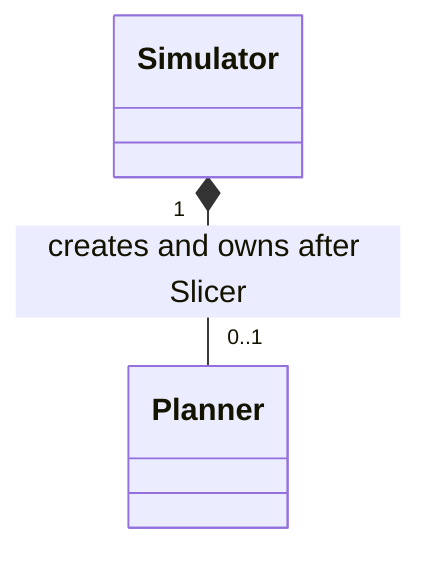

Legend: `-->` is the exact sibling reference bound by `Simulator`.

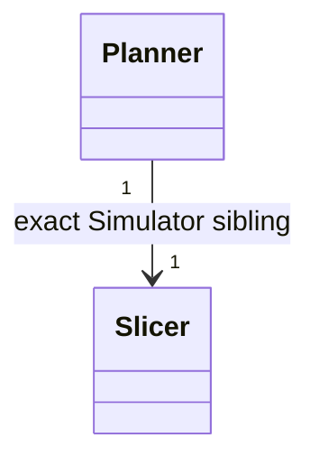

Legend: `*--` is ownership of the current immutable snapshot.

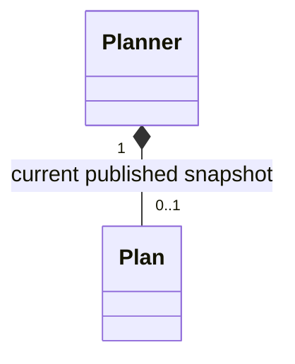

Legend: `*--` is immutable Plan composition. The temporal index and
precedences reference the same transition instances and do not duplicate
payload.

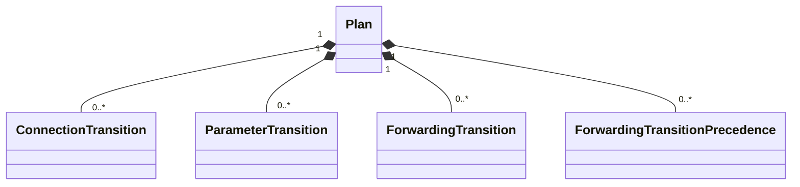

Legend: `-->` is a same-Plan transition reference, not ownership or execution.

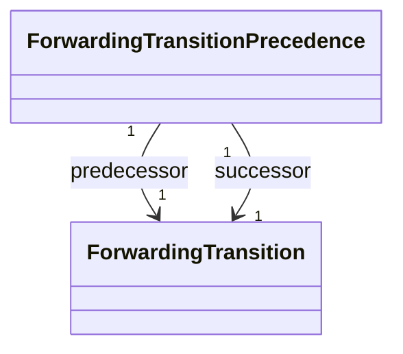

Legend: `..>` is the retained reference to and invocation of one injected
replaceable algorithm role; the role does not own Planner.

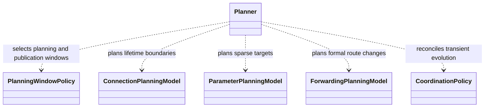

Planner owns its private continuous planning state and current published Plan;
neither is owned by a Model. Plan owns coverage, its three transition tuples,
Forwarding precedences and temporal index. Private state is intentionally not
promoted into another public Mermaid class.

Standalone public values and implementations expanded below:
`ConnectionTransition`, `ConnectionTransitionOperation`,
`ParameterTransition`, `ForwardingTransition`,
`ForwardingTransitionPrecedence`, `PlanningDecision`,
`AllAvailablePlanningWindowPolicy`,
`SampleBoundaryConnectionPlanningModel`,
`MidpointConnectionPlanningModel`,
`AccumulatedDeadbandParameterPlanningModel`,
`DependencyAwareForwardingPlanningModel`, and `DefaultCoordinationPolicy`.

## Detailed public class/member diagrams

Legend: `*--` is the current immutable Plan owned by the Planner. Decision
evidence remains separately retained and is not Plan payload.

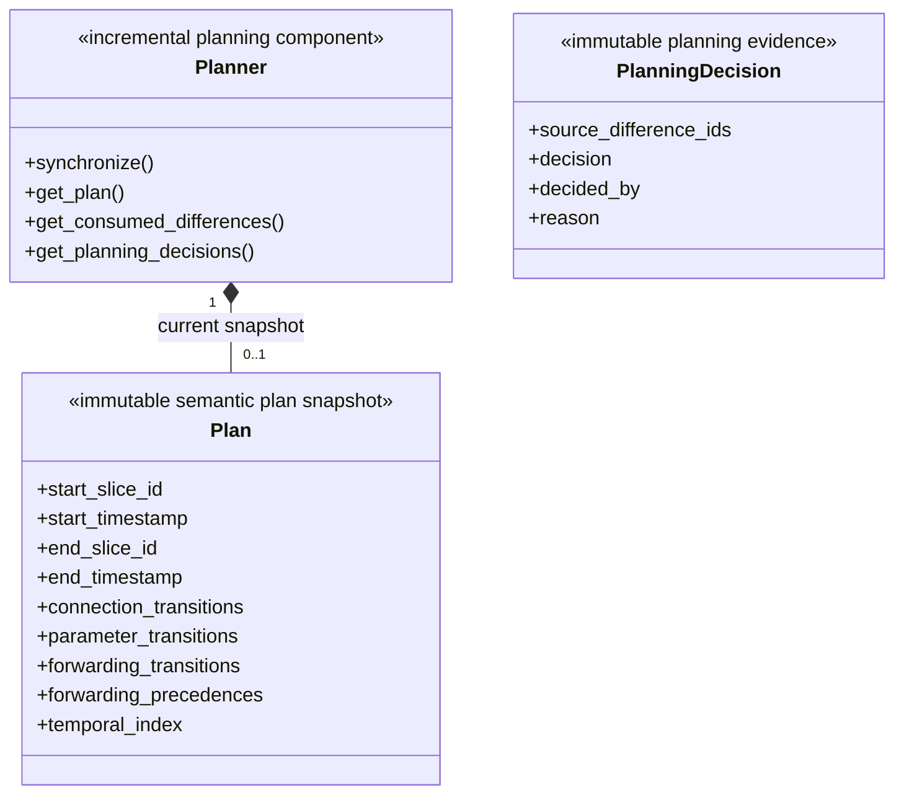

Legend: `*--` is immutable value composition; the operation enum belongs to a
Connection transition.

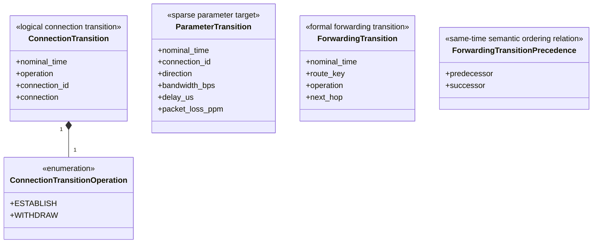

Legend: `-->` is an endpoint reference to an exact Forwarding transition in
the containing Plan.

Legend: these are independent Protocol roles; no connector implies no
ownership or call relationship between the algorithms.

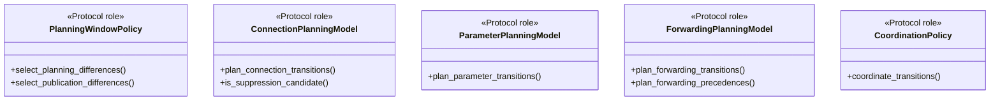

Legend: `..|>` means the public class implements the named Protocol role.

```mermaid
classDiagram
    class PlanningWindowPolicy
    class ConnectionPlanningModel
    class ParameterPlanningModel
    class ForwardingPlanningModel
    class CoordinationPolicy
    class AllAvailablePlanningWindowPolicy {
        <<default planning-window algorithm>>
        +select_planning_differences()
        +select_publication_differences()
    }
    class SampleBoundaryConnectionPlanningModel {
        <<reference connection algorithm>>
        +plan_connection_transitions()
        +is_suppression_candidate()
    }
    class MidpointConnectionPlanningModel {
        <<reference connection algorithm>>
        +plan_connection_transitions()
        +is_suppression_candidate()
    }
    class AccumulatedDeadbandParameterPlanningModel {
        <<reference parameter algorithm>>
        +plan_parameter_transitions()
    }
    class DependencyAwareForwardingPlanningModel {
        <<reference forwarding algorithm>>
        +plan_forwarding_transitions()
        +plan_forwarding_precedences()
    }
    class DefaultCoordinationPolicy {
        <<default coordination strategy>>
        +coordinate_transitions()
    }

    PlanningWindowPolicy <|.. AllAvailablePlanningWindowPolicy
    ConnectionPlanningModel <|.. SampleBoundaryConnectionPlanningModel
    ConnectionPlanningModel <|.. MidpointConnectionPlanningModel
    ParameterPlanningModel <|.. AccumulatedDeadbandParameterPlanningModel
    ForwardingPlanningModel <|.. DependencyAwareForwardingPlanningModel
    CoordinationPolicy <|.. DefaultCoordinationPolicy
```

| Diagram name | Public contract | Members maintained here |
|---|---|---|
| `Planner` | `skyseed_v2.simulator.planning.Planner` | `synchronize()`, `get_plan()`, `get_consumed_differences()`, `get_planning_decisions()` |
| `Plan` | `skyseed_v2.simulator.planning.Plan` | `start_slice_id`, `start_timestamp`, `end_slice_id`, `end_timestamp`, `connection_transitions`, `parameter_transitions`, `forwarding_transitions`, `forwarding_precedences`, `temporal_index` |
| `PlanningDecision` | `skyseed_v2.simulator.planning.PlanningDecision` | `source_difference_ids`, `decision`, `decided_by`, `reason` |
| `ConnectionTransition` | `skyseed_v2.simulator.planning.ConnectionTransition` | `nominal_time`, `operation`, `connection_id`, `connection` |
| `ConnectionTransitionOperation` | `skyseed_v2.simulator.planning.ConnectionTransitionOperation` | `ESTABLISH`, `WITHDRAW` |
| `ParameterTransition` | `skyseed_v2.simulator.planning.ParameterTransition` | `nominal_time`, `connection_id`, `direction`, `bandwidth_bps`, `delay_us`, `packet_loss_ppm` |
| `ForwardingTransition` | `skyseed_v2.simulator.planning.ForwardingTransition` | `nominal_time`, `route_key`, `operation`, `next_hop` |
| `ForwardingTransitionPrecedence` | `skyseed_v2.simulator.planning.ForwardingTransitionPrecedence` | `predecessor`, `successor` |
| `PlanningWindowPolicy` | `skyseed_v2.simulator.planning.PlanningWindowPolicy` | `select_planning_differences()`, `select_publication_differences()` |
| `AllAvailablePlanningWindowPolicy` | `skyseed_v2.simulator.planning.AllAvailablePlanningWindowPolicy` | `select_planning_differences()`, `select_publication_differences()` |
| `ConnectionPlanningModel` | `skyseed_v2.simulator.planning.ConnectionPlanningModel` | `plan_connection_transitions()`, `is_suppression_candidate()` |
| `SampleBoundaryConnectionPlanningModel` | `skyseed_v2.simulator.planning.SampleBoundaryConnectionPlanningModel` | `plan_connection_transitions()`, `is_suppression_candidate()` |
| `MidpointConnectionPlanningModel` | `skyseed_v2.simulator.planning.MidpointConnectionPlanningModel` | `plan_connection_transitions()`, `is_suppression_candidate()` |
| `ParameterPlanningModel` | `skyseed_v2.simulator.planning.ParameterPlanningModel` | `plan_parameter_transitions()` |
| `AccumulatedDeadbandParameterPlanningModel` | `skyseed_v2.simulator.planning.AccumulatedDeadbandParameterPlanningModel` | `plan_parameter_transitions()` |
| `ForwardingPlanningModel` | `skyseed_v2.simulator.planning.ForwardingPlanningModel` | `plan_forwarding_transitions()`, `plan_forwarding_precedences()` |
| `DependencyAwareForwardingPlanningModel` | `skyseed_v2.simulator.planning.DependencyAwareForwardingPlanningModel` | `plan_forwarding_transitions()`, `plan_forwarding_precedences()` |
| `CoordinationPolicy` | `skyseed_v2.simulator.planning.CoordinationPolicy` | `coordinate_transitions()` |
| `DefaultCoordinationPolicy` | `skyseed_v2.simulator.planning.DefaultCoordinationPolicy` | `coordinate_transitions()` |

## Entry points

Code entries are `planner.py`, `values.py`, and `algorithms.py`. The user-facing
facade remains `skyseed_v2.simulator`.

## Incremental flow

Legend: `-->` is the one-way processing handoff for one synchronization batch;
it does not express object ownership.

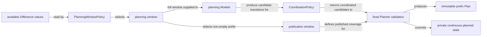

Planning-window selection occurs before any Model call.
`select_planning_differences()` chooses the planning window and
`select_publication_differences()` chooses its non-empty publication window.
Every Model and Coordination see the complete planning window, including its
unpublished portion. Settled historical Differences are not
replayed: reusable unpublished overlap and private planned baselines are
extended by the affected tail. Publishing trims that prefix and preserves the
remaining planning window plus planned Connection, parameter, Forwarding and
deadband state.

Planner alone queries its Slicer. ForwardingPlanningModel receives immutable
per-Slice mappings from RouteKey to formal path Connection identities, never a
Slicer or RouteModel capability. CoordinationPolicy receives all three Model
results plus narrow immutable route facts and returns the complete coordinated
transition tuples and concise decisions; fixed validity remains in Planner.

## Model input data flow

These public Protocol arguments describe planning data flow; none creates a
new owner or network domain object.

| Input | Provider / authority | Why the Model receives it | It is not |
|---|---|---|---|
| `differences` | Planner passes the complete formal Difference sequence in the planning window | permits cross-Difference reasoning over the complete planning window | settled history replay or Model-owned Slice state |
| `affected_differences` | Planner identifies the newly added or otherwise affected suffix of that planning window | limits normal incremental algorithm work | a new network object, Plan, or ownership boundary |
| `previous_transitions` | Planner passes previously planned but still-unpublished transitions | permits reuse or local revision of unpublished planning-window work | a second Plan or another transition owner |
| `observed_parameters` | Planner projects the latest formal Simulator/Slicer directional parameter state before the affected suffix | supplies the sampled value reached by formal evolution | the target already selected for realization |
| `planned_parameters` | Planner supplies the latest directional target it actually decided should be realized | preserves accumulated-deadband comparison across Plan boundaries | a raw boundary Slice reset |
| `route_path_connection_ids` | Planner derives a narrow read-only RouteKey-to-Connection-ID mapping from sibling Slicer facts | supports Forwarding dependency and precedence reasoning without handing over Slicer | RouteModel authority, path recomputation capability, or Model-owned state |

The observed/planned distinction is intentional: observed follows the latest
formal samples, while planned changes only when Planner accepts a target.

Published Plans form continuous non-overlapping `(start, end]` coverage; a
transition exactly at a shared boundary belongs to the earlier Plan. The next
Plan continues from Planner's private planned semantic state at that boundary,
not from raw Slice state. Already-published Plan objects remain immutable.

`temporal_index` is a deterministic unified inspection view grouped at exact
nominal timestamps. Forwarding tuple and index order are storage/inspection
order, not a backend/runtime execution schedule. Only a
`ForwardingTransitionPrecedence` states that one same-time transition must
precede another; unrelated transitions remain unconstrained, and a future
Compiler may satisfy several relations without literal sequential execution.
The built-in Forwarding Model derives only direct formal-path relations:
downstream readiness precedes upstream activation/use for new state, while an
upstream REMOVE or path switch precedes removal of the old directly downstream
state. A mixed path change may therefore form an acyclic chain such as
`new downstream ADD → upstream CHANGED → old downstream REMOVE` without
fabricating intermediate route states.

## Dependencies

Planning depends on `simulator/slicing` and neutral shared values. Slicer does
not import planning. The Simulator lifecycle facade creates Planner only after
its exact sibling Slicer exists. Reference algorithms are stateless; Planner
commits its own state only after validation. The Protocols do not promise
rollback of private mutations made inside an arbitrary third-party stateful
strategy.

Plan owns each `ForwardingTransitionPrecedence`; the ForwardingPlanningModel
produces it through Planner after Coordination has finalized the
planning-window transition set. Future approved Plan consumers such as a
Compiler may consume it. No Compiler/Runtime class, operation cost or execution
mechanism is part of this package.

## Examples and tests

The readable path is `examples/complete_static_emulator/simu.py`. Focused
value/algorithm tests are under `tests/unit/test_planning_*.py`; ownership,
incremental synchronization, ordering, suppression and fixed invariants are in
`tests/integration/test_planner_main_chain.py`.

The repository-local human-review entry is
`python -m examples.mini_satellite_internet.main`. Its Tool reads
formal Slicer, Plan, and retained PlanningDecision results without adding a
Planner API or invoking planning algorithms.

## Maintenance checklist

When this owner changes, update the public facade/import table, Simulator
lifecycle, planning contract, global owner/import diagrams, canonical example,
focused tests and architecture-delta audit together.
