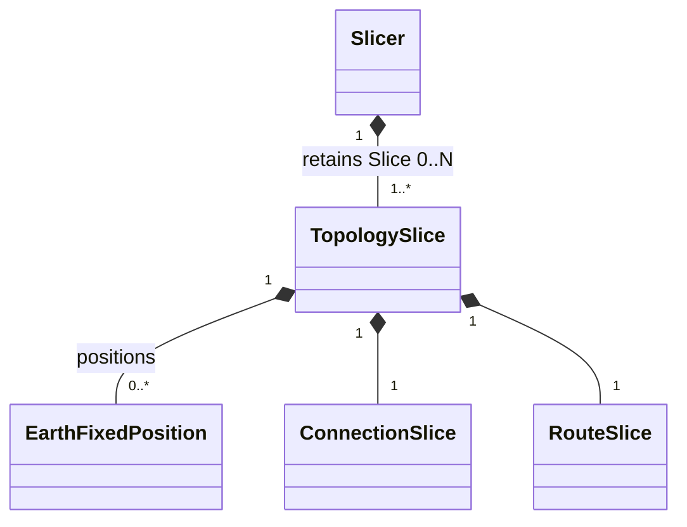
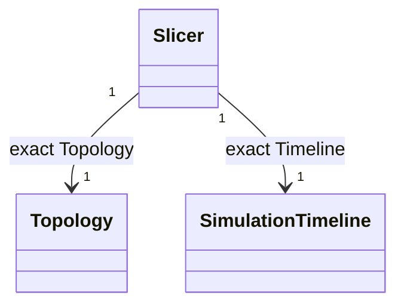
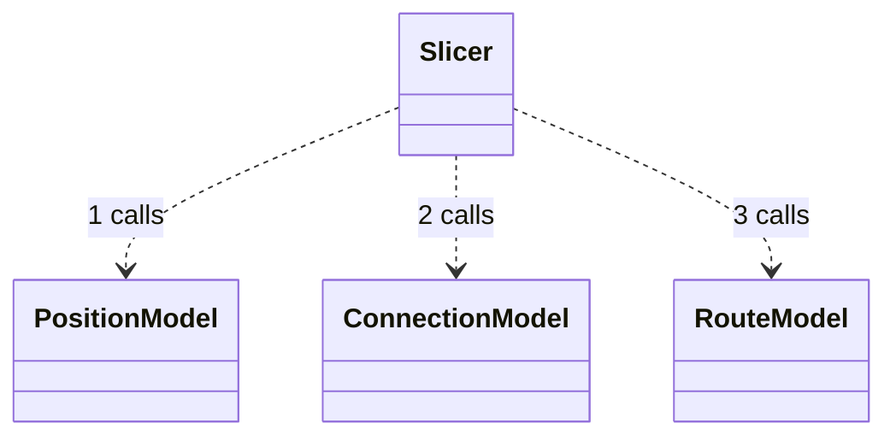
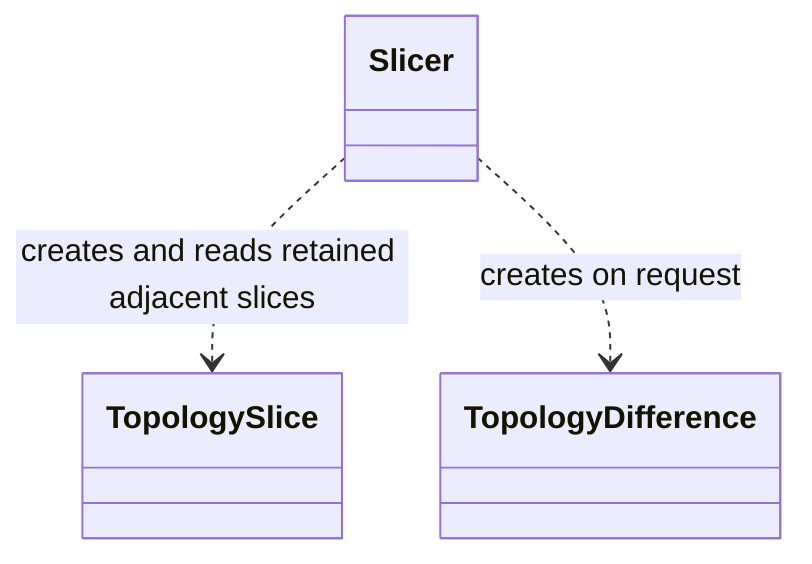
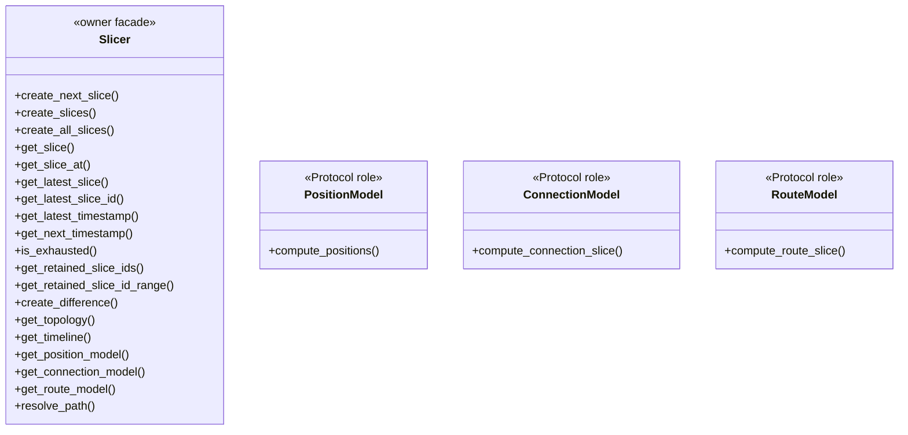
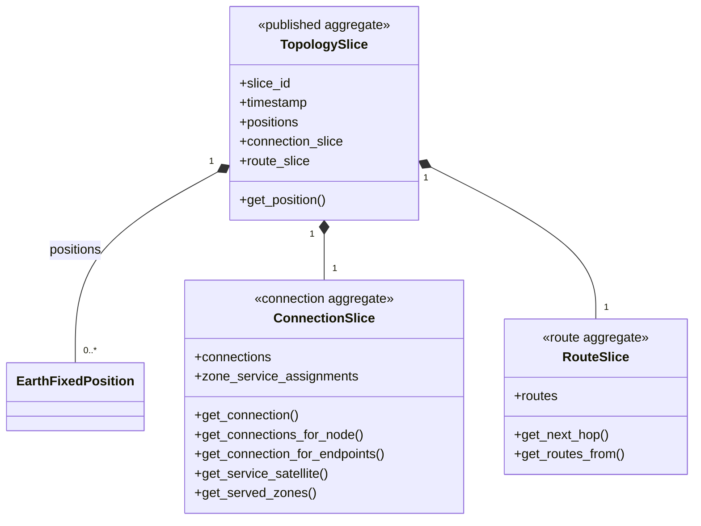
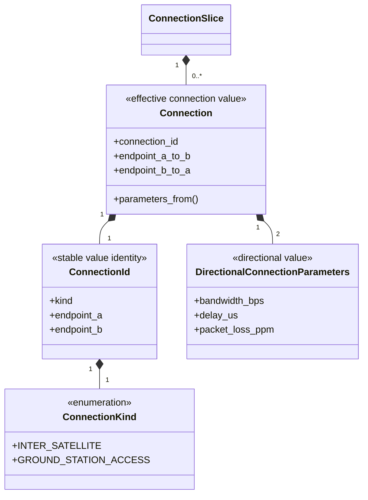
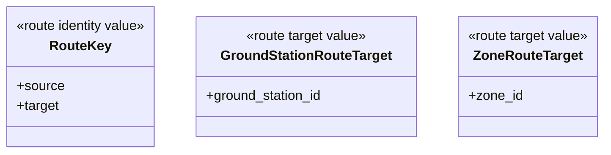
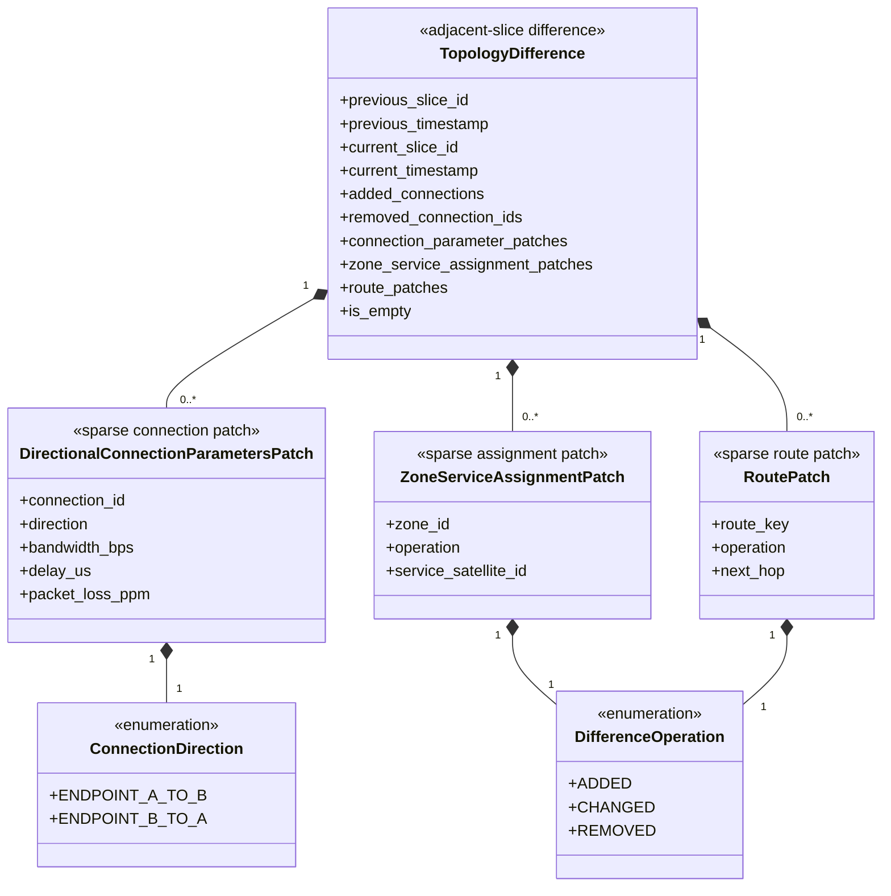

# Dynamic slicing contracts and values

This package owns the three replaceable Model Protocols, the `Slicer`
lifecycle, published `TopologySlice` values, route/connection values, and
the exact `TopologyDifference` value contract. Slicer creates each Difference
on request from retained adjacent Slices but does not retain it; its caller
owns the returned immutable value. Built-in algorithms are owned by `../models/`.

## Local assembly / ownership map

The local assembly map is split by UML relation so each connector has one
meaning. Legend: `*--` is retained immutable composition.

Legend: `-->` is an exact retained reference, not ownership.

Legend: `..>` is a numbered call to an injected Protocol role. The names are
Protocols, not built-in implementations.

Legend: `..>` is an on-request creation/read dependency; it does not retain a
`TopologyDifference`.

`Slicer` creates every complete `TopologySlice`, retains Slice 0..N, and
reads retained `TopologySlice` N and N+1 when creating a requested
`TopologyDifference`.

Standalone local values expanded below: `Connection`, `ConnectionId`,
`ConnectionKind`, `DirectionalConnectionParameters`, `RouteKey`,
`GroundStationRouteTarget`, `ZoneRouteTarget`,
`DirectionalConnectionParametersPatch`, `ZoneServiceAssignmentPatch`,
`RoutePatch`, `DifferenceOperation`, and `ConnectionDirection`.

## Detailed public class/member diagrams

Legend: this class inventory has no connector; it expands the owner facade and
the three Protocol roles from the local assembly map.

Legend: `*--` is immutable Slice composition.

Legend: `*--` is immutable Connection-value composition.

`RouteTarget` is the public type alias
`GroundStationRouteTarget | ZoneRouteTarget`.

Legend: this route-value inventory has no connector; target alternatives are
expressed by the public type alias.

Legend: `*--` is immutable Difference patch-value composition.

| Diagram name | Public contract | Members maintained here |
|---|---|---|
| `Slicer` | `skyseed_v2.simulator.slicing.Slicer` | `create_next_slice()`, `create_slices()`, `create_all_slices()`, `get_slice()`, `get_slice_at()`, `get_latest_slice()`, `get_latest_slice_id()`, `get_latest_timestamp()`, `get_next_timestamp()`, `is_exhausted()`, `get_retained_slice_ids()`, `get_retained_slice_id_range()`, `create_difference()`, `get_topology()`, `get_timeline()`, `get_position_model()`, `get_connection_model()`, `get_route_model()`, `resolve_path()` |
| `PositionModel` | `skyseed_v2.simulator.slicing.PositionModel` | `compute_positions()` |
| `ConnectionModel` | `skyseed_v2.simulator.slicing.ConnectionModel` | `compute_connection_slice()` |
| `RouteModel` | `skyseed_v2.simulator.slicing.RouteModel` | `compute_route_slice()` |
| `TopologySlice` | `skyseed_v2.simulator.slicing.TopologySlice` | `slice_id`, `timestamp`, `positions`, `connection_slice`, `route_slice`, `get_position()` |
| `ConnectionSlice` | `skyseed_v2.simulator.slicing.ConnectionSlice` | `connections`, `zone_service_assignments`, `get_connection()`, `get_connections_for_node()`, `get_connection_for_endpoints()`, `get_service_satellite()`, `get_served_zones()` |
| `RouteSlice` | `skyseed_v2.simulator.slicing.RouteSlice` | `routes`, `get_next_hop()`, `get_routes_from()` |
| `Connection` | `skyseed_v2.simulator.slicing.Connection` | `connection_id`, `endpoint_a_to_b`, `endpoint_b_to_a`, `parameters_from()` |
| `ConnectionId` | `skyseed_v2.simulator.slicing.ConnectionId` | `kind`, `endpoint_a`, `endpoint_b` |
| `ConnectionKind` | `skyseed_v2.simulator.slicing.ConnectionKind` | `INTER_SATELLITE`, `GROUND_STATION_ACCESS` |
| `DirectionalConnectionParameters` | `skyseed_v2.simulator.slicing.DirectionalConnectionParameters` | `bandwidth_bps`, `delay_us`, `packet_loss_ppm` |
| `RouteKey` | `skyseed_v2.simulator.slicing.RouteKey` | `source`, `target` |
| `GroundStationRouteTarget` | `skyseed_v2.simulator.slicing.GroundStationRouteTarget` | `ground_station_id` |
| `ZoneRouteTarget` | `skyseed_v2.simulator.slicing.ZoneRouteTarget` | `zone_id` |
| `TopologyDifference` | `skyseed_v2.simulator.slicing.TopologyDifference` | `previous_slice_id`, `previous_timestamp`, `current_slice_id`, `current_timestamp`, `added_connections`, `removed_connection_ids`, `connection_parameter_patches`, `zone_service_assignment_patches`, `route_patches`, `is_empty` |
| `DirectionalConnectionParametersPatch` | `skyseed_v2.simulator.slicing.DirectionalConnectionParametersPatch` | `connection_id`, `direction`, `bandwidth_bps`, `delay_us`, `packet_loss_ppm` |
| `ZoneServiceAssignmentPatch` | `skyseed_v2.simulator.slicing.ZoneServiceAssignmentPatch` | `zone_id`, `operation`, `service_satellite_id` |
| `RoutePatch` | `skyseed_v2.simulator.slicing.RoutePatch` | `route_key`, `operation`, `next_hop` |
| `DifferenceOperation` | `skyseed_v2.simulator.slicing.DifferenceOperation` | `ADDED`, `CHANGED`, `REMOVED` |
| `ConnectionDirection` | `skyseed_v2.simulator.slicing.ConnectionDirection` | `ENDPOINT_A_TO_B`, `ENDPOINT_B_TO_A` |

## Entry points

Code entries are `slicer.py`, `position.py`, `connection.py`, `route.py`,
`slice.py`, `difference.py`, and `_routing_policy.py`.

## Dependencies

`Slicer` references `../topology/` and `../timeline.py`, uses values from
`../geometry/`, and calls only the three Protocol roles declared here.
Built-in realizations live in `../models/`; no Model calls another Model.

## Examples and tests

The readable assembly is `examples/mini_satellite_internet/simu.py`. Focused
tests are `tests/unit/test_slice_difference_main_chain.py` and
`tests/unit/test_topology_difference.py`; Tool tests verify read-only
consumption.

## Maintenance checklist

When a contract, retained-state rule, Difference rule, or Protocol changes,
update this README, the Dynamic Slicing/failure contracts, the global object
model when cross-package relations change, public imports, Tool projections,
and the focused tests above.
