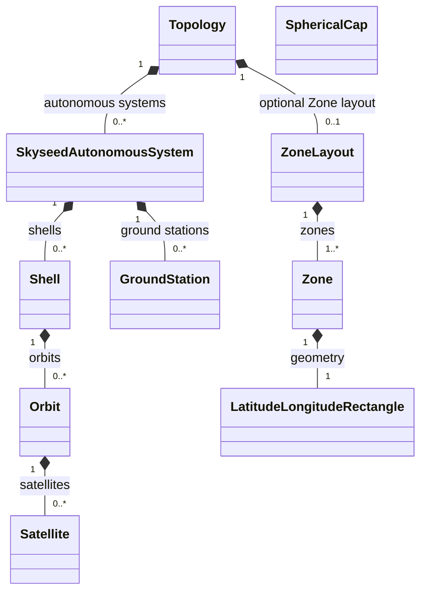
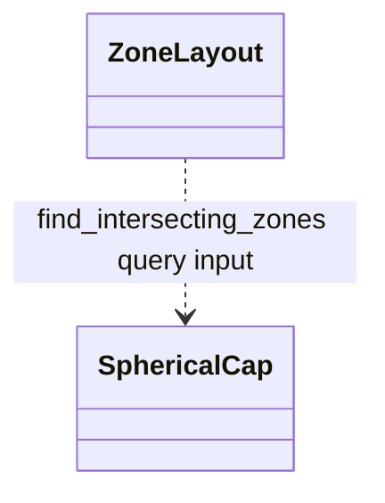
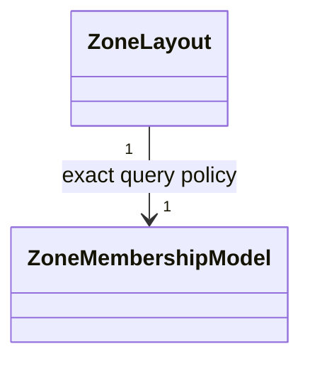
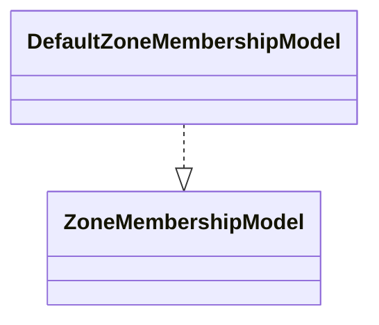
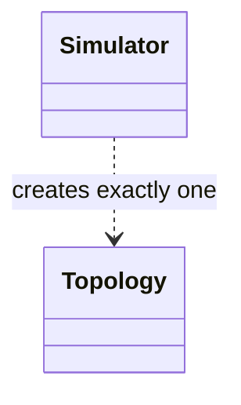
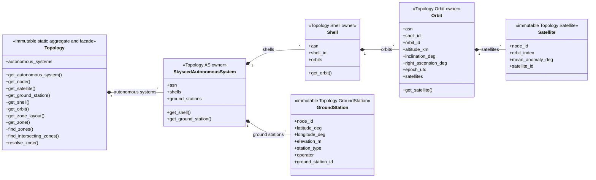
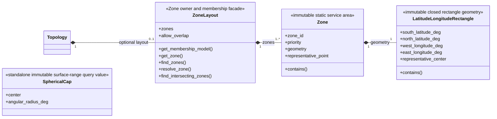
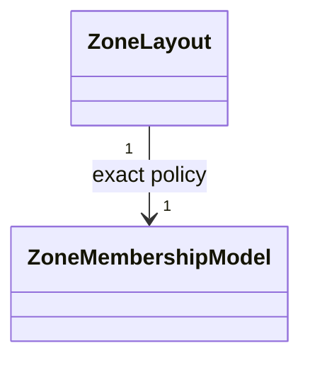
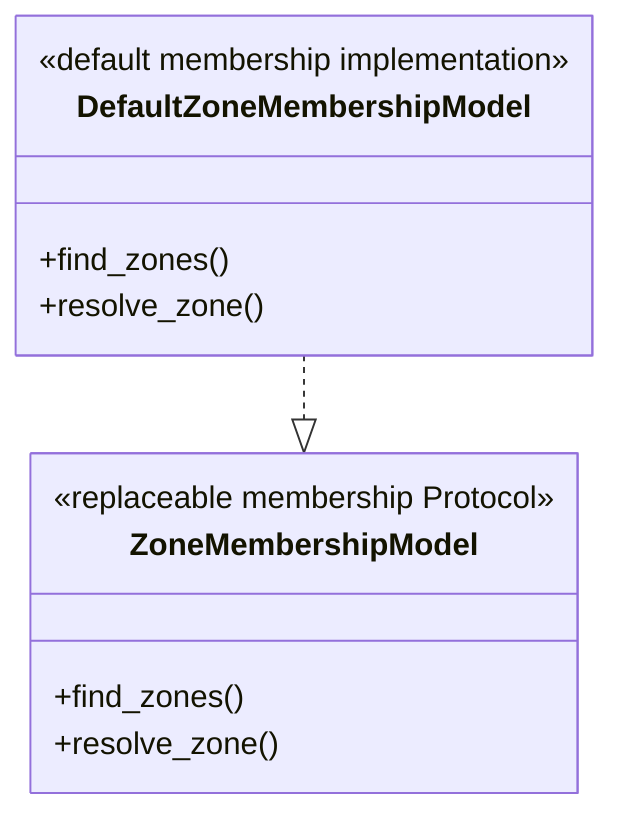

# Topology and Zone

This package owns the immutable static Simulator aggregate, its owner/facade
tree, Zone layout, Zone geometry values, and membership Protocol/default
implementation. It materializes new objects from `SimulatorStaticInput` and
retains no Emulator/SEED object.

## Local assembly / ownership map

Legend: `*--` is static ownership/composition. `Topology` is the static-world
owner; `ZoneLayout` is an optional child, not an independent top-level owner.

Legend: `..>` is a temporary query-input dependency, not ownership or stored
Zone geometry.

Legend: `-->` is the exact membership-policy reference used by
`ZoneLayout` queries.

Legend: `..|>` is Protocol realization.

Legend: `..>` is creation by the Simulator composition root.

## Detailed public class/member diagrams

Legend: `A *-- B` means static owner A owns the exact B objects.

Legend: `A *-- B` means static value/owner A contains B.

`SphericalCap` is a standalone, temporary, immutable Earth-surface range
query value. It is supplied to `ZoneLayout.find_intersecting_zones()` and is
never owned or retained by `Zone` or `ZoneLayout`.

Legend: `..>` is a temporary query-input dependency.

Legend: `ZoneLayout --> ZoneMembershipModel` means the layout retains the
exact injected membership-policy instance.

Legend: `Implementation ..|> Protocol` is UML Protocol realization.

| Diagram class | Public contract | Required public members |
|---|---|---|
| `Topology` | `skyseed_v2.simulator.topology.Topology` | `autonomous_systems`, `get_autonomous_system()`, `get_node()`, `get_satellite()`, `get_ground_station()`, `get_shell()`, `get_orbit()`, `get_zone_layout()`, `get_zone()`, `find_zones()`, `find_intersecting_zones()`, `resolve_zone()` |
| `SkyseedAutonomousSystem` | `skyseed_v2.simulator.topology.SkyseedAutonomousSystem` | `asn`, `shells`, `ground_stations`, `get_shell()`, `get_ground_station()` |
| `Shell` | `skyseed_v2.simulator.topology.Shell` | `asn`, `shell_id`, `orbits`, `get_orbit()` |
| `Orbit` | `skyseed_v2.simulator.topology.Orbit` | `asn`, `shell_id`, `orbit_id`, `altitude_km`, `inclination_deg`, `right_ascension_deg`, `epoch_utc`, `satellites`, `get_satellite()` |
| `Satellite` | `skyseed_v2.simulator.topology.Satellite` | `node_id`, `orbit_index`, `mean_anomaly_deg`, `satellite_id` |
| `GroundStation` | `skyseed_v2.simulator.topology.GroundStation` | `node_id`, `latitude_deg`, `longitude_deg`, `elevation_m`, `station_type`, `operator`, `ground_station_id` |
| `ZoneLayout` | `skyseed_v2.simulator.topology.ZoneLayout` | `zones`, `allow_overlap`, `get_membership_model()`, `get_zone()`, `find_zones()`, `resolve_zone()`, `find_intersecting_zones()` |
| `Zone` | `skyseed_v2.simulator.topology.Zone` | `zone_id`, `priority`, `geometry`, `representative_point`, `contains()` |
| `LatitudeLongitudeRectangle` | `skyseed_v2.simulator.topology.LatitudeLongitudeRectangle` | `south_latitude_deg`, `north_latitude_deg`, `west_longitude_deg`, `east_longitude_deg`, `representative_center`, `contains()` |
| `SphericalCap` | `skyseed_v2.simulator.topology.SphericalCap` | `center`, `angular_radius_deg` |
| `ZoneMembershipModel` | `skyseed_v2.simulator.topology.ZoneMembershipModel` | `find_zones()`, `resolve_zone()` |
| `DefaultZoneMembershipModel` | `skyseed_v2.simulator.topology.DefaultZoneMembershipModel` | `find_zones()`, `resolve_zone()` |

## Entry points

Code entries are `topology.py` and `zone.py`.

## Dependencies

Topology construction consumes `SimulatorStaticInput` and Simulator Zone
definitions. Built-in Models and read-only Tools consume the resulting static
owner tree and Zone query facade.

## Examples and tests

Dynamic and complete examples create the Topology through `Simulator`.
`test_simulator_topology.py`, `test_zone.py`, architecture checks, and
Tool-boundary tests cover this package.

## Maintenance checklist

When identity, lookup, geometry, Zone ordering, or membership changes, update
the local maps and detailed diagrams, global object model when cross-package
relations change, Topology/Zone/failure contracts, public imports, Tools, and
focused tests.
