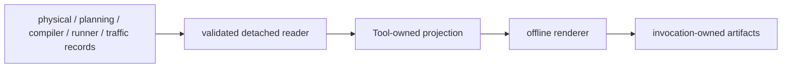

# Detached inspection Tools

Repository-local Tools read completed semantic/runtime values or durable
records and write non-authoritative offline artifacts.

Legend: `-->` is a detached read/project/render handoff; no edge grants a Tool
control over the source owner.

Maintained Tools:

- `physical_world/`: linked temporal 3D/2D physical entities, Zones, and
  clearly separated retained candidate overlays;
- `zone/`: static Zone geography;
- `planner/`: staged INPUT → MODEL → RESULT/CHANGE inspection with linked
  temporal planned-network views, lifecycle, Plans, deltas, and lineage;
- `bpf_compiler/`: compact activation workload, operation/folding trends,
  intended-state cardinalities, lineage, and Observation timing;
- `runner/`: post-run lifecycle and realized-state evidence;
- `observation/`: real monotonic spans plus duration/work/resource records;
- `traffic/`: explicit planned reachability and telemetry replay.

The physical/planning/compiler evidence streams are
`domain-history/physical-frames.jsonl`, `domain-history/planning.jsonl.gz`, and
`domain-history/compiler.jsonl`. Traffic consumes
physical and planning histories explicitly rather than reconstructing semantic
truth from missing runtime entries.

Tools never call PositionModel, PhysicalLinkModel, Planner Models,
`compile_bpf`, or Runner lifecycle actions. They do not own fact retention.
Tool failure is isolated from the valid sealed Runner artifact.
Generated `run.sh` reports detached Tool failure as a warning and preserves a
successful domain-runtime exit status.

Run a maintained generator, then open `output/inspection/index.html`. Browser
validation scripts in `scripts/` inspect the generated artifacts; screenshots
are validation evidence, not formal inputs.

Contracts: `docs/codex-reference/inspection-tools.md` and
`docs/user-guides/inspection-tools.md`.
