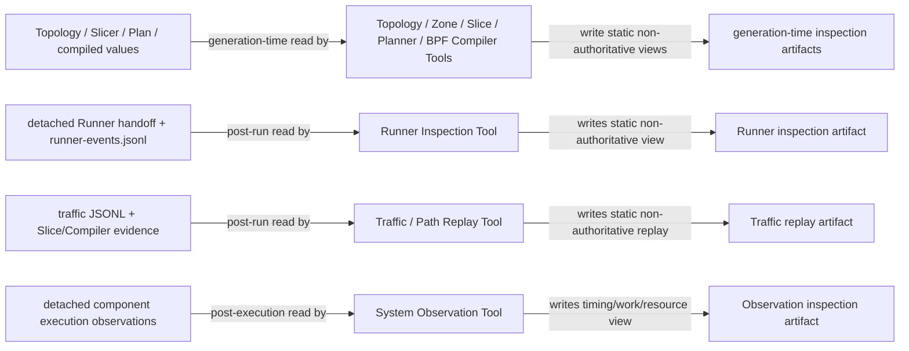
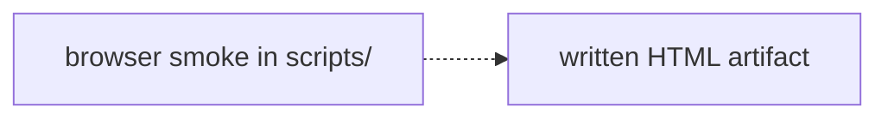

# Repository-local Inspection Tools

These packages generate private, offline views from already-created formal
objects or already-persisted post-run evidence. They are not installed as
`skyseed_v2`, do not mutate domain objects, and never provide fallback results.

Legend: every edge below is labeled with its exact read/write relationship. The first
lane is generation-time formal-object inspection; the other two are post-run
evidence inspection. None of the Tools owns production lifecycle or fact
retention.



Within each Tool, the applicable implementation responsibilities remain:
`reader → projection → optional display_analysis → renderer → artifact_writer`.
Runner and Traffic readers consume detached files/mappings rather than live
formal objects, and a small Tool may colocate adjacent responsibilities.

The S4 qualification root schedules heavy Slice, Planner, Compiler, and
Observation materialization through the private `_detached_inspection` helper.
At most a small configured number of family-level processes run concurrently.
Each receives an immutable fork view, persists a deterministic compressed
snapshot under short-lived `.inspection-control/`, builds under a same-parent
staging directory, audits checksums, and atomically publishes. The control
directory is deleted after join or termination. These gzip/pickle snapshots
are runtime bookkeeping rather than durable experiment evidence. This helper
is execution composition for Tools, not a public job framework or a domain
owner.

Legend: `A -.-> B` means validation A consumes the already-written artifact B;
it is not a Tool pipeline stage.



The eight tools remain deliberately separate:

- `topology/` reads the static owner tree and facade identity;
- `zone/` reads the static Zone layout and renders display-only direct
  selection without executing membership Models;
- `slice/` reads one exact Slicer's retained Slice next-hop facts and adjacent
  Difference results, writes one offline chunk per Slice, and restores only an
  explicitly selected display path in the browser. Exact Slice/Planner/Compiler
  chunks use deterministic compressed envelopes and are decoded only on
  selection without losing `file://` or checksum auditability.
- `planner/` reads one exact Slicer, exact caller-supplied consumed
  Differences, consecutive immutable Plans, and retained PlanningDecisions;
  its external bootstrap manifest and hierarchical catalogs lazily load
  selected domain/Slice chunks and restore only the selected route path.
- `bpf_compiler/` reads consecutive immutable Plans plus already-produced
  `BpfCompiledRealization` values and displays their exact supported lowering
  relationships without invoking the Compiler.
- `runner/` consumes a detached post-cleanup Runner summary, complete recorded
  event history, and thin runtime-invocation outcome; it presents lifecycle,
  timing, Maintenance, reclaim, failure, and cleanup evidence without
  controlling Runner or freshly inspecting kernel/dataplane state.
- `traffic/` consumes the durable tc-BPF traffic stream, retained Slice
  Position evidence, and the
  already-written BPF Compiler inspection artifact; it validates exact
  generation/boundary/network identity, pairs unambiguous ICMP request/reply
  records, derives observed flows from telemetry, and renders dependency-free
  simulation/packet replay without controlling runtime or recomputing satellite
  positions. The example-owned planned workload is optional schedule context.
- `observation/` parses detached optional component observations and shows
  bootstrap-separated independent leaf/rollup timing, work/cardinality,
  leaf-stage time-versus-work, and optional resource evidence. It does not sum
  overlapping records into component or pipeline execution time. Current
  emitters are Slicer, Planner, and BPF Compiler; the record model admits a
  future Runner component without becoming execution authority.

Only the Slicer calls Position, Connection, and Route Models. Tools do not
propagate Position, form Connections, compute Routes, compare slices, update
the static container network, or create a second authoritative computation
path. The Slice / Difference UI's orbit guides and classifications are display-only.

Topology and Zone renderers share one frozen Tool-private Natural Earth 1:110m
coastline coordinate asset under `_assets/`. It is embedded into standalone
HTML for offline geographic orientation only; it is not a formal input, GIS
API, or source of Topology/Zone facts. The adjacent provenance file records the
theme version, source and frozen hashes, and preprocessing rule.

Run the compact example:

```bash
python examples/complete_static_emulator/main.py
```

Run the richer Slice / Difference reference:

```bash
python examples/mini_satellite_internet/main.py
```

Run the complete Planner inspection workflow as one command:

```bash
python -m examples.mini_satellite_internet.main
```

After starting the generated Mini deployment, `output/run.sh` writes the
post-run Runner bundle to `output/inspection/runner/` on completion,
controlled interruption, or ordinary Runner failure when finalization can run.
It also writes `output/inspection/traffic/index.html` from the same run's
traffic stream, generation-time Slice / Difference artifact, and pre-existing BPF
Compiler inspection artifact when those inputs form one valid replay evidence
set; a planned workload augments only its collapsed schedule comparison.

Outputs are written under each example's ignored `output/inspection/`
directory. Browser validation is performed by the matching smoke scripts in
`scripts/`, including `check_bpf_compiler_tool_browser.py`; screenshots are
validation artifacts and do not belong to the formal read chain.

When a Tool projection changes, update its package README, focused Tool tests,
`docs/user-guides/inspection-tools.md`, and
`docs/codex-reference/inspection-tools.md`. The unique global synchronization
table is `docs/codex-reference/maintenance-map.md`. A production contract
change must also update the owning Simulator contract before the Tool.
