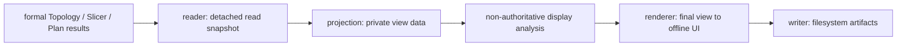
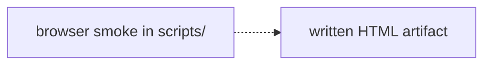

# Repository-local Inspection Tools

These packages generate private, offline views from already-created formal
objects. They are not installed as `skyseed_v2`, do not mutate domain objects,
and never provide fallback results.

Legend: `A --> B` means the output of Tool stage A is the only input of stage
B.



Legend: `A -.-> B` means validation A consumes the already-written artifact B;
it is not a Tool pipeline stage.



The four tools remain deliberately separate:

- `topology/` reads the static owner tree and facade identity;
- `zone/` selects observation probes, then records authoritative membership
  and resolution returned by Topology;
- `dynamic_slice/` reads one exact Slicer's retained Slice, resolved paths,
  and adjacent Difference results.
- `planner/` reads one exact Slicer plus consecutive immutable Plans and
  retained PlanningDecisions, then compares those formal results directly.

Only the Slicer calls Position, Connection, and Route Models. Tools do not
propagate Position, form Connections, compute Routes, compare slices, update
the static container network, or create a second authoritative computation
path. The Dynamic Slice UI's orbit guides and classifications are display-only.

Run the compact example:

```bash
python examples/complete_static_emulator/main.py
```

Run the richer Dynamic Slice reference:

```bash
python examples/mini_satellite_internet/main.py
```

Run the complete Planner inspection workflow as one command:

```bash
python -m examples.mini_satellite_internet.main
```

Outputs are written under each example's ignored `output/inspection/`
directory. Browser validation is performed by
`scripts/check_dynamic_slice_tool_browser.py`; screenshots are validation
artifacts and do not belong to the formal read chain.

When a Tool projection changes, update its package README, focused Tool tests,
`docs/user-guides/inspection-tools.md`, and
`docs/codex-reference/inspection-tools.md`. The unique global synchronization
table is `docs/codex-reference/maintenance-map.md`. A production contract
change must also update the owning Simulator contract before the Tool.
