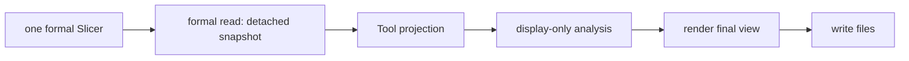

# Dynamic Slice Tool

Legend: `A --> B` means stage A supplies the only input accepted by stage B.

The Tool facade composes these responsibilities. The reader obtains retained
formal results and emits a detached snapshot. Projection receives no Slicer,
Topology, Slice, or Difference. Orbit-plane fitting/eigendecomposition,
guides, and classifications live only in display analysis and are not
Position, Connection, Route, or Difference computation. Rendering accepts
final view data and artifact writing only writes files. File count and names
are not contractual. Browser smoke remains in
`scripts/check_dynamic_slice_tool_browser.py` and is never imported here.

Tests: `tests/tools/test_dynamic_slice_tool.py`,
`tests/integration/test_dynamic_slice_reference_example.py`, and the browser
smoke script.

Contracts: `docs/codex-reference/inspection-tools.md` and
`docs/codex-reference/dynamic-slicing-contracts.md`.
