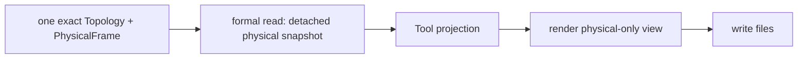

# Physical Frame Inspection Tool

Legend: `A --> B` means stage A supplies the only input accepted by stage B.



The facade accepts one already-created `Topology` and one already-created
`PhysicalFrame`. The reader copies the frame timestamp, exact ECEF positions,
their formal WGS84 geodetic views, and only the static node/orbit identity and
access-capability fields needed to interpret them. Projection, rendering, and
writing retain no domain object.

This Tool never calls `Topology.frame_at()`, invokes a `PositionModel`, advances
time, or reads Slicer/Slice history. Its payload has no Slice identity,
Connection, operational resource allocation, Zone serving assignment, Route,
Difference, Plan, or realized runtime state. The map and marker sizes are
non-authoritative display values; exact position facts remain visible in the
selected-node detail.

Public repository-local facade:

```python
from tools.physical_frame import write_physical_frame_tool

write_physical_frame_tool(topology, physical_frame, output_directory)
```

Tests: `tests/tools/test_physical_frame_tool.py`.

Contracts: `docs/codex-reference/inspection-tools.md` and the owning Topology
package documentation.
