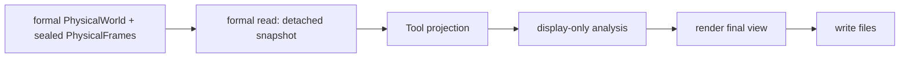

# Physical World Tool

Legend: `A --> B` means stage A supplies the only input accepted by stage B.

The Tool facade composes these responsibilities. Only the formal reader reads
public owner tuples, facade lookups, the verified existing PhysicalFrame
stream, and the separate exact Tool-owned candidate stream; projection receives a detached snapshot. Rendering accepts final view
data and artifact writing only writes files. No Position or PhysicalLink Model
is invoked.

The detached static records include each Satellite's configured simultaneous
ISL capability, its simultaneous GroundStation-access capability and each
GroundStation's configured simultaneous Satellite-access capability. These are
immutable PhysicalWorld facts, not candidate relationships, established access
relationships, terminal direction/steering claims or effective allocation.
The primary view is a rotatable 3D Earth linked to a 2D subpoint map. Position,
Physical Link Observation, and Zone layer buttons retain that same workspace. Both use
the same formal timestamp and selected Satellite/GroundStation/Zone. Exact
positions remain ECEF; the map's spherical subpoint conversion is explicitly
Tool-private display geometry. Per-frame local JS chunks keep initial browser
memory bounded. The exact candidate stream adds only focused dashed adjacency,
never a global candidate graph and never selected or operational labels. Exact
single-frame position and candidate detail is part of this Tool; there is no
separate PhysicalFrame inspection surface.

Typed Shell checkboxes support multi-select, select-all and solo viewing, with
stable Shell colors. Shared GroundStations and Zones have independent visibility
switches. All filters keep one world and time cursor, preserve exact ECEF/altitude,
and show visible/global counts. A hidden focused entity or relationship is
explicitly marked; changing visibility neither reloads history nor runs a Model.

Model provenance shows concrete type/config descriptors supplied from the same
maintained assembly values that construct the Models. Configuration uses public materialized values only;
unexposed implementation parameters are reported as unavailable rather than
read from private fields.

Tests: `tests/tools/test_physical_world_tool.py` and
`tests/integration/test_tooling_boundaries.py`.

Contracts: `docs/codex-reference/inspection-tools.md` and
`docs/codex-reference/physical-world-zone-contracts.md`.

The shared Shell controls include a compact owner-qualified Shell → Orbit
selector, All orbits and Reset. Orbit membership comes from recorded AS/Shell/
orbit fields; display names are not parsed. Multiple-Shell and shared GS/Zone
controls remain independent. Filtering changes visibility only and reports hidden
focused endpoints. Compiler can lazily embed this same view as physical context;
its parent boundary message moves the existing cursor without recomputing facts.
