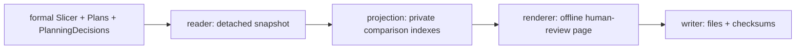

# Planner Inspection Tool

The single user-facing facade consumes one exact `Slicer`, consecutive
immutable `Plan` publications, retained `PlanningDecision` values, and the
explicit scenario inspection configuration. It writes one primary standalone
HTML page plus deterministic private JSON/audit files.

Legend: `A --> B` means the output of Tool stage A is the only input of stage
B.



`write_planner_tool(...)` performs the whole Tool workflow. Users do not call
the stages separately. The Tool never calls `Planner.synchronize()`, invokes a
Model, computes a Difference independently, reconstructs an expected Plan, or
retains a formal object after the reader.

The page distinguishes sampled time, Plan `(start,end]` coverage, grouped
nominal times, and same-time semantic Forwarding precedence. It groups repeated
formal/planned periods by stable `ConnectionId`, overlays sampled parameters
with actual ParameterTransitions, compares RoutePatch with
ForwardingTransition, and displays only retained PlanningDecision evidence.
Rejected suppression candidates are explicitly reported as unavailable because
the current public Planner inspection surface does not retain them.

Canonical IDs remain unchanged in JSON and expandable page detail. A private
display-alias map supplies compact labels such as `O3-S6`, `GS-Yamaguchi`, and
`Z:north-america-east`. The Connection view has dual sampled/planned lifetime
lanes; Parameter uses formal samples plus a Plan-derived target step line;
Forwarding uses formal/published next-hop lanes and only actual precedence
edges. The shared rotatable spatial panel reuses the Slice / Difference Tool's ECEF
canvas projection convention and reads exact retained Slice positions. For a
midpoint transition it explicitly toggles the surrounding Before/After Slice
samples and never interpolates a formal position.

The Global Timeline lists the real transitions at one selected nominal time,
grouped by domain. It draws nothing merely from the aggregate: the reviewer
selects one concrete event to drive the shared globe, so high-count timestamps
remain scrollable rather than visually overloaded. A Zone-targeted Route uses
the formal configured Zone rectangle and representative-point label as an
Earth-surface overlay; Zone is not added to `path.nodes` and no synthetic
satellite-to-Zone link is drawn.

The complex human-review entry is:

```bash
python -m examples.mini_satellite_internet.main
```

No Jinja2 template is introduced: the existing dependency-free
`tools._html.standalone_page` convention cleanly owns this offline artifact and
the project has no Jinja2 dependency.
