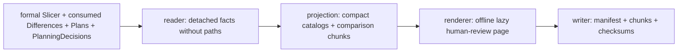

# Planner Inspection Tool

The single user-facing facade consumes one exact `Slicer`, consecutive
immutable `Plan` publications, the exact caller-provided
`Planner.get_consumed_differences()` values, retained `PlanningDecision`
values, and the explicit scenario inspection configuration. It writes one
primary offline HTML page, a small bootstrap manifest, and deterministic
offline index/data chunks plus audit files.

The exact Slicer, retained Slice, and consumed Difference inputs are the
visible temporary legacy operational seam in Round 1. This Tool preserves the
current Planner inspection contract without creating another producer or
hiding that debt. Its source inputs are replaced when the Network Planner owns
Connection, effective Parameter, Route, and Coordination planning and the old
Slicer/TopologySlice/TopologyDifference path is removed.

Legend: `A --> B` means the output of Tool stage A is the only input of stage
B.



`write_planner_tool(...)` performs the whole Tool workflow. Users do not call
the stages separately. The Tool never calls `Planner.synchronize()`, invokes a
Model, asks Slicer to recreate a Difference, reconstructs an expected Plan, or
retains a formal object after the reader.

The HTML loads a small external `planner-manifest.js`; it does not duplicate
the JSON manifest. The bootstrap contains static context, summaries, and only
descriptors for hierarchical Connection/Parameter/Forwarding catalog pages.
Catalog pages and selected data are external `file://`-compatible script
chunks. Exact transitions live in canonical Plan chunks, exact consumed
Differences live in Difference chunks, and entity views carry only the minimal
derived summaries they render. Generation guards reject stale asynchronous
selections and chunk registries are released after extracting the selected
fact. Exact chunk JSON is stored in deterministic `gzip-base64-json` envelopes
with the uncompressed byte count and SHA-256; a selected chunk is decompressed
and parsed only after its script loads, preserving direct `file://` use and
exact auditability without materializing the run. Slice chunks
contain compact next-hop tuples, not eagerly restored paths; the browser
restores only the selected Route path from the selected Before/After Slice.
The page no longer embeds a whole-run projection or creates a pretty raw-JSON
copy.

The page distinguishes sampled time, Plan `(start,end]` coverage, grouped
nominal times, and same-time semantic Forwarding precedence. It groups repeated
formal/planned periods by stable `ConnectionId`, overlays sampled parameters
with actual ParameterTransitions, compares RoutePatch with
ForwardingTransition, and displays only retained PlanningDecision evidence.
Rejected suppression candidates are explicitly reported as unavailable because
the current public Planner inspection surface does not retain them.

The primary discovery surface is compact rather than identity-list-first:
whole-run and selected-Plan transformation flows expose formal workload,
materialized transitions, HOLD/FOLLOW, omissions, decisions, precedence, and
retained parameter/route-quality distributions. Long Connection, Parameter,
Route, Plan, and transition lists remain collapsed searchable drill-down and
machine evidence. The global timeline draws exact configured planning-window
and publication coverage; open sampled/planned Connection episodes stop at the
current artifact boundary with explicit right-censored markers rather than
extending to Scenario end.

Canonical IDs remain unchanged in JSON and expandable page detail. A private
display-alias map supplies compact labels such as `O3-S6`, `GS-Yamaguchi`, and
`Z:north-america-east`. The Connection view has dual sampled/planned lifetime
lanes; Parameter uses formal samples plus a Plan-derived target step line;
Forwarding uses formal/published next-hop lanes and only actual precedence
edges. The shared rotatable spatial panel reuses the Slice / Difference Tool's ECEF
canvas projection convention and reads exact retained Slice positions. For a
midpoint transition it explicitly toggles the surrounding Before/After Slice
samples and never interpolates a formal position.

The Global Timeline lists the real transitions at one selected nominal time,
grouped by domain. It draws nothing merely from the aggregate: the reviewer
selects one concrete event to drive the shared globe, so high-count timestamps
remain scrollable rather than visually overloaded. A Zone-targeted Route uses
the formal configured Zone rectangle and representative-point label as an
Earth-surface overlay; Zone is not added to `path.nodes` and no synthetic
satellite-to-Zone link is drawn.

Playback advances these exact nominal groups in place. It retains the active
tab, document scroll position, expanded context, and globe camera; it does not
navigate, reload, call `scrollIntoView`, rebuild the whole timeline, or rerun a
Model. The event region has stable layout while selected Plan chunks load, and
stale completions remain generation-guarded.

For a selected forwarding event, the globe restores only the selected formal
path Q and published planned path P at the chosen retained formal boundary.
Shared, formal-only, and planned-only edges have distinct styling and are
clickable Connection drill-down targets. The side panel keeps the previous
formal Slice sample, exact Planner nominal time, and next formal Slice sample
together; it never interpolates a midpoint, reruns Position/Route Models, or
constructs a third Route. Source, semantic target, and actual path terminal
remain separate labels.

The complex human-review entry is:

```bash
python -m examples.mini_satellite_internet.main
```

No Jinja2 template is introduced: the existing dependency-free
`tools._html.standalone_page` convention cleanly owns this offline artifact and
the project has no Jinja2 dependency.
