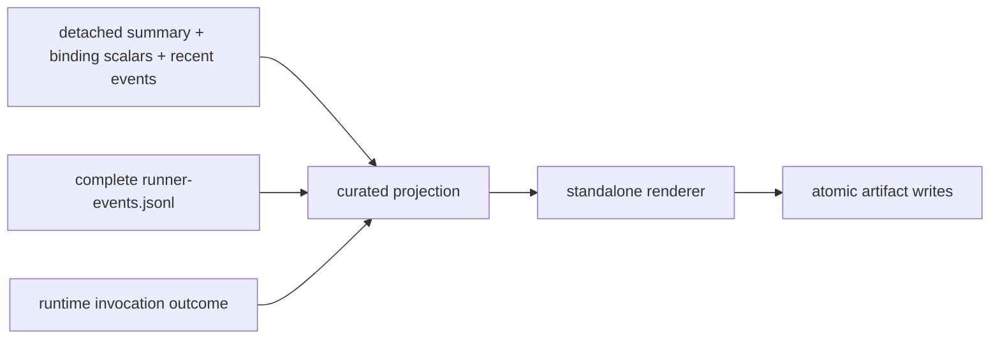

# Runner Inspection Tool

This repository-local Tool writes one post-run static view from detached
`BpfRunner.inspection_snapshot()` scalars/recent events, the complete durable
`runner-events.jsonl`, and a plain invocation-outcome mapping. It does not
retain a live Runner, control its lifecycle, inspect the kernel, inject traffic,
or become installed `skyseed_v2` API.
For generated S4 output it also accepts the separate small Compose-startup
evidence file, so deployment startup and Runner Preparation never collapse
into one timing.

The implementation responsibilities are deliberately small and distinct:

Legend: `A --> B` means detached output from A is the only input supplied to B;
it does not transfer lifecycle authority.



- `reader.py` reads and validates either a complete historical record or the bounded
  nonblocking Runner event stream;
- `projection.py` stable-sorts the supplied complete event history by monotonic time
  with original list order as the tie-break, curates the human timeline,
  separates lifecycle phases, duration work, and instant milestones, and
  derives timing/default-dataplane views, one-shot Preparation capacity/identity
  evidence, Main publication-barrier results, resource health, evidence
  completeness, and teardown evidence. Failed Main projection preserves the
  target, last completed formal ACTIVE frontier, publication, partial-state,
  rollback and cleanup-ownership facts;
- `renderer.py` renders only projected values into dependency-free offline
  HTML, including the elapsed-monotonic execution graph, frozen runtime
  foundation bindings, completed ACTIVE/frontier evidence, a compact Runner
  reading guide, and
  Chinese/English presentation strings over the same evidence dataset;
- `inspection.py` composes projection/rendering and writes the five-file
  bundle using shared atomic text/JSON helpers;
- `__main__.py` is the Tool-owned command entry point that reads the detached
  generated-execution handoff and durable event stream;
- `__init__.py` exports the repository-local facade.

The generated bundle is:

```text
inspection/runner/
├── index.html
├── runner-invocation.json
├── runner-inspection.json
├── summary.txt
├── inventory.json
└── checksums.sha256
```

Runner lifecycle/control-plane evidence is the Tool's scope. Fresh
kernel/dataplane inspection, traffic telemetry, and active traffic validation
remain distinct concerns. Runner retains the finite prepared plans; compact event capture has a bounded
queue. The Tool fails closed when bounded durable history overflowed or did
not close completely. Its projection keeps only summaries/timeline drill-down
and a pointer to the exact JSONL source, rather than embedding a second full
raw history in both JSON and HTML. A fully streaming percentile/index builder
remains future Tool work.

Generated execution writes the detached invocation handoff after Runner
cleanup. The handoff therefore consumes cached sealed-artifact scalars and can
report a `cleaned` lifecycle without retaining or dereferencing the artifact
mmap. Preparation includes complete artifact decode and plan materialization,
capacity and startup identity validation, complete semantic map prewriting, and
physical boundary-0 activation. Formal Main begins at boundary 1, records
compact pre/publication/post barrier timing, and enqueues identity work to a
background writer. Missing timing remains unavailable.

Current Runner event names remain authoritative. Main duration comes from
`activation_end.main_seconds`; Preparation duration comes from
`preparation_end.duration_seconds`. No Maintenance or READY timing path remains.

Startup boundary 0 remains in the Preparation timeline and `startup_activations`.
It is excluded from formal activation counts, timing summaries, Main subphases
and work bars. A B0-only run has zero formal activations and unavailable steady
Main durations. Generation reuse never fabricates a publication timing sample.

The timing page consumes private `detailed_timing_version: 1` and `2` aggregates from the
same events. Offline `detailed_timing` contains per-boundary clocks/counts,
operation, barrier, envelope and pacing distributions, signed accounting
residuals, Preparation/B0, and Cleanup. Percentiles use linear interpolation.
Fixed operation categories with no attempts contribute zero duration/count;
actual publication duration has samples only on attempted publication. Missing
unversioned evidence remains unavailable. B0 never contributes to steady samples.
The page shows totals, p50/p95/max and per-boundary attempt counts. It labels
nested inclusive spans: command includes helper dispatch, dispatch includes
activation, and barriers include operation-family wall time. Neither nested
durations nor phase percentiles are additive. Residuals are retained without
invented IPC, scheduler or pure kernel CPU attribution. Post-Main observation
excludes its own closing event and final condition notification; Cleanup's
event-history drain is a separate tail after the existing `cleanup_end` boundary.

Version 2 physical deletion reports joined critical wall time and confirmed pair
counts. `retirement` separately reports actual group deletion requests, confirmed
group batches and summed concurrent task durations; these sums are not elapsed
Main time. Creation includes endpoint MAC/queue/group attributes, so standalone
MAC and DOWN calls have known zero attempts. Main activation JSON encoding is
performed in Preparation. Fixed-origin records retain real start/completion lag;
the superseded recursive-anchor carry residual is unavailable for those records.
