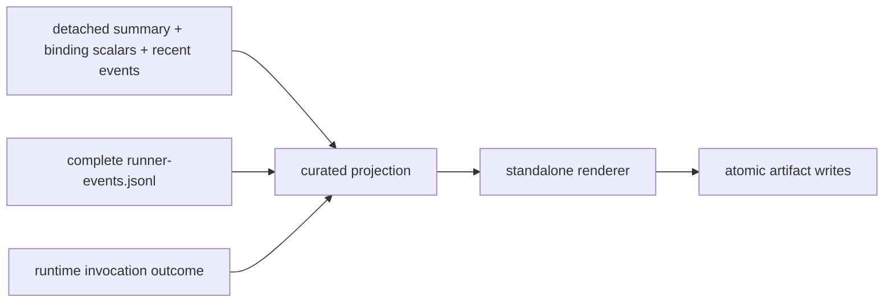

# Runner Inspection Tool

This repository-local Tool writes one post-run static view from detached
`BpfRunner.inspection_snapshot()` scalars/recent events, the complete durable
`runner-events.jsonl`, and a plain invocation-outcome mapping. It does not
retain a live Runner, control its lifecycle, inspect the kernel, inject traffic,
or become installed `skyseed_v2` API.
For generated S4 output it also accepts the separate small Compose-startup
evidence file, so deployment startup and Runner Preparation never collapse
into one timing.

The implementation responsibilities are deliberately small and distinct:

Legend: `A --> B` means detached output from A is the only input supplied to B;
it does not transfer lifecycle authority.



- `reader.py` reads and validates either legacy complete history or the bounded
  nonblocking Runner event stream;
- `projection.py` stable-sorts the supplied complete event history by monotonic time
  with original list order as the tie-break, curates the human timeline,
  separates lifecycle phases, duration work, and instant milestones, and
  derives timing/default-dataplane views plus Preparation subphases, Main
  subphases, logical-to-external amplification, batching/worker use,
  Maintenance backlog, sparse resource health, evidence completeness, and
  teardown evidence;
- `renderer.py` renders only projected values into dependency-free offline
  HTML, including the elapsed-monotonic execution graph, frozen runtime
  foundation bindings, configured time/depth preparation bounds, captured
  READY depth/limiting reason, a compact Runner reading guide, and
  Chinese/English presentation strings over the same evidence dataset;
- `inspection.py` composes projection/rendering and writes the five-file
  bundle using shared atomic text/JSON helpers;
- `__main__.py` is the Tool-owned command entry point that reads the detached
  generated-execution handoff and durable event stream;
- `__init__.py` exports the repository-local facade.

The generated bundle is:

```text
inspection/runner/
├── index.html
├── runner-invocation.json
├── runner-inspection.json
├── summary.txt
├── inventory.json
└── checksums.sha256
```

Runner lifecycle/control-plane evidence is the Tool's scope. Fresh
kernel/dataplane inspection, traffic telemetry, and active traffic validation
remain distinct concerns. Runner memory stays bounded independently of trace
length. The Tool fails closed when bounded durable history overflowed or did
not close completely. Its projection keeps only summaries/timeline drill-down
and a pointer to the exact JSONL source, rather than embedding a second full
raw history in both JSON and HTML. A fully streaming percentile/index builder
remains future Tool work.
