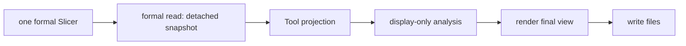

# Slice / Difference Inspection Tool

Legend: `A --> B` means stage A supplies the only input accepted by stage B.

The Tool facade composes these responsibilities. The reader obtains retained
formal next-hop and adjacent-Difference results and emits a detached snapshot;
it does not eagerly call `Slicer.resolve_path()` for every route. Projection receives no Slicer,
Topology, Slice, or Difference. Orbit-plane fitting/eigendecomposition,
guides, and classifications live only in display analysis and are not
Position, Connection, Route, or Difference computation. Rendering accepts
final view data and artifact writing writes a compact static manifest plus one
offline script chunk per retained Slice. The browser keeps only the selected
Slice chunk materialized. Direct canvas selection drives node, Connection, and
Zone details; selected identities persist across the timeline, Zone service and
Difference are contextual overlays, and the normal Route view pairs one Zone
with a currently published relevant Gateway and direction. That path is
restored from projected formal next hops as display output; generic
source/target locators remain an advanced fallback. It never computes routing
policy. Topology orbit guides and Slice Satellite positions share the same
Tool-private spherical display policy: unit Earth plus formal altitude divided
by the IUGG mean Earth radius. This WGS84 approximation affects display only;
marker and hit-test sizes remain CSS-pixel values. Selected/hovered objects are
labeled near the globe, and selecting an active object again clears its
object-dependent overlays.

A compact current-Slice card presents projected served/unserved Zone counts,
covered GroundStations, Connection classes, sparse Route-entry count, and
Tool-derived Zone-service geometry statistics. Callers may supply a detached
Tool-private model-context mapping at generation time; topology shell facts
and the explanatory service-envelope radius are derived in display analysis.
Neither this metadata nor the browser is a Simulator policy authority, and no
field is added to a formal Slice, Connection, Route, or Difference value.
File count and names are private. Browser smoke remains in
`scripts/check_slice_tool_browser.py` and is never imported here.

Tests: `tests/tools/test_slice_tool.py`,
`tests/integration/test_mini_satellite_internet_example.py`, and the browser
smoke script.

Contracts: `docs/codex-reference/inspection-tools.md` and
`docs/codex-reference/dynamic-slicing-contracts.md`.
