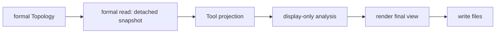

# Topology Tool

Legend: `A --> B` means stage A supplies the only input accepted by stage B.

The Tool facade composes these responsibilities. Only the formal reader reads
public owner tuples and facade lookups; projection receives its detached
snapshot. The static orbit-ring view is explicitly non-authoritative and
never propagates Position. Rendering accepts final view data and artifact
writing only writes files. This responsibility chain does not require a fixed
number or naming pattern of Python files.

Tests: `tests/tools/test_topology_tool.py` and
`tests/integration/test_tooling_boundaries.py`.

Contracts: `docs/codex-reference/inspection-tools.md` and
`docs/codex-reference/topology-zone-contracts.md`.
