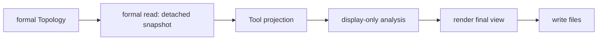

# Topology Tool

Legend: `A --> B` means stage A supplies the only input accepted by stage B.

The Tool facade composes these responsibilities. Only the formal reader reads
public owner tuples and facade lookups; projection receives its detached
snapshot. The static orbit-ring view is explicitly non-authoritative and
never propagates Position. Rendering accepts final view data and artifact
writing only writes files. This responsibility chain does not require a fixed
number or naming pattern of Python files.

The detached static records include each Satellite's configured simultaneous
GroundStation-access capability and each GroundStation's configured
simultaneous Satellite-access capability. These are immutable Topology facts,
not an established access relationship or effective allocation. Timestamped
node positions are inspected separately by the Physical Frame Tool.

The renderer draws thin CSS-pixel orbit/marker styling on a DPR-scaled backing
canvas, labels only the selected or hovered orbit or GroundStation, and embeds
the shared Tool-private Natural Earth coastline reference. Orbit altitude uses
the shared Tool-private spherical display policy: unit Earth plus formal
altitude divided by the IUGG mean Earth radius. This is a WGS84 display
approximation only; marker size and CSS-pixel hit testing remain independent
from radial position and use only existing projected orbit/ground-station
fields. Selecting the active object again clears it.

Tests: `tests/tools/test_topology_tool.py` and
`tests/integration/test_tooling_boundaries.py`.

Contracts: `docs/codex-reference/inspection-tools.md` and
`docs/codex-reference/topology-zone-contracts.md`.
