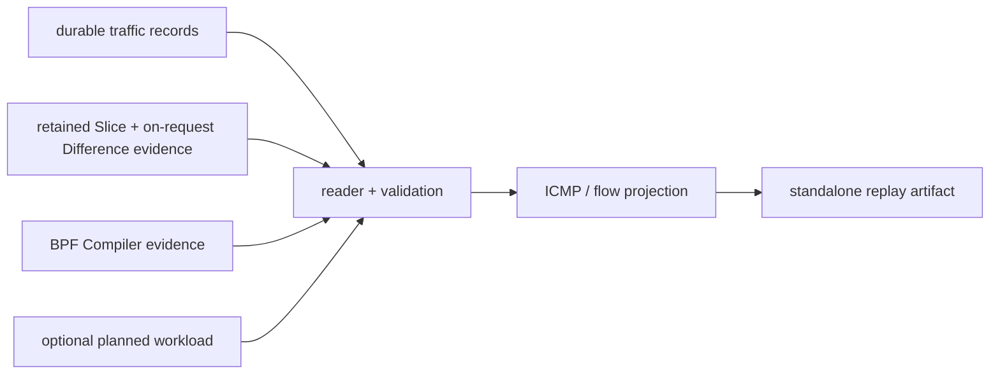

# Traffic / Path Replay Tool

This repository-local Tool consumes only durable post-run evidence:

```text
inspection/traffic/traffic-telemetry.jsonl
inspection/slice/slice-manifest.json + chunks/slice-*.js
inspection/compiler/manifest.json + chunks/*.js     # S4 canonical path
inspection/traffic/probe-plan.json                  # experiment-side intent
inspection/traffic/probe-execution.jsonl            # retained Ping execution
inputs/traffic-workload.json              # optional planned context
        ↓
read + fail-closed timeline/generation/network validation
        ↓
ICMP pairing + telemetry-derived observed flows + shared simulation-state projection
        ↓
standalone traffic replay HTML/JSON bundle
```

It does not retain or call a Runner, collector, kernel command, Simulator
Model, Compiler, InternetMap component, or network-semantic authority. The v3
reader reconstructs only its required Compiler domains from the manifest and
chunks (while retaining legacy monolith read compatibility), cross-validates
the telemetry generation/boundary identities, and derives each background network
only from exact-generation reciprocal `interface_identity` evidence. The
grouping scope remains reliable ICMP packet evidence with source/destination
IPv4, type, identifier, and sequence. Echo request/reply records are paired
into Ping transactions only when their directional identities and ordering
are unambiguous. Other packet observations remain explicit raw / unclassified
evidence.

`src/skyseed_v2/experiment/traffic/` is the separate experiment-side producer:
it derives the bounded probe plan from immutable Compiler outputs and supervises
ordinary Ping processes around the canonical Runner run. This Tool never imports
that executor or launches its processes; it independently reads the durable JSON
artifacts after Runner cleanup. Other examples may retain their established
Compiler Tool directory name, but S4 uses `inspection/compiler/` directly and
does not create a compatibility copy.

Legend: `A --> B` means detached evidence A is consumed by read-only Tool stage
B; the arrow grants no runtime or fact-producing authority.



The example-owned generated-input workload schedule is optional context. When present, it
records planned `[start,end)` series and cadence only. It does not prove a
command ran, a packet was emitted, a timeout occurred, or a packet was lost.
Replay confines schedule IDs and qualified no-observation slots to a collapsed
comparison; packet telemetry remains the observation authority.

Node, Zone, and Unknown are private replay endpoint kinds. A Zone is a stable
logical IPv4 endpoint whose generation-specific service satellite supplies
the physical packet path; the Zone is never drawn as a geographic packet hop.
Future-prepared links are not part of an ACTIVE generation background.

Retained Slice Positions are authoritative samples; adjacent Difference
evidence was produced on request from those retained Slices. Linear ECEF
interpolation between them is visualization-only and is never presented as a
retained Simulator Position fact.

The primary UI uses one real simulation-time scrubber, selects the latest
nominal boundary at or before the chosen time, and moves nodes using the shared
retained/interpolated Position set. Recent observed traffic is reconstructed
from a 2/5/10-second simulation-time window, so it remains stable while paused
and a seek cannot replay crossed history. Selecting one Ping pauses at its real
time and uses its recorded generation for network/Zone context; one Replay Ping
action expands the recorded request and then reply without changing recorded
timing.
Zone rectangles are geographic context only and are never drawn as packet
links to their service satellites.

The generated bundle remains in the telemetry root; the optional workload is
read from `output/inputs/` and is not copied into observed evidence:

```text
inspection/traffic/
├── probe-plan.json
├── probe-execution.jsonl
├── traffic-telemetry.jsonl
├── traffic-replay.json
├── index.html
├── summary.txt
├── inventory.json
└── checksums.sha256
```

`python -m tools.traffic --telemetry ... --slice ... --bpf-compiler ...
--probe-plan ... --probe-execution ... --runner-events ... --output ...` is the
Tool-owned command used automatically by generated `run.sh`. Normal execution
omits `--workload`, so the planned canonical Mini schedule is not a runtime
control input or normal traffic generator. The same `run.sh` then refreshes
`inspection/index.html`, which links both Runner and Traffic results.

The page is dependency-free, directly openable through `file://`, and has no
realtime or runtime-control path. Global Position samples, ACTIVE graphs, and
Zone geometry are stored once rather than copied into every transaction. The
renderer has no live runtime path.
