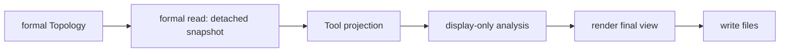

# Zone Tool

Legend: `A --> B` means stage A supplies the only input accepted by stage B.

Only reader calls formal membership/resolution APIs and stores their results
in a detached Tool-owned snapshot. Its private `probe_read_plan.py` chooses
deterministic coordinates needed for those formal calls; it does not read a
formal object. Rectangle boundary sampling, focus visibility, and summaries
live in `display_analysis.py`. Projection never receives Topology.
The Tool facade composes the responsibilities; rendering accepts final view
data and artifact writing only writes files. The current files may remain
separate, but their count and names are not the contract.

Tests: `tests/tools/test_zone_tool.py` and
`tests/integration/test_tooling_boundaries.py`.

Contracts: `docs/codex-reference/inspection-tools.md` and
`docs/codex-reference/topology-zone-contracts.md`.
