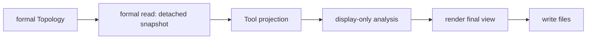

# Zone Tool

Legend: `A --> B` means stage A supplies the only input accepted by stage B.

The reader copies the formal static Zone layout into a detached Tool-owned
snapshot. It does not choose coordinates, query membership, execute the
membership Model, or include GroundStations. Rectangle boundary sampling and
layout summaries live in `display_analysis.py`. The globe and map use those
existing fields for display-only direct selection; browser hit testing is not
a formal membership result. Projection never receives Topology.
The Tool facade composes the responsibilities; rendering accepts final view
data and artifact writing only writes files. The current files may remain
separate, but their count and names are not the contract.

The renderer uses one subdued Zone color family, labels only the selected
Zone, and draws its 3D view on a DPR-scaled backing canvas. The shared
Tool-private Natural Earth coastline reference supplies offline orientation
only and never enters the Zone reader payload or formal membership semantics.

Tests: `tests/tools/test_zone_tool.py` and
`tests/integration/test_tooling_boundaries.py`.

Contracts: `docs/codex-reference/inspection-tools.md` and
`docs/codex-reference/topology-zone-contracts.md`.
