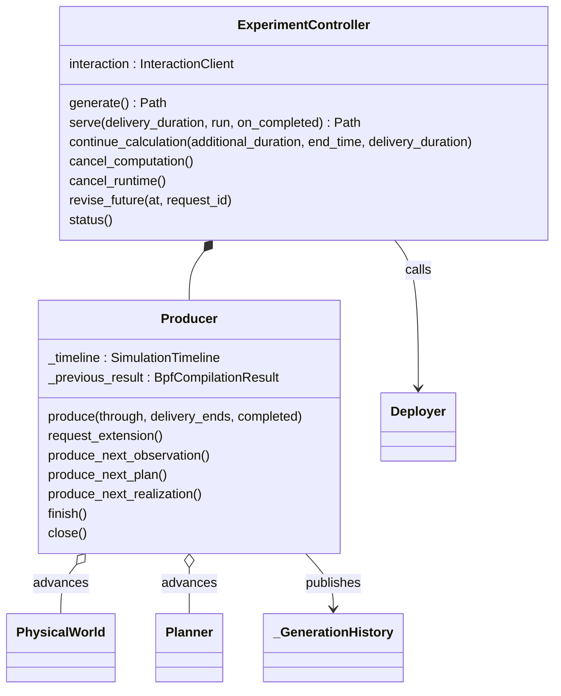

# Experiment orchestration

`Producer` is the sole chronological calculation cursor. It holds the original
Timeline, physical Models and Planner plus the necessary compiler predecessor.
`ExperimentController` integrates it with input capture, optional presentation,
material publication and separately owned deployment/runtime operations.

`generate()` drains a finite request. `serve()` waits efficiently after each completed
range; continuation extends its suffix. Explicit revision may recompute earlier replaceable
windows using framework checkpoints, without restoring private Model state. The Controller's optional presentation
worker coalesces completed requests independently of Producer/Runner progress.
[Output records](output/README.md) provide the detached read boundary.

`execution.py` owns invocation claims, Runner/Traffic startup, reset and shutdown.
`run_generated_experiment()` remains explicit finite deployment/execution automation.
`ExperimentController.status()` is a local diagnostic read, including before startup.
Shared `interaction.state()` adds owner session/version/freshness; `state_history()` and
`watch_state()` expose meaningful publications separately from liveness.
Generated `experiment_control.py` is a client to live owners, not restart recovery.
[Experiment reference](../../../docs/development/experiment-control.md) defines command ownership;
[controls guide](../../../docs/user-guides/computation-and-controls.md) gives operations.

Default Model assembly belongs to
`simulator.create_default_simulator(definition, forwarding_backend=..., ...)`.
Use the same selected backend for Emulator construction; Controller inherits its
execution selection and leaves the already constructed Models unchanged.

The Controller's optional `preparation` function and `preparation_inputs` capture
user source/JSON values for the separate generated execution process. Public
`PreparationContext` supplies initial planned/prepared facts. `preparation.py`
loads the captured code; `execution.py` retains the single process/lifecycle owner
through its existing initial-readiness command mechanism. See the
[contract](../../../docs/development/experiment-control.md#user-preparation-function).

## Interaction and revision owners

| Implementation | Responsibility and boundary |
|---|---|
| [interaction.py](interaction.py) | Public `InteractionClient`, `RequestReceipt`, `InteractionUnavailable`, `InteractionHistoryCompacted`; Etcd transport, focused queries, user values and private atomic owner publication. No service/process startup or Model interpretation. Its source is also the standalone container client. |
| [interaction_service.py](interaction_service.py) | Explicit output-scoped Etcd start/attach/stop, discovery, persistent data and recorded process identity. Uses output claims; never restores Models or stops an external service. |
| [container_interaction.py](container_interaction.py) | Generate the client/requirements/README and Compose endpoint variables/mounts. No application, proxy, extra network route or Python image installation. |
| [_control.py](_control.py) | Shared request consumer, session/admission fencing, scheduling and receipt/result publication; generated CLI. Dispatches into actual owners, retaining terminal decisions after lost acknowledgements. |
| [controller.py](controller.py) | Calculation owner, Producer lifetime, completed publication and presentation; local dispatch implements computation controls. Its existing consumer observes bounded runtime freeze facts. |
| [execution.py](execution.py) | Runtime claim, local dispatch, Runner/Traffic/readiness lifecycle, reset and final outcome through drainage/handoff. Deployer still owns independently deployed Compose cleanup. |
| [materials.py](materials.py) | File-backed selected catalog, seal/lineage verification and proposal handoff. Offline selection holds the runtime claim; live runtime's consumer commits selection against Runner's preparation decision. |
| [revision.py](revision.py), [producer.py](producer.py) | Recalculate a complete dependent suffix on Producer's thread; own framework continuation and candidate evidence. A lost race recalculates from the selected predecessor; confirmed adoption retains the matching calculation head. |

Generic Planner and Runner have no Etcd dependency. Runner owns the short decision
that freezes a window at preparation, not the service or revision algorithm. Models
choose their own client reads and cache behavior; no mandatory feedback hook exists.
Interaction records stay in Etcd; immutable materials, selected catalogs, completed
publications and raw evidence stay in [files](output/README.md). A closed owner may
report failed cleanup, so service stop is not a resource-cleanup certificate.

For ordinary use, follow [connect → query → publish → explicitly control → observe](../../../docs/user-guides/computation-and-controls.md#interaction-setup-and-independent-programs).
The [shared interaction](../../../docs/development/experiment-control.md#shared-interaction-and-process-authority)
and [revision](../../../docs/development/experiment-control.md#revision-and-reusable-continuation)
references own precise contracts. The old owner socket protocol and per-delivery
Traffic planner have been removed; these files do not introduce replacements for them.
