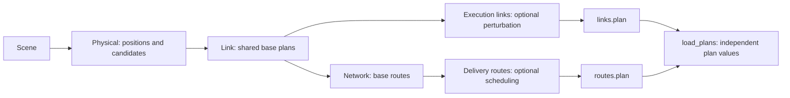
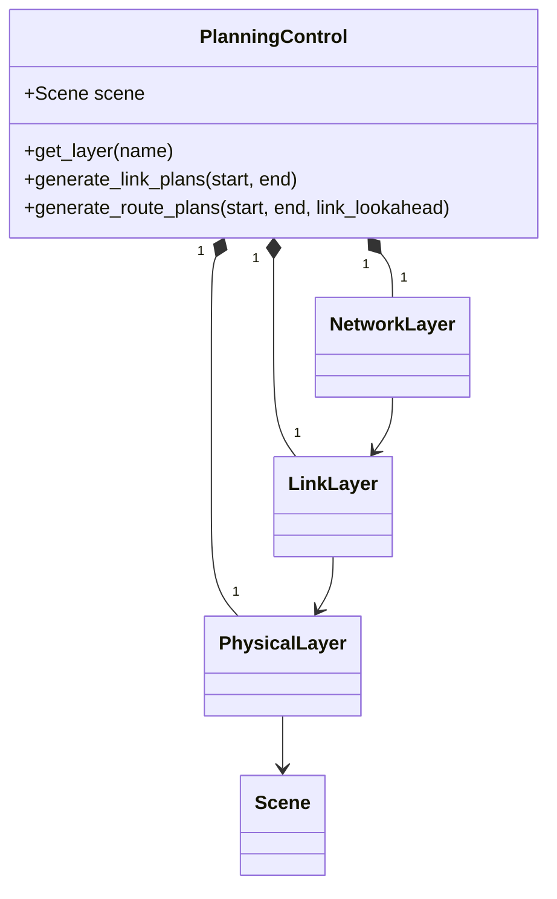

# PlanningControl and plan files

**English** · [中文](README.zh-CN.md)

`PlanningControl(scene)` assembles one Physical, Link and Network layer around
the same Scene. Each layer owns its model instances and history. P&C exposes two
independent, finite plan requests; it does not execute them.



## Use

```python
from datetime import datetime, timedelta
from skyseed import Scene, PlanningControl, save_plans, load_plans

scene = Scene.load("scene.json")
pc = PlanningControl(scene)
network = pc.get_layer("network-layer")
# Configure models through their owning layers before generation.
start = datetime.fromisoformat("2026-01-01T00:00:00+00:00")
middle = start + timedelta(seconds=30)
end = start + timedelta(seconds=60)
save_plans("output/links.plan", pc.generate_link_plans(start=start, end=end))

def route_batches():
    yield from pc.generate_route_plans(start=start, end=middle)
    yield from pc.generate_route_plans(start=middle, end=end)

save_plans("output/routes.plan", route_batches())
for plan in load_plans("output/routes.plan"):
    rules_by_node = plan.state_at(plan.start_time)
    print(plan.start_time, len(plan.operations), rules_by_node.keys())
```

`timedelta` is Python's standard duration type; adding it to a datetime produces
another time. Define the planning start once. It can also be read from a known
Scene shell's `epoch`; Scene itself does not impose a single global epoch.

Both requests return iterators: calculation starts on consumption by `save_plans`,
`tuple(...)` or a `for` loop. Consume one request before the next on the same
instance. Saving consumes its input; retain the original objects yourself if needed.

| Entry | Result and ownership |
|---|---|
| `get_layer("physical-layer")` | Existing [PhysicalLayer](physical/README.md): position and candidate models |
| `get_layer("link-layer")` | Existing [LinkLayer](link/README.md): selection, properties, generation and perturbation |
| `get_layer("network-layer")` | Existing [NetworkLayer](network/README.md): service, routing, generation and delivery |
| `generate_link_plans(start=..., end=...)` | Execution LinkPlans; no route computation |
| `generate_route_plans(start=..., end=..., link_lookahead=timedelta(0))` | Delivery RoutePlans; prepares base links without perturbation |
| `save_plans(path, plans)` | Consume a finite sequence, one plan type per file |
| `load_plans(path)` | Read plans incrementally in saved order; no Scene or models needed |

Layer setters accept model classes and retain their instances. Their minimum
contracts and configuration stay in the linked layer documentation; P&C adds
no second model registry.

## Coverage and continuation

Requests share **base link coverage**, with independent output branches. A route
request for `[0, 20)` with 10 seconds of lookahead prepares base links through
30 seconds. A later link request for `[0, 20)` reuses this base input and returns
execution links for its requested range. Disabled Network precomputation returns
an empty iterator without additional link preparation.

Continue from the requested endpoint, not an extended Delivery tail: a request
ending at 20 seconds may return operations at 25 seconds; the next request still
starts at 20. Route batches can overlap, with these distinct contents:

| RoutePlan field | Meaning in a saved batch |
|---|---|
| `initial_rules` | Known state before operations at the batch's start |
| `operations` | New operations returned by this batch, including its delayed tail |
| `context_operations` | Previously returned operations needed to reconstruct state; not new instructions |

Files preserve batches exactly, without merging them or redelivering context.
Each batch retains the information known when produced and can be read alone.
For the latest combined view in a live P&C instance, use Network's
`delivery_state_at` / `delivery_plans_between`.

Follow each layer's continuous-forward generation contract; use its query APIs
for retained results and a new P&C for an independent experiment. Loading restores
plan values, **not active model state** or a P&C checkpoint.

## Plan files

Version 1 uses UTF-8 JSON Lines. `.plan` is a filename convention; the header
identifies the format. A file contains one kind of LinkPlan, RoutePlan or PhysicalPlan, or an
empty sequence.

| Record | Fields | Purpose |
|---|---|---|
| Header | `format: "skyseed.plans"`, `version: 1`, `plan_type: "link" / "route" / "physical" / null` | Identify format/type; null means empty |
| Each LinkPlan | `start_time`, `end_time`, `initial_links`, `operations` | Initial connections, directional reports/properties and timed changes |
| Each RoutePlan | `start_time`, `end_time`, `initial_rules`, `operations`, `context_operations` | Typed destinations, logical exits, rules and separate delivery context |
| Each PhysicalPlan | Backend, deployment association, targets, initial/new/context instructions | See the [Compiler](compiler/README.md) field table |
| Completion | `end: <plan count>` | Detect incomplete files, including truncation between complete records |

Times are UTC ISO strings. See the [LinkPlan](link/README.md) and
[RoutePlan](network/README.md) field tables for logical meanings. Rules retain
MPLS-like local labels/actions, or supplementary ordinary IP destination rules.

Model `data` supports `None`, strings, booleans, integers, finite floats,
string-keyed mappings, lists, tuples and timezone-aware datetimes recursively.
Compound values are tagged to preserve tuples and distinguish user keys from
format tags; mappings load as ordinary dictionaries. Convert custom classes and
arrays to supported values before saving. Model instances, random state and
runtime resources are not stored.

Saving writes one plan at a time to a temporary sibling file, then replaces the
destination after success. Missing parent directories are created; failure leaves
an existing file intact. Saving again replaces rather than appends. Loading yields
one plan at a time; **fully consume the iterator** to validate completion. Errors
identify the path and record line. Memory use is per complete plan record, in
addition to history retained by the caller or layers.

## Structure and inspection



| Location | Responsibility |
|---|---|
| `planning_control.py` | Layer assembly and the two request iterators |
| `plan_file.py` | Versioned encoding, incremental save/load and file completion |
| `physical/`, `link/`, `network/` | Layer algorithms, model contracts and producer-owned value types |

`PlanningControl`, `save_plans` and `load_plans` are exported from `skyseed` and
`skyseed.pc`. The [Link](../../../tools/observation/link/README.md) and
[Network](../../../tools/observation/network/README.md) inspectors link their graphical
views to plan-detail subpages: original batches, restored content and downloadable files.
PlanningControl assembles these layers and provides the two request entry points;
it does not need a separate visualization. `tests/unit/pc`
checks files and failures; `tests/integration` checks the real three-layer
workflow. [PlanCompiler](compiler/README.md) lowers both streams into saved
PhysicalPlans. [Runner](../runner/README.md) binds and executes them in the deployed network.
