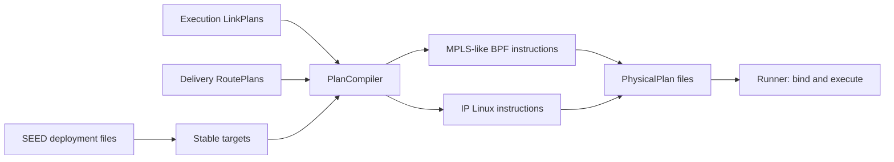

# PlanCompiler

**English** · [中文](README.zh-CN.md)

`PlanCompiler` reads an Emulator/SEED deployment directory and lowers LinkPlans
and RoutePlans into reusable **PhysicalPlans**. It assigns service names,
interfaces, addresses and logical ports before containers exist. It does not
start containers, create interfaces, load BPF or execute routes.



## Use

```python
from skyseed import PlanCompiler, save_plans, load_plans

compiler = PlanCompiler("output/deployment")  # MPLS-like BPF
save_plans("output/physical.plan", compiler.compile_plans(
    link_plans=load_plans("output/links.plan"),
    route_plans=load_plans("output/routes.plan"),
))
```

Select `forwarding_backend="linux"` for ordinary IPv4 rules. The default GZ
routing model can generate these with `label_forwarding=False`; Linux compilation
rejects label actions rather than discarding their semantics. BPF also supports
the explicit `forward`/`deliver` IP rule forms. Other forwarding semantics need a
compiler and Runner that agree on them, not arbitrary fields in `rule.data`.
The shared PhysicalPlan/file envelope can retain another compiler's backend name,
ABI and instructions. Reading preserves them; only that backend's Runner may
interpret them. The built-in PlanCompiler accepts BPF and Linux only.

Inputs are finite iterables, each ordered by start time. Counts and intervals
need not match, and either iterable may be empty. Output retains one batch per
input, ordered by start time (Link before Route at a tie). This is **batch order,
not a flattened execution timeline**: delayed route operations may extend beyond
the next batch's start. Reuse the compiler across successive requests to retain
assignments. No old plan history is stored or replayed by the compiler.

## Result shape

| PhysicalPlan field | Meaning |
|---|---|
| `start_time`, `end_time` | Original UTC coverage, including a RoutePlan's delayed tail |
| `stream` | `link` or `route`; each restores only its own state |
| `forwarding_backend` | `bpf` or `linux` |
| `deployment_id` | Digest of relevant node/service/network facts and allocation pools |
| `targets` | Referenced nodes, link endpoints, destination prefixes; BPF program/pipeline description |
| `initial_operations` | Instructions to reconstruct this stream's starting state |
| `operations` | This batch's new timed updates |
| `context_operations` | Earlier batches' overlapping updates, retained for independent reconstruction |
| `backend_abi` | `skyseed.physical.v1`, the instruction contract below |

Each `PhysicalOperation` contains `timestamp`, logical `kind`, `target`, and an
ordered tuple of `BackendInstruction(opcode, node_id, parameters, requires)`.
`requires` names resources needed by a step in that operation. A route's
`parameters.resource` is different: it is a **conditional exit dependency**;
an absent link activates drop at the scheduled time, without delaying the route.

```python
plan = next(load_plans("output/physical.plan"))
for operation in plan.operations:
    print(operation.timestamp, operation.kind, operation.target)
    for instruction in operation.instructions:
        print(instruction.opcode, dict(instruction.parameters))
```

Saved PhysicalPlans use the common version-1 plan envelope with
`plan_type="physical"`. They retain all targets and instructions without the
Scene, models or original deployment directory. Running them still requires a
compatible deployment and backend ABI.

| Already in PhysicalPlan | Bound by Runner for this run |
|---|---|
| Node identity and Compose service name | Actual container and namespace handle |
| Interface name, MAC, address and logical port | Created veth, actual ifindex and port binding |
| BPF matches/actions, program and table structure | Loaded program/map descriptors and table versions |
| Scheduled operation time | This run's monotonic origin and actual activation record |

Loading does not restore a compiler checkpoint; continue compilation with the
original instance.

## Target and instruction contract

Node identities come from SEED's `skyseed.scene_id` / `skyseed.scene_kind`
metadata labels in `docker-compose.yml`. Existing network addresses are retained.
Default allocation pools are `198.18.0.0/16` for node `/32` identities,
`198.19.0.0/16` for logical endpoint `/32`s, and `100.64.0.0/10` for dynamic `/31`
links. Override `node_address_pool`, `endpoint_address_pool`, `link_address_pool`
if they overlap the deployment. Node assignments use sorted identities; new
links/endpoints are allocated on first reference. Names are stable within this
compiler and saved plans; different first-reference orders in separate compiler
instances need not assign the same addresses or ports.

| Instruction | Concrete effect required of Runner |
|---|---|
| `veth.create` | Create one pair, place endpoints in their recorded node services |
| `interface.configure` | Set interface name, MAC, `/31` address, MTU and permanent peer neighbor |
| `netem.replace` | Replace combined directional delay in µs, rate in bit/s and random loss in percent |
| `link.activate` | After both endpoints are prepared, attach the BPF pipeline if selected, bring up and bind ports; restore still-current Linux route intents |
| `link.unbind` | Remove BPF port bindings / switch dependent Linux intents to blackhole before deletion |
| `veth.delete` | Delete the pair; retain independent route intents |
| `bpf.rule` | Install/replace/withdraw the encoded match/action in the next node table; local delivery also owns its local destination prefix |
| `linux.route` | Apply a managed IPv4 route or local-delivery prefix; retain conditional forward intent while the exit is absent |

Veth preparation steps execute in listed order at the operation's time.
Microseconds and integer bit/s are backend resolution; positive sub-bit/s rates
round up to 1. Missing physical directions and zero bandwidth use 100% drop,
with no `rate 0` setting. Both directions retain separate attributes.
Linux route fields include prefix, interface, peer gateway, main table 254,
protocol 253 and priority 1. Local delivery uses the corresponding local prefix;
it does not forward through a default route.

**Unavailable links:** a rule stays as desired state. BPF drops when its logical
port has no current binding; Linux installs a blackhole entry for the managed
prefix. Link restoration binds/reinstalls only still-current rules. A route
withdrawal removes both its active/drop entry and its retained intent. Compiler
does not create an absent link, recalculate a path, or change Delivery time.

## MPLS-like packet and table ABI

The wire format is Ethernet (`0x8847`) + one standard 4-byte MPLS shim + IPv4.
Labels are node-local, 20-bit and allocated downstream by P&C. Transit lookup
uses the **incoming label**, never the business IP destination. Ingress IPv4
prefix classification selects `push`; transit `swap` changes the label to the
next receiver's label; `pop_deliver` removes it and passes IPv4 to local Linux
delivery. This is one-label forwarding, not a full MPLS protocol or label stack.
The built-in pipeline uses a pipe TTL: push sets 64, swap decrements it and drops
when exhausted; the inner IP TTL is unchanged by label forwarding. No label
distribution protocol runs in the nodes.

| BPF map | Key → value | Owner/use |
|---|---|---|
| `active_generation` | slot 0 → published generation ID | Shared across nodes; Runner publishes once when due |
| `generation_readers` | generation → active reader count | Shared; protects generation data while a rule is read |
| `node_versions` | generation → node's data version | Node-local; unchanged nodes reuse data versions |
| `rule_versions` | data version → immutable inner rule map | Node-local prepared versions |
| inner LPM rule map | prefix length + kind + match → action, logical port, outgoing label | Exact labels (`kind=0`, 64 bits); IPv4 classification (`kind=1`, 32 + prefix bits) |
| `port_bindings` | logical port → actual ifindex, source MAC, peer MAC | Runner binds/unbinds link resources |

Key kind/match bytes are network endian; prefix length and three value integers
use native endian. `encode_rule(..., byteorder=...)` supplies both encodings;
compiled hex fields explicitly show little endian and retain semantic fields
for other hosts. The action numbers are push=1, swap=2, pop_deliver=3, forward=4,
deliver=5. Unknown/missing matches and unavailable output ports drop.

The program copies one selected action before returning to TC. Push/pop filters
consume that decision without consulting a newer table. TC's native `mpls`
actions manage headroom and protocol changes; BPF owns the label/exit decision.
Runner prepares each generation's node-to-version mappings and new tables, then
publishes one shared generation ID. Nodes due to change select new versions;
others retain their versions. IDs are nonzero and never reused in a run.
The program pins a reader, rechecks publication, copies the selected rule and
releases the reader. A publication race retries at most three times; if no stable
selection is acquired it drops. Runner reclaims a retired generation only after
its reader count is zero, and a version only after no retained generation refers
to it. Push/pop continuations use the copied action, not generation-owned data.
All changes for one node at one timestamp form one prepared table; input batch
order resolves ties. Initial/context records are used only when restoring a
stream, not redelivered while continuing it.
No packet carries a network-wide table version, so Delivery timing differences
between nodes remain observable.

Runner must reuse the two `targets.bpf_program.shared_maps` across **all nodes**;
the remaining maps are shared by the five programs within each node. It attaches
the ordered pipeline in `targets.bpf_program.pipeline`. Node-local originated
traffic needs a dedicated ingress veth and prefix routes into it; its MTU is
1500, with 1504-byte dynamic links for the label overhead. Runner also installs
node identity addresses and current local-delivery prefixes. These are runtime
setup obligations, not resources created by the compiler. Map capacity can be
sized before load; port entry storage grows on demand, while hash buckets still
have a fixed allocation. Source templates allow 128 retained generations/versions
and 4096 active ports per node; Runner sizes these for its preparation window.

## Files and validation

| Location | Responsibility |
|---|---|
| `plan_compiler.py` | Two-stream iteration and backend instruction lowering |
| `deployment_targets.py` | Deployment identity/address facts and stable allocation |
| `physical_plan.py` | Portable result values |
| `bpf/label_tables.py` | Label-first table encoding and TC pipeline description |
| `bpf/label_forwarding.bpf.c` | Actual packet classification, label actions and port binding lookup |

`tests/unit/compiler` checks lowering, timing/context, allocation and cost;
`tests/connections/test_deployment_compiler.py` uses a real SEED export and
independent file reader. C tests compile little/big-endian eBPF and execute the
same C logic with offline helper substitutes. They do **not** prove verifier
acceptance, TC attachment or live forwarding; those belong to Runner validation.
The optional [Compiler inspector](../../../../tools/observation/compiler/README.md)
shows actual saved instructions and target mappings.

Implementation references: Linux [TC MPLS actions](https://github.com/torvalds/linux/blob/v6.8/net/sched/act_mpls.c),
[BPF classifier](https://github.com/torvalds/linux/blob/v6.8/net/sched/cls_bpf.c)
and [map-in-map](https://docs.kernel.org/bpf/map_of_maps.html). The built-in BPF pipeline implements node-local label forwarding.
