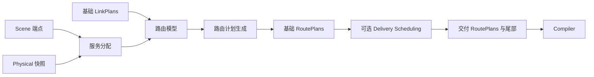
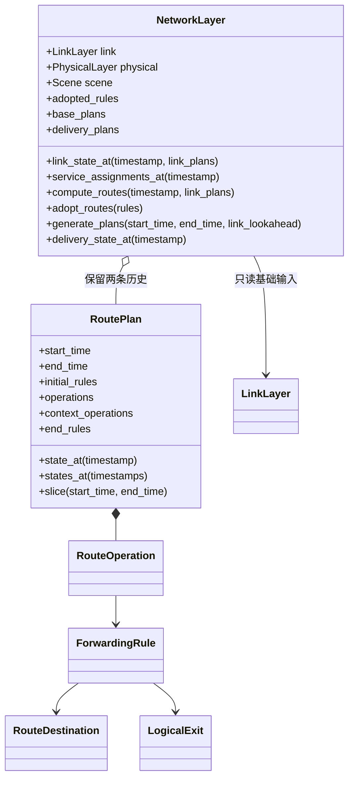

# Network 网络层

**中文** · [English](README.md)

`NetworkLayer` 使用基础 LinkPlan，计算节点转发规则，保留基础和 Delivery 调整后的
RoutePlan。算法及私有状态归各模型；本模块不运行后端指令或路由协议。





## 用法

```python
from datetime import datetime, timedelta
from skyseed.pc.network import NetworkLayer

# link 是已有 LinkLayer；Scene 已包含本实验所需端点。
start = datetime.fromisoformat("2026-01-01T00:00:00+00:00")
end = start + timedelta(minutes=1)
network = NetworkLayer(link)
plans = network.generate_plans(start, end)
query_time = start + timedelta(seconds=8)
rules_by_node = network.delivery_state_at(query_time)
beijing_rules = rules_by_node.get("Beijing", ())
```

`datetime`／`timedelta` 是 Python 标准库的时间点／时长类型。
每次生成自动返回本批全部交付操作，包括晚于 `end` 的更新，无需单独收尾。
随后仍以基础生成的 `end` 继续请求，不能用含延迟尾部的返回值终点作为下一轮计算起点。
生成不执行网络操作；总体装配与独立保存／读取见 [PlanningControl 与计划文件](../README.zh-CN.md)。

`rules_by_node` 是“节点 ID → 当时受管规则集合”，不是未来计划或完整路径。
无同秒更新就沿用此前状态。`plans[0]` 是第一份返回计划；其 `state_at(t)` 只查询该批
生成时已知的状态，时间须在其覆盖内。跨批查看最新合并结果用上面的 `delivery_state_at`。

| 模型接口 | 唯一必需方法 | setter | 默认 |
|---|---|---|---|
| `ServiceAssignmentModel` | `assign_service(scene, snapshot)` | `set_service_assignment_model` | 最高仰角 |
| `RoutingModel` | `compute_routes(scene, timestamp, link_plans)` | `set_routing_hook` | Ground Station–Zone |
| `RoutePlanModel` | `generate_plans(scene, start_time, end_time, link_plans)` | `set_plan_model` | 五秒周期 |
| `DeliverySchedulingModel` | `schedule_plans(scene, route_plans)` | `set_delivery_scheduling_hook` | None |

首次生成前注册类，框架创建并复用实例，构造后关联 `model.layer`；无需继承 Protocol。
算法参数由模型构造函数定义，可选 `model_options` 仅转交构造参数。
`FixedDelayDeliverySchedulingModel` 是可选的固定延迟示例模型，默认没有挂接。

`set_routing_hook(None)` 或 `set_precomputed_routing(False)` 跳过输入准备、生成及交付处理，
后者保留所选模型。已启用模型返回 `{}` 则会撤销此前受管规则，两者含义不同。
自定义路由无需采用端点、Zone 或服务分配模型。

## 共同输出与计划组织

一次路由计算返回 `node_id -> 受管规则元组`。外层映射标识节点；每条规则描述匹配条件、
动作和所需的逻辑出口。生成器比较规则身份与内容，再组织成定时更新。这些职责不要求
使用标签转发；当前内置规则的具体字段放在后面的实现说明中。

| `RoutePlan` 字段 | 内容／示意 |
|---|---|
| `start_time` / `end_time` | 此批已知状态的半开覆盖区间；Delivery 可延伸到请求终点之后 |
| `initial_rules` | 起点操作前的配置，如 `{"B": (rule1, rule2)}` |
| `operations` | 本批新增的有序 `RouteOperation`，包括延迟尾部 |
| `context_operations` | 前批已返回、仍在本批覆盖内发生的操作；通常为空，仅供状态还原 |
| `end_rules` | 合并上下文与本批操作后的结束配置 |

| `RouteOperation` 字段 | 示例 | 含义 |
|---|---|---|
| `timestamp` | `start + timedelta(seconds=7)` | 安排的生效时刻 |
| `node_id` | `"B"` | 操作所属节点 |
| `kind` | `"replace"` | install／replace／withdraw |
| `rule` | 一条规则值 | 安装／替换的新内容；撤销时携带被撤销规则 |

`RouteOperation` 没有标签字段，其 `rule` 保留安装、替换或撤销所需的完整规则值。
节点内的 `rule.key` 标识受管表项；同一 key 的内容改变会产生替换。
不同 IP 前缀即使地址范围重叠，也保留为不同表项。计划查询还原配置，不执行报文查表或最长前缀匹配。

### Model 与 Compiler 的交接边界

| 信息 | 归属与含义 |
|---|---|
| 节点、规则身份、生效时间 | 共同的计划组织；更新指向已有逻辑节点及其受管规则 |
| 匹配条件与动作 | 使用模型和对应 Compiler 都能理解的明确规则表示 |
| 逻辑出口 | 模型选择连接及发送端，Compiler 解析具体接口和下一跳地址 |
| 模型附加数据 | 可以保留研究数值；若影响实际转发，必须明确对应 Compiler 的解释 |

当前 `data` 映射保留附加内容并参与值比较，不会自动产生新的匹配字段或后端动作。
例如记录路径评分，不等于设置了内核路由 metric。换选路算法可以沿用规则表示；
增加规则表示则需要相应的 Compiler 翻译。Compiler 应明确处理受支持的形式，
不支持时明确报错，不能猜测任意附加字段的含义。Compiler 是独立编译阶段，
这里说明其必须遵守的交接边界，不表示 IP 或 BPF 转发已安装执行。

## 默认 GZ 与局部标签

Scene 保存可选 `AccessEndpoint` 定义。`scene.create_zone(...)` 创建代表点及可选矩形边界；
`scene.create_default_zones()` 创建固定的 24 纬带、按纬度余弦缩放的全球划分。
其他端点类型携带由模型解释的 JSON 数据。端点与物理节点分开，不自动部署节点；
Scene 保存读取会保留端点，已有不含端点的文件仍可读取。

默认服务模型在地域代表点选仰角最高且满足最低 5° 仰角的卫星，无可用卫星则返回 `None`。
它不做容量预留，也不保证整个区域内所有终端均覆盖。先按地平线尺度分组建立空间索引，
再精确计算候选几何，避免高轨节点扩大低轨全量扫描。

GZ 按大圆距离关联最近的 GS（默认一座，可配置），在基础连接图中分别计算双向最少跳路径。
卫星可中转，GS 只作为端点；保留单向可用性，不凭空补齐反向连接。
5° 和一座 GS 是可调整的工程基线。

路径与绑定从目的端向上游展开。下图中 C 为目的 E 提供出口，数字仅作示例：


实线表示转发，虚线表示 P&C 计算绑定的方向，不是运行时控制消息。
标签由接收节点解释，并非全网目的编号。
同一节点对同一逻辑目的保留入标签，路径变化时更新下一跳和下游给出的出标签；
本模型实例内不把已分配编号转给另一个目的。`label_bindings()` 可查看这些绑定，包含暂未使用的绑定。
`GroundStationZoneRoutingModel.ground_station_associations(scene)` 返回每个 Zone 的有序 GS 关联（只读），无需先生成路由；次序不随当前可达性改变。


这一方向对应下游分配、局部解释的标签机制
（[RFC 3031 §3.4](https://www.rfc-editor.org/rfc/rfc3031.html#section-3.4)）。
P&C 离线计算绑定，不运行节点间标签分发协议。
默认输出 `push`、`swap`、`pop_deliver`，入口本地交付使用 `deliver`。
模型参数 `label_forwarding=False` 改为面向 IP 后端编译的目的匹配 `forward`／`deliver`。
实际封装和 BPF 表见 [Compiler](../compiler/README.zh-CN.md)，终端末跳接入见 S4 的 UT 扩展。

### 内置转发规则表示

当前 `ForwardingRule` 支持两种形式。GZ 默认使用标签；自定义路由模型也可以直接
输出普通 IP 前缀规则，不依赖端点或服务分配。

| 字段 | MPLS-like 标签示例 | IP 前缀示例 |
|---|---|---|
| `destination` | `RouteDestination("endpoint", "E")` | `RouteDestination("prefix", "10.0.0.0/24")` |
| `action` | `"swap"` | `"forward"` |
| `exit` | `LogicalExit(("B", "C"), "B")` | 同一个逻辑连接 |
| `incoming_label` | `20`，由 B 在本地分配 | `None` |
| `outgoing_label` | `30`，由下游 C 分配 | `None` |
| `data` | 可选的模型附加值 | 模型附加值，例如 `{"path_cost": 4}` |

第一条规则匹配入标签 20，换为 30 后经 B→C 转发。第二条把该 IP 前缀通过同一连接转发，
Compiler 负责解析 C 的链路地址和出接口。IP 规则使用 CIDR 前缀，
包括主机路由与默认路由；报文查找语义归目标 IP 后端，Planner 独立保留每个前缀。

| 内置形式 | 匹配 | 支持的动作 |
|---|---|---|
| 按标签转发 | 入口按目的分类；中转匹配节点本地标签 | `push`、`swap`、`pop_deliver`；本地 `deliver` |
| 按目的转发 | 类型化目的：节点、端点或 IP 前缀 | `forward`、`deliver`；两个标签均为 `None` |

这份实现的 key 固定为入标签或类型化目的，动作是上述五种，转发使用一个逻辑出口。
这是当前内置表示的边界，不是所有预计算路由都必须采用 MPLS-like 的要求。
多出口、新匹配字段或其他动作需要协调扩展规则及其消费者，不能用 `data` 字段代替。
当前未实现任意规则的 Compiler 或通用扩展注册体系。
查询只包含本模型受管表项，不包括其他协议维护的转发表。

## 查询、记录与时间

`compute_routes`、`service_assignments_at` 可用于试算；只有 `adopt_routes` 或接纳生成计划
才推进正式转发状态。模型通过 `link_state_at` 查询准备好的基础连接。
请求的非负 `link_lookahead` 只延长链路输入，不扩大路由输出；完整目标区间和输入序列一起交给生成器。
服务快照同时包含卫星和物理地面节点，自定义模型可结合地面位置与实际接入连接分配服务。
规则值及外层映射只读；嵌套自定义数据须保持不变，并支持相等比较。

`base_plans_between(start, end)`、`delivery_plans_between(start, end)` 只读历史，不调用模型。
RoutePlan 查询应用截至所需时刻的操作，无需恰好存在同秒更新。升序查询只遍历一次事件；
普通链路查询也复用前进游标。GZ 按目的及未改变的卫星连通部分复用反向搜索。
可选 `observer` 输出 `GZRouteEvaluation`，由调用者决定是否留存。

<details>
<summary>计划边界与 Delivery 合同</summary>

覆盖区间为 **[start, end)**。`initial_rules` 是起点操作前的承接状态；`state_at(start)` 包含起点操作。
规则的 key 是节点内匹配条件：入标签或类型化逻辑目的。操作按该 key 安装、替换或撤销。
计算中省略的节点／规则会撤销模型此前受管部分，协议维护的其他表项不属于这一集合。

默认生成器跨请求保留五秒相位，每次新增区间输出一份计划；自定义生成器可输出相邻多份计划。
已覆盖请求读取已有结果，新请求连续推进。改变输入／模型使用新实例，不回滚旧历史。

Delivery 一次收到本次新生成的完整计划序列，保留起点状态及各节点转发内容与顺序，
调整时间和分段。模型返回所有安排好的操作，包含越过源区间末端的操作，并组织为合法 RoutePlan 序列。
后一次调用不能让同一节点的新更新越过此前更新。

Layer 按生成批次保留 `delivery_plans`，批次的时间范围可以因延迟而重叠。
每批 `operations` 只包含本批新增操作；前批已返回但还会发生的操作放在
`context_operations`，供独立查询使用，不作为新增指令重复交付。
起点配置是该批起点操作前的实际承接值；同刻先应用前批上下文，再应用本批更新。

单份批次是“截至生成时已知”的投影：之后才生成的其他节点更新不会改写旧对象。
`delivery_state_at(t)` 查询最新合并状态；`delivery_plans_between(start, end)` 返回
不重叠的时间投影，其 `operations` 包含该查询区间的完整演化，用于读取而非再次交付。
两种查询均不调用模型。单份 `slice` 保留新增／上下文的区分。

例如第一批把 A 的安装安排在 7 秒；第二批增加 B 在 5 秒的安装及 A 在 7 秒的替换。
第二批只新增后两项，A 的原安装作为上下文。合并查询在 6 秒只有 B，在 7 秒包含更新后的 A。
返回批次自动延伸到其最后已知事件之后一微秒，以保持半开区间；这不是运行截止或关机指令。
Runner 执行已安排的操作并记录实际时刻，没有新指令时保持配置。

</details>

## 文件与查看

| 文件 | 职责 |
|---|---|
| [network_layer.py](network_layer.py) | 模型实例、共同查询、正式／历史状态及交付尾部 |
| [forwarding_rules.py](forwarding_rules.py) | 类型化目的、局部匹配、有向逻辑出口与动作 |
| [route_plan.py](route_plan.py) | 定时操作与可独立查询的区间 |
| [service_assignment_model.py](service_assignment_model.py) | 服务接口及地域默认实现 |
| [routing_model.py](routing_model.py) | 路由接口、GZ、反向树及局部标签绑定 |
| [route_plan_model.py](route_plan_model.py) | 生成接口及周期默认实现 |
| [delivery_scheduling_model.py](delivery_scheduling_model.py) | 交付接口及可选固定延迟 |

[可视化工具](../../../../tools/observation/network/README.zh-CN.md)逐跳读取实际规则；
缺少匹配、环路和不可用出口如实显示，不补算路径。
测试见 [unit/network](../../../../tests/unit/network) 和
[Link–Network 连接](../../../../tests/connections/test_link_network.py)。
