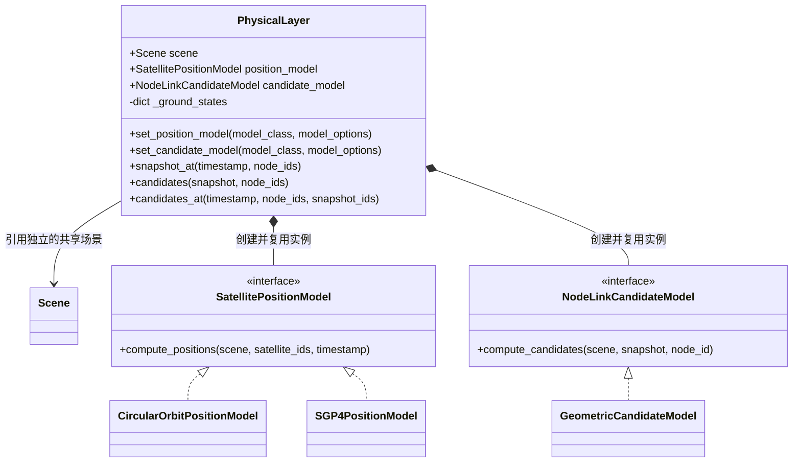

# Physical 物理层

**中文** · [English](README.md)

`PhysicalLayer` 管理位置查询和逐节点通信候选，为 Link 规划提供依据，
也可以直接用于研究和检查。Scene 提供输入；连接选择和计划生成属于后续 Link。
`Scene` 是与 Emulator 共享的独立场景对象；Physical 引用它并计算所请求时刻的状态。

## 类结构



图中的接口是 Python Protocol，不要求自定义类继承它们。两个 setter 接收**模型类**，
以仅限关键字的 `model_options` 实例化，然后绑定 `model.layer`；模型可访问
`self.layer.scene`。规划前配置模型。独立查询可以替换模型，本模块不持有已采用的计划。
两项都需要实际模型，可以替换，不接受用 `None` 关闭。

## 查询过程


| 调用 | 结果和范围 |
|---|---|
| `snapshot_at(timestamp, node_ids=None)` | 返回 `PhysicalPositionSnapshot`；计算所请求卫星的位置，复用固定地面状态 |
| `candidates(snapshot, node_ids=None)` | 返回 `节点 ID → tuple[LinkCandidate]`；以选定节点为查询中心，**仅在快照所含节点中**寻找对端 |
| `candidates_at(timestamp, node_ids=None, *, snapshot_ids=None)` | 合并以上操作；`snapshot_ids` 限定快照与对端范围，`node_ids` 选择查询中心 |

`None` 表示所有适用节点，`[]` 表示空集。时间必须带时区，内部统一为 UTC。
未知身份、快照外的查询中心、属于其他 Scene 的快照都会报错。
复用快照不会重算位置；新一次快照请求仍会调用位置模型。

| 数据类型 | 属性 |
|---|---|
| `NodeState` | 必需的 ECEF `position_m`；可选的 ECEF `velocity_m_s`；模型自定义 `data` |
| `PhysicalPositionSnapshot` | `scene`、UTC `timestamp`、`states`；通过 `snapshot[node_id]` 取状态 |
| `LinkCandidate` | 查询端 `node_id`、对端 `peer_id`；可选的 `distance_m`、`propagation_delay_s`、`elevation_deg`；自定义 `data` |

位置和速度均为有限三维向量，单位分别是米、米/秒；固定地面节点的 ECEF 速度为零。
未提供的可选属性保持未知。映射顶层只读，嵌套自定义值保留自身语义，使用期间应保持不变。
相反方向的节点报告分别保留，以免丢失方向属性。候选计算不分配终端、带宽或建链时刻。

下面是便于阅读的合成几何示意，不是额外模型配置：

| 读取表达式 | 示例值 | 单位／结构 |
|---|---|---|
| `snapshot["GS"].position_m` | `(6378137, 0, 0)` | ECEF 米；赤道地面点 |
| `snapshot["S1"].position_m` | `(6928137, 0, 0)` | ECEF 米；正上方 550 km 卫星 |
| `reports["GS"][0].peer_id` | `"S1"` | GS 的第一条有向候选报告 |
| `reports["GS"][0].distance_m` | `550000` | 米；可选字段，不提供时为 None |

## 用法与模型

```python
from datetime import datetime, timezone
from skyseed import Scene
from skyseed.pc.physical import PhysicalLayer

epoch = datetime(2026, 1, 1, tzinfo=timezone.utc)
scene = Scene()
scene.create_constellation("demo", planes=2, satellites_per_plane=8,
                           altitude_km=550, inclination_deg=53, epoch=epoch)
scene.create_ground_station("Beijing", latitude_deg=40, longitude_deg=116)
physical = PhysicalLayer(scene)
snapshot = physical.snapshot_at(epoch)
reports = physical.candidates(snapshot, ["Beijing"])
```

| 模型 | 输入 → 输出／可配置基线 |
|---|---|
| `CircularOrbitPositionModel`（默认） | Scene 共享轨道或 `circular-orbit/v1` → ECEF 位置和速度 |
| `SGP4PositionModel` | `sgp4-tle/v1` → SGP4 在 TEME 中传播 → ECEF 位置和速度 |
| `GeometricCandidateModel`（默认） | WGS84 可见性；星间距离 ≤ 6000 km；地面仰角 ≥ 5°；可选星地距离上限；时延 = 距离 / 光速 |

圆轨道和 SGP4 都属于内置位置实现，遵守相同的结果合同。新建层默认选择圆轨道；
TLE 输入通过 `set_position_model` 选择 `SGP4PositionModel`。
两种实现与位置接口一起放在 `position_model.py`。

候选默认值是工程配置，不是论文规定的硬件能力。默认模型不产生地面站之间的候选，
也排除涉及椭球内部坐标的机会。混合来源或轨迹回放可由自定义模型实现；
内置模型遇到不支持的输入类型时，不会静默切换为另一种算法。

<details>
<summary>TLE 接入、数值约定与计算成本（展开查看）</summary>

```python
from skyseed.pc.physical import SGP4PositionModel, tle_position_source

scene = Scene()
scene.create_satellite("sat-1", position=tle_position_source(
    line1, line2, source="my-input.tle"))  # 从输入文件读取的两行 TLE。
physical = PhysicalLayer(scene)
physical.set_position_model(SGP4PositionModel)
```

适配器保留 TLE 原文、其中的历元和可选来源，可随 Scene 保存读取；不下载数据，
也不承诺任意 OMM／CSV 导入。传播失败会指出卫星和查询时刻。
圆轨道以 GCRS 轴为参考，升交点为零相位，半径为 WGS84 赤道半径加高度，
μ = 3.986004418e14 m³/s²；经过时间包含闰秒。两种内置模型均联合变换位置和速度到
ITRS/ECEF，包含参考系运动。SGP4 状态速度是近似值，不等于任意精度的位置数值导数。

Astropy 使用本地地球定向数据，在计算作用域内关闭下载，结束后恢复配置；
保留精度警告。参考 [Astropy 卫星坐标说明](https://docs.astropy.org/en/stable/coordinates/satellites.html)
和 [SGP4](https://pypi.org/project/sgp4/)。

预处理输入按卫星复用，对应输入变化时失效。候选模型只保留一个快照的数组和空间分桶；
星间与星地分别使用自己的搜索范围，只有两类节点都存在时才建立星地分桶。
先做保守的距离／地平线筛选，再精算几何。不创建 N×N 矩阵，但真实候选本身很密集时，
输出量仍可能为平方规模。核心不保留完整轨迹历史。

</details>

## 文件与检查入口

| 文件 | 职责 |
|---|---|
| [physical_layer.py](physical_layer.py) | 查询入口、模型实例与身份交接 |
| [physical_results.py](physical_results.py) | 节点状态、位置快照和候选结果 |
| [position_model.py](position_model.py) | 位置接口、圆轨道与 SGP4 实现、TLE 适配 |
| [link_candidate_model.py](link_candidate_model.py) | 候选接口、几何实现及其空间搜索 |
| [earth_geometry.py](earth_geometry.py) | WGS84 几何与共享坐标变换 |

分别查看 [Scene 输入](../../../../tools/observation/scene/README.zh-CN.md)
和 [Physical 结果](../../../../tools/observation/physical/README.zh-CN.md)。
测试入口：[Physical 单元测试](../../../../tests/unit/physical)、
[Scene–Physical 连接测试](../../../../tests/connections/test_scene_physical.py)。
连接计划、路由和执行分别由 Link、Network 与 Runner 负责。
