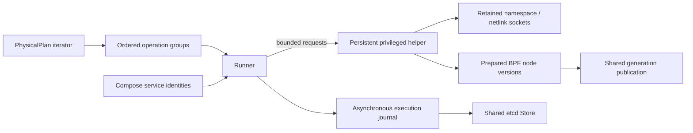
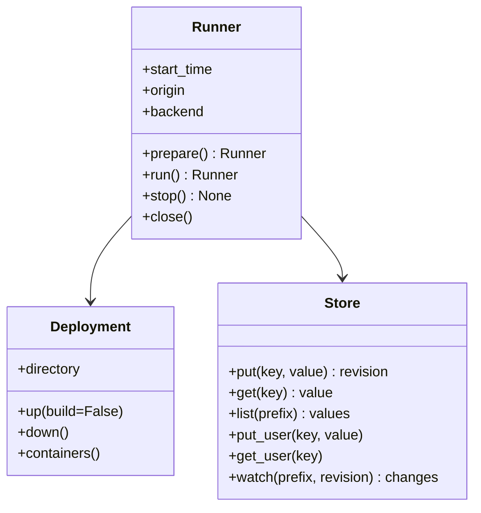
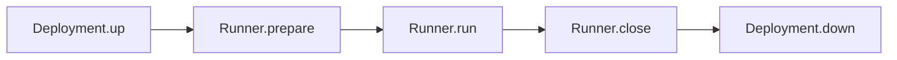

# Runner

[中文](README.zh-CN.md)

Runner applies compiled PhysicalPlans to an already deployed network. It does
not calculate paths, start the deployment implicitly, or change plan times.

```python
from skyseed import Deployment, Runner, Store, load_plans

deployment = Deployment("output/deployment")
with deployment:
    with Runner(load_plans("output/physical.plan"), deployment,
                output="output/run-001",
                store=Store(namespace="skyseed/run-001")) as runner:
        runner.run()
```

Full experiments use etcd as a shared Store, kept running throughout its use.
Examples own service startup and shutdown. A standalone Runner may omit Store
and keep local records only; this does not replace the shared role of Store. Reusing plans does not reuse
live container IDs, namespace handles, or BPF descriptors. Use a fresh output
directory for each run.

## Responsibilities



| File | Responsibility |
|---|---|
| runner.py | Public lifecycle, scheduled execution, fair preparation/reclamation |
| plan_queue.py | Merge overlapping batches by operation time; use each stream's initial state once |
| deployment.py | Compose up/down for SEED output, service/container lookup, context lifecycle |
| execution_process.py | Internal helper launch, persistent connection and command protocol |
| instruction_executor.py | Runtime interface/address ownership and instruction execution |
| netlink.py | Linux rtnetlink encoding, including combined netem and TC MPLS actions |
| bpf/versions.py | Prepared tables, generation references, reader-safe retirement |
| bpf/kernel.py | libbpf loading and bounded map IO |
| ../store.py | JSON values and revisioned etcd subscriptions |



Store is shared infrastructure independent of Runner. Execution, measurement
and model programs can access it from separate processes.

| Storage | Purpose | Current use |
|---|---|---|
| etcd through `Store` | Shared values, transactions, revisions and subscriptions | Runner publishes execution records; the S4 example archives measurements |
| Local JSONL | Append-only history for offline reading | Execution journal and experiment measurements |

The example does not implement cross-process P&C scheduling, multi-host resource
management or clock coordination. Local records remain usable after etcd stops.

## Lifecycle and timing



| Step | Result |
|---|---|
| `Deployment.up()` | Start containers from SEED's Compose output |
| `Runner.prepare()` | Resolve and verify container identities; start the helper; restore initial links and rules |
| `Runner.run()` | Establish one monotonic origin; execute through the final interval and Delivery tail; leave the network in its final state |
| `Runner.stop()` | Request stop after the current backend call; cancel unapplied future work, then release resources with close. Record stopped, not drained |
| `Runner.close()` | Drain records and release this Runner's interfaces, routes, programs and descriptors |
| `Deployment.down()` | Stop the deployed containers |

Python's `with` calls preparation on entry and cleanup on normal or exceptional
exit. Nested contexts release Runner before Deployment; cleanup preserves the
primary error if both execution and cleanup fail.

Preparation reads all batches at the initial start and keeps the first later
batch as lookahead. During execution, a maintenance thread reads subsequent
material. Table preparation and retirement yield between bounded units; ready
nodes can publish while another node is still preparing. Each node's own update
order is preserved, and link work follows its own dependencies.

<details>
<summary>Batch order, delayed input and preparation limits</summary>

The input iterator is ordered by **batch start**, as emitted by PlanCompiler.
Each stream first restores its initial snapshot and future context. Subsequent
snapshots and context are not replayed. Known operations execute without waiting
for the next batch. Overlapping tails may insert earlier work for other nodes;
a node’s own accepted updates must preserve timestamp order, as Delivery does.
Late same-time updates apply after already published work. A missing successor
delays only its affected work; it never resets the clock. An independent run uses a new
Runner. There is no implicit historical replay.

The scheduler decodes one batch at a time and prepares a 30-second lookahead.
A batch may contain a longer tail. Each node retains at most two unadopted
prepared/preparing versions, so one slow node does not block another node’s input. Node rule state remains necessary to prepare its next full
table. Unchanged nodes reuse their table across generations. Map updates use
kernel batch support where available and fall back for unsupported map types.

</details>

## Backends

| | MPLS-like BPF (default) | Ordinary IPv4/Linux |
|---|---|---|
| Forwarding | Ingress IPv4 prefix, transit node-local label, push/swap/pop | Kernel prefix route |
| Preparation | Separate node tables, shared generation bindings | Stable request fields |
| Activation | One shared generation write for the ready node set | Progressive netlink writes |
| Missing link | Unbound logical port drops | Retained intent installs blackhole |
| Link restoration | Rebind the same logical port | Reinstall still-effective route intent |

BPF uses a dedicated in-node veth to send locally originated business traffic
through the same classifier. Policy routes cover the Compiler's business pools
and explicit prefixes; ordinary SEED interfaces are not rewritten. Dynamic
satellite links use MTU 1504 for a 1500-byte IPv4 payload plus one MPLS header.
SEED must already disable all.rp_filter for local injection. The packaged
Compiler program is built once before timed execution, or supplied as ELF bytes
through Runner's program argument. clang with the BPF target and libbpf are
required on the host.

This helper requires Linux and permission to run privileged Docker containers.
It mounts the host read-only to use the active Python installation and accesses
the deployed namespaces. It does not change permanent host sysctls or pin maps
globally. The helper raises only its own descriptor soft limit to its granted
hard limit, to retain hundreds of nodes’ resources. Container replacement during
a run is not supported.

## Records and queries

output/execution.jsonl is append-only; helper.log retains kernel/verifier errors.
Observation IO runs separately from scheduled requests and is drained on close.

| Record | Key data |
|---|---|
| available | Scheduled group, node/link/route counts, actual material preparation time |
| prepared | Node/version and completion of its table |
| ready | Preparation start/end and plan start_time |
| clock | Monotonic origin corresponding to start_time |
| link | Scheduled operation, link identity, actual start/activation/completion |
| route (BPF) | Generation, adopted nodes/scheduled times/instruction_counts, actual start/activation/completion |
| route (Linux) | Scheduled node operation and actual start/activation/completion |
| stopped | Actual stop after a user request; unapplied future work is not counted as executed |
| drained | Completion of accepted plans and maintenance |

Subtract origin + (scheduled - start_time) from activation to obtain execution
lag. The scheduled timestamp already includes Delivery Scheduling; do not count
that delay a second time. Preparation records preceding clock are not runtime
lag. Link and Linux multi-command activation means completion of that operation;
BPF activation records the actual generation write before address cleanup.

Store places Runner records under runner/events/. Experiment measurements use
put_user()/get_user() and the user/ subtree. A watch is revisioned, so a consumer
can start from a known revision without losing changes:

```python
revision = store.put_user("tcp", {"sequence": 1})
with store.watch("user/", revision=revision) as changes:
    change = next(changes)
```

Store uses the [etcd v3 JSON gateway](https://etcd.io/docs/v3.6/dev-guide/api_grpc_gateway/).
Connections go directly to the configured endpoint. The journal and plans
support offline analysis; neither proves packet-by-packet traversal.

Tests are organized under tests/unit/runner, tests/live/runner and
tests/live/store. Live tests require explicit environment selection of a
cached node image and an etcd executable; normal collection skips those tests.

BPF adoption receipts include per-node `instruction_counts`: late same-time batches
are not attributed to the first publication. Old ambiguous receipts cannot establish
that distinction and replay must report it instead of consuming future instructions.
