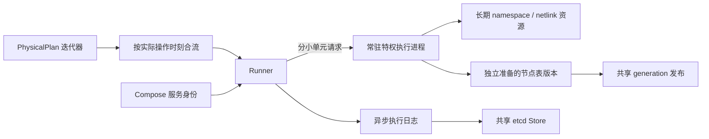
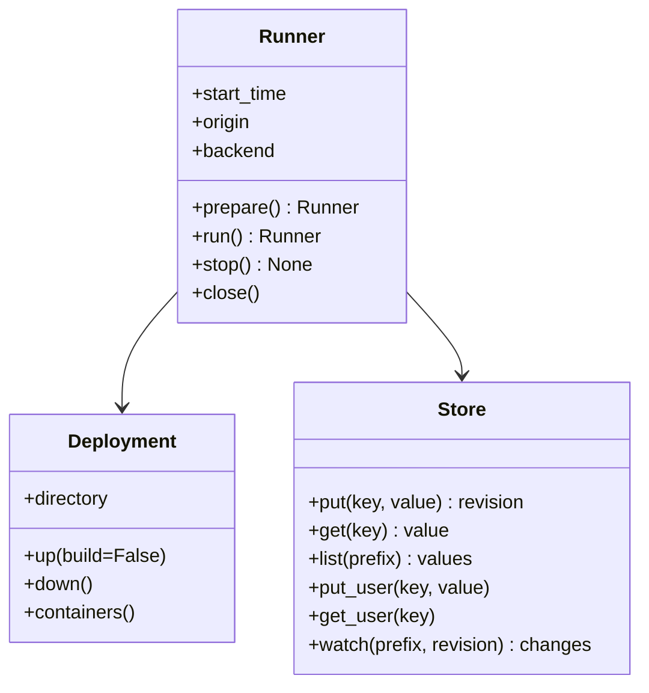

# Runner

[English](README.md)

Runner 把编译后的 PhysicalPlan 应用到已经部署的网络，负责准备、定时执行和运行期间维护。

```python
from skyseed import Deployment, Runner, Store, load_plans

deployment = Deployment("output/deployment")
with deployment:
    with Runner(load_plans("output/physical.plan"), deployment,
                output="output/run-001",
                store=Store(namespace="skyseed/run-001")) as runner:
        runner.run()
```

完整实验使用 etcd 作为共享 Store，服务需在使用期间持续运行；示例负责它的启动和停止。
独立使用 Runner 时可省略 Store，仅保存本地记录。这个入口不改变 Store 在完整系统中的共享职责。
每次实验使用新的输出目录；计划文件可以复用，容器 ID、namespace 句柄和 BPF
描述符每次重新绑定。

## 组成



| 文件 | 职责 |
|---|---|
| runner.py | 公共生命周期、定时执行、公平安排准备与回收 |
| plan_queue.py | 按操作时刻合并重叠批次；每路初始状态只使用一次 |
| deployment.py | 调用 SEED 产物的 Compose up/down，查询服务与容器的对应关系；支持 with |
| execution_process.py | 内部执行进程的启动、持续连接和命令协议 |
| instruction_executor.py | 运行时接口／地址所有权与指令解释 |
| netlink.py | rtnetlink 编码，包含合并 netem 配置及 TC MPLS 动作 |
| bpf/versions.py | 准备表、generation 引用和读者安全回收 |
| bpf/kernel.py | libbpf 加载和有界 map 写入 |
| ../store.py | JSON 值读写与按 revision 订阅 etcd 变化 |



Store 独立于 Runner，供执行、测量及模型程序跨进程共享数据。

| 存储方式 | 用途 | 当前使用 |
|---|---|---|
| 通过 `Store` 访问 etcd | 共享键值、事务、revision 和订阅 | Runner 实时发布执行记录；S4 示例归档业务测量 |
| 本地 JSONL | 追加历史，供离线读取 | 执行日志与实验测量 |

当前示例尚未实现跨进程 P&C 调度、多机资源管理和时钟协调。etcd 停止后仍可读取本地记录。

## 生命周期与时间


| 步骤 | 完成后的状态 |
|---|---|
| `Deployment.up()` | 按 SEED 的 Compose 产物启动容器 |
| `Runner.prepare()` | 核对容器身份，启动执行进程，恢复初始链路和规则 |
| `Runner.run()` | 建立唯一 monotonic 原点，执行到计划区间与 Delivery 尾部结束；网络保留最终状态 |
| `Runner.stop()` | 请求在当前后端调用完成后停止调度；不等待尚未执行的未来指令，随后由 close 释放资源。记录 stopped，不冒充 drained |
| `Runner.close()` | 等待记录写完，释放本 Runner 的接口、路由、程序及描述符 |
| `Deployment.down()` | 停止部署的容器 |

Python 的 `with` 在进入时准备资源，正常或异常退出时清理。嵌套写法先释放 Runner，
再停止 Deployment；执行和清理同时出错时保留原始错误。

初始准备读取同起点的全部批次，并保留首个更晚批次作前瞻。运行时由维护线程读取后继材料，
表准备和回收分小单元推进：一个节点准备迟到，其他就绪节点仍可发布。
同一节点的更新保持顺序，链路工作按自身依赖推进。

<details>
<summary>批次顺序、材料迟到与准备窗口（展开）</summary>

输入按**批次起点**排序，正是 PlanCompiler 的输出顺序。
每路首次恢复 initial 快照和未来 context，不重放后续批次的这些内容。
已收到的操作不等待下一批输入。重叠尾部可以插入其他节点较早的工作；
同一节点的已接纳更新必须像 Delivery 一样保持时间顺序。
迟到的同刻更新在已经发布的工作之后生效。后继材料迟到只推迟相关工作，不重置时钟；
独立重跑使用新的 Runner，没有隐含的历史回放。

调度器逐批读取，前瞻准备 30 秒的工作；单批可以包含更长尾部。
每节点最多持有两版尚未采用的准备中／已准备表，一个慢节点不会阻塞其他节点的输入。
节点规则状态用于准备下一版完整表；
没有更新的节点跨 generation 复用表。内核支持时批量写 map，不支持的 map 类型
使用逐项写入；两种方式都在有界单元之间让出执行通道。

</details>

## 两种后端

| | MPLS-like BPF（默认） | 普通 IPv4/Linux |
|---|---|---|
| 转发 | 入口 IP 前缀；中转节点局部标签；push/swap/pop | 内核前缀路由 |
| 准备 | 独立节点表及共享 generation 绑定 | 稳定请求字段 |
| 生效 | 一次共享 generation 写入选择已就绪节点 | netlink 逐步写入 |
| 断链 | 逻辑端口未绑定，直接丢弃 | 保留路由意图，安装 blackhole |
| 恢复 | 重新绑定同一逻辑端口 | 重新落实仍有效的路由意图 |

BPF 使用节点内部的专用 veth，让本地产生的业务流量进入相同分类器。
策略路由覆盖 Compiler 的业务地址池和显式前缀，不改写普通 SEED 接口。
动态链路 MTU 为 1504，容纳 1500 字节 IPv4 负载和一个 MPLS 头。
SEED 应已关闭 all.rp_filter，以支持本地注入。
Compiler 配套程序在定时执行前只编译一次，也可以通过 Runner 的 program
参数传入已编译 ELF 字节；宿主需要支持 BPF target 的 clang 和 libbpf。

需要 Linux 及运行特权 Docker 容器的权限。辅助进程只读挂载宿主，
使用同一活动 Python 安装并进入部署的网络 namespace；
不会永久修改宿主 sysctl 或创建全局 map pin。辅助进程仅把自己的文件描述符软限制
提高到已授予的硬限制，以持有数百节点的资源。不支持运行中替换容器。

## 结果与查询

output/execution.jsonl 为追加执行日志，helper.log 保存内核／verifier 诊断。
观测写出与到期请求分离，close() 等待写出完成。

| 记录 | 关键内容 |
|---|---|
| available | 计划时刻、节点／链路／路由数量、材料准备时间 |
| prepared | 节点、表版本及准备完成时间 |
| ready | 初始准备起止时间、计划 start_time |
| clock | start_time 对应的 monotonic origin |
| link | 计划时刻、链路、操作、实际开始／生效／完成 |
| route（BPF） | generation、采用节点/计划时刻/每节点 instruction_counts、实际开始／生效／完成 |
| route（Linux） | 节点计划操作及实际开始／生效／完成 |
| stopped | 用户中断后的实际停止时刻；未完成的未来工作不计为执行成功 |
| drained | 已接纳计划和维护工作完成 |

执行滞后等于 activated 减去 origin + (scheduled - start_time)。
scheduled 已含 Delivery 调度延迟，不能再计一次；clock 之前的初始准备不属于
运行滞后。链路和 Linux 多命令操作以整体完成作为生效点；
BPF 记录 generation 写入的实际时刻，后续地址清理另计完成时间。

Store 将 Runner 记录放在 runner/events/；实验通过 put_user()/get_user()
使用 user/ 子树。订阅支持从已知 revision 开始：

```python
revision = store.put_user("tcp", {"sequence": 1})
with store.watch("user/", revision=revision) as changes:
    change = next(changes)
```

Store 使用 [etcd v3 JSON gateway](https://etcd.io/docs/v3.6/dev-guide/api_grpc_gateway/)，
直接连接配置的端点。计划和执行记录可供离线分析，但本身不能证明逐包经过的路径。
回执的 instruction_counts 区分同一节点、同一计划时刻但稍后才到达的批次；
不能把未来同刻指令都归到第一次采用中。旧记录缺此字段且存在分批歧义时，回放必须说明无法精确恢复。

测试按 tests/unit/runner、tests/live/runner 和 tests/live/store
组织。现场测试需显式指定缓存节点镜像和 etcd 可执行文件，普通收集会跳过现场测试。
