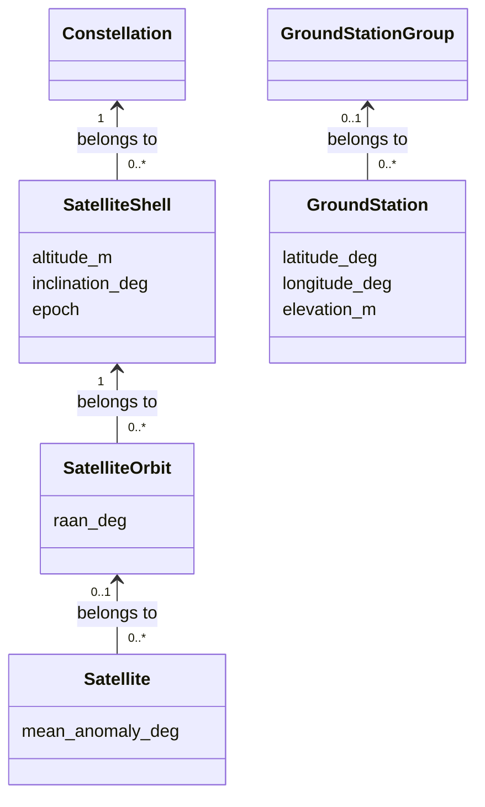

# Scene

[中文](README.zh-CN.md)

`Scene` stores satellite-network facts and stable identities for reuse by Emu and
planning models. It contains no AS assignment or algorithm configuration.
You can construct it in Python, pass it directly to a consumer, or save it as a
`.scene` file.

## Structure



For circular constellations, a shell holds shared altitude, inclination and epoch;
an orbit adds RAAN, and each satellite adds its phase. A satellite can instead
have an independent position source, without an orbit. GS grouping is optional.
Membership is explicit: equal geometry does not make two shells the same shell.

Every entity and Scene itself has custom `data`, for example an operator name or
equipment information. These facts do not automatically assign ASs or policies.

## Build and query

```python
from datetime import datetime, timezone
from skyseed.scene import Scene

scene = Scene()
scene.create_constellation("demo", data={"operator": "example"})
scene.create_shell(
    "low", constellation="demo", planes=2, satellites_per_plane=3,
    altitude_km=550, inclination_deg=53,
    epoch=datetime(2026, 1, 1, tzinfo=timezone.utc),
    raan_start_deg=0, phase_factor=1,
)
scene.create_ground_station_group("ground")
scene.create_ground_station("G1", latitude_deg=40, longitude_deg=116, group="ground")

shells = scene.get_shells("demo")
orbits = scene.get_orbits(shells[0].group_id)
satellites = scene.get_satellites(orbits[0].group_id)
stations = scene.get_ground_stations("ground")
```

`create_shell` generates circular orbits and satellites from ordinary parameters.
For example, `planes=6, satellites_per_plane=60` creates 360 satellites; no preset
name is required. Add another shell under the same constellation to combine shells.
Counts are positive integers; altitude is supplied in kilometres and stored in
metres. Epochs must include a timezone and are normalized to UTC per shell.

| Geometry argument | Meaning / default |
|---|---|
| `planes`, `satellites_per_plane` | Number of planes and satellites in each plane |
| `altitude_km`, `inclination_deg`, `epoch` | Shared circular-orbit geometry and initial time |
| `raan_start_deg=0` | First plane's RAAN; subsequent planes advance by `360 / planes` degrees |
| `orbit_raan_deg=None` | Optional explicit RAAN list, one per plane; replaces uniform directions |
| `phase_start_deg=0` | First satellite's phase in the first plane |
| `phase_factor=0` | Each plane advances phase by `phase_factor * 360 / (planes * satellites_per_plane)` degrees |

Within a plane, satellites advance by `360 / satellites_per_plane` degrees. Angles
wrap at 360°. `phase_factor` is a real-valued layout parameter, not restricted to
integer Walker patterns. The example above produces phases 0°/120°/240° in the
first plane and 60°/180°/300° in the second.

Generated identities are `low-orbit-001` and `low-orbit-001-satellite-0001`, etc.
`id_prefix` defaults to the shell ID; `first_orbit=1` controls the starting orbit
number. These options change names only. Satellites use their IDs as names;
the shell's `data` remains shared shell information, not copied to every node.

[S1–S5](../../../data/README.md) are parameter presets, not built-in Scene types.
The [S4 example](../../../examples/s4_handover/scene.py) reads one small parameter
record and calls this method explicitly. S5 supplies four nonuniform plane RAANs.
Changing counts creates a custom shell; give it a corresponding name.

For irregular per-satellite input, omit counts and build the hierarchy explicitly:

```python
scene.create_constellation("custom")
scene.create_shell("manual", constellation="custom", altitude_km=550,
                   inclination_deg=53, epoch=datetime(2026, 1, 1, tzinfo=timezone.utc))
scene.create_orbit("plane", shell="manual", raan_deg=45)
scene.create_satellite("S1", orbit="plane", mean_anomaly_deg=90)
```

Creation methods return the new entity and accept optional `data`. Parent arguments
take group IDs. GS elevation defaults to zero metres; its name is the default
node ID. Node and group IDs each have their own unique namespace within Scene.

| Entry | Use |
|---|---|
| `create_constellation(name)` | Parent for one or more shells |
| `create_constellation(name, planes=..., ...)` | Convenience for one uniform shell with zero starting phase in every plane; existing IDs remain unchanged |
| `create_shell(..., planes=..., satellites_per_plane=...)` | Parameter-generated shell with independent geometry and phasing |
| `create_shell(...)` without counts, then `create_orbit` / `create_satellite` | Individually specified orbits, unequal counts or per-node source data |

Typed queries return tuples of owned objects; omit the parent ID to get all of
that type. `get_node` and `get_group` resolve IDs, while `nodes` and `groups` list
all entities. Upward references such as `satellite.orbit.shell` point to shared
parent objects. When using `add_group` or `add_node` directly, add parents first
and refer to those owned objects.

## Select nodes

```python
selected = scene.get_node_ids(groups=["demo", "ground"])
```

This returns descendant node IDs in Scene order, deduplicating overlaps.
`kind="satellite"` or `"ground_station"` optionally filters the result.
Omitting `groups` selects all nodes, including ungrouped ones; `groups=[]` selects
none. Unknown IDs fail. Pass the result to
[SkyAS.loadScene](../emulator/README.md#load-and-customize); the consumer decides AS assignment.

## Custom data and position inputs

Identity, membership and initial geometry are fixed after construction; `data`
remains editable. Input dictionaries are copied and must contain JSON-compatible
values, with finite numbers. Model instances, settings and execution state belong
to their consumers. `Scene.validate()` checks editable data before saving or Emu
loading; errors identify the entity and field.

A node's `position` provides a detached `ScenePositionSource` for position consumers:

| Kind | Data |
|---|---|
| `circular-orbit/v1` | Altitude in metres, inclination, RAAN and phase in degrees, plus UTC epoch |
| `geodetic/v1` | GS latitude/longitude in degrees and elevation in metres |
| Custom kind | Consumer-defined JSON, such as a trajectory file reference |

For an independent satellite, use
`create_satellite(node_id, position=ScenePositionSource(kind, data))`, importing
`ScenePositionSource` from `skyseed.scene`. This replaces the orbit/phase input.
Custom source data is preserved for its consumer; Scene does not fetch referenced
files or implement external orbit/trajectory importers.

## Save and load

```python
scene.dump("tiny.scene")
restored = Scene.load("tiny.scene")
```

The file is UTF-8 JSON (`format: "skyseed.scene"`, `version: 2`), separate from
SEED's construction-description format. Loading restores identities, order and
shared parent references. Saving validates data and atomically replaces the file;
its parent directory must exist. Invalid content reports the file and record.
Unsupported versions are rejected; regenerate unreleased version-1 files.
The saved file describes the fully constructed Scene, including individual nodes.
It is a reusable snapshot for Emu and P&C, not a parameter recipe to regenerate.

## Logical access destinations

`Scene.endpoints`, `get_endpoint` and `get_endpoints(kind)` expose logical access
destinations separately from physical nodes. `create_zone` supplies a representative
latitude/longitude and optional rectangular bounds; `create_default_zones` adds
the fixed cosine-scaled global partition. `create_endpoint` supports other kinds
with model-defined JSON data. Endpoint identity/kind are fixed; editable data is
validated when saved. Endpoints persist in the optional v2 `endpoints` field;
existing v2 scenes without that field load with an empty collection.


## Files

- `scene.py`: Scene ownership, construction, queries and save/load.
- `scene_entities.py`: constellation, shell, orbit, satellite and GS types,
  position inputs and their local checks.
- `shell_layout.py`: circular-shell angle generation shared by construction methods.
- `scene_endpoints.py`: stable access destinations and the default geographic
  partition; no service assignment or forwarding rules.

The module uses only the standard library. See the [construction example](../../../examples/tiny_network/scene.py).
