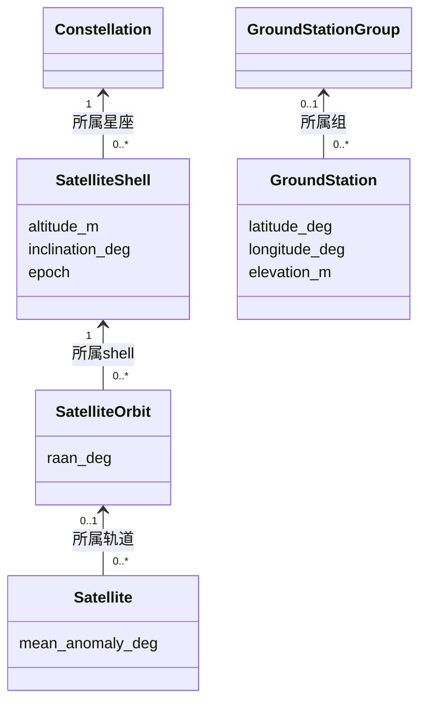

# Scene

[English](README.md)

`Scene` 保存卫星网络事实和稳定身份，可同时供 Emu 和规划模型使用，不包含 AS 分配或算法配置。
可在 Python 中构造、直接传递，也可保存为 `.scene` 文件。本模块只依赖标准库。

## 结构



圆轨道场景中，shell 保存共同高度、倾角和历元，orbit 补充 RAAN，卫星补充相位。
卫星也可使用独立位置来源而不属于轨道；GS 分组可选。
归属显式定义，相同几何参数不使两个 shell 自动成为同一对象。
Scene 和各实体都有自定义 `data`，不会据此自动分配 AS 或策略。

## 构造与查询

```python
from datetime import datetime, timezone
from skyseed.scene import Scene

scene = Scene()
scene.create_constellation("demo", data={"operator": "example"})
scene.create_shell(
    "low", constellation="demo", planes=2, satellites_per_plane=3,
    altitude_km=550, inclination_deg=53,
    epoch=datetime(2026, 1, 1, tzinfo=timezone.utc),
    raan_start_deg=0, phase_factor=1,
)
scene.create_ground_station_group("ground")
scene.create_ground_station("G1", latitude_deg=40, longitude_deg=116, group="ground")

shells = scene.get_shells("demo")
orbits = scene.get_orbits(shells[0].group_id)
satellites = scene.get_satellites(orbits[0].group_id)
stations = scene.get_ground_stations("ground")
```

`create_shell` 按普通参数生成圆轨道和卫星。例如设置
`planes=6, satellites_per_plane=60`，就生成 360 颗卫星，不要求使用某个预设名称。
同一星座下可以继续创建其他 shell。数量为正整数，高度输入 km、内部保存 m；
历元必须带时区，按各 shell 转为 UTC。

| 几何参数 | 含义／默认值 |
|---|---|
| `planes`、`satellites_per_plane` | 轨道数量、每轨卫星数量 |
| `altitude_km`、`inclination_deg`、`epoch` | 共同高度、倾角和初始时刻 |
| `raan_start_deg=0` | 首轨 RAAN；之后每轨增加 `360 / planes` 度 |
| `orbit_raan_deg=None` | 可显式提供每轨 RAAN，代替均匀分布 |
| `phase_start_deg=0` | 首轨首颗卫星的相位 |
| `phase_factor=0` | 每轨相位递增 `phase_factor * 360 / (planes * satellites_per_plane)` 度 |

同轨相邻卫星相差 `360 / satellites_per_plane` 度，角度在 360° 处回绕。
`phase_factor` 是可取实数的布局参数，不限于整数 Walker 模式。
上例两条轨道的卫星相位分别为 0°/120°/240° 和 60°/180°/300°。

自动编号形如 `low-orbit-001`、`low-orbit-001-satellite-0001`。
`id_prefix` 默认为 shell ID，`first_orbit=1` 指定首轨编号，两者只影响名称。
卫星名称使用其 ID；shell 的 `data` 保留为共享信息，不逐颗复制。

[S1–S5](../../../data/README.zh-CN.md) 是参数预设，不是 Scene 内置类型。
[S4 示例](../../../examples/s4_handover/scene.py) 读取一小份参数，再显式调用上述方法；
S5 则提供四条非均匀轨道方向。修改数量后属于自定义 shell，应使用相应的新名称。

逐星输入不规则几何时，省略数量，再逐个构造：

```python
scene.create_constellation("custom")
scene.create_shell("manual", constellation="custom", altitude_km=550,
                   inclination_deg=53, epoch=datetime(2026, 1, 1, tzinfo=timezone.utc))
scene.create_orbit("plane", shell="manual", raan_deg=45)
scene.create_satellite("S1", orbit="plane", mean_anomaly_deg=90)
```

创建方法返回实体，接受可选 `data`；父级参数使用 group ID。
GS 海拔默认零米，名称默认作为 node ID。节点和组各自在自己的命名空间内唯一。

| 入口 | 使用场合 |
|---|---|
| `create_constellation(name)` | 作为一个或多个 shell 的父级 |
| `create_constellation(name, planes=..., ...)` | 单 shell 简便构造，各轨相位均从零开始；保留既有编号 |
| `create_shell(..., planes=..., satellites_per_plane=...)` | 参数生成，可分别配置几何与轨间相位 |
| 不带数量的 `create_shell`，再调用 `create_orbit`／`create_satellite` | 单独指定轨道、每轨不同数量或逐节点输入资料 |

分类查询返回所属对象的 tuple，省略父 ID 时返回该类型全部对象。
`get_node`／`get_group` 按 ID 查询，`nodes`／`groups` 列出全部。
`satellite.orbit.shell` 等向上引用指向共享父对象；直接使用 `add_group`／`add_node`
时先添加父级，再引用 Scene 已拥有的对象。

## 选择节点

```python
selected = scene.get_node_ids(groups=["demo", "ground"])
```

按 Scene 顺序返回后代 node ID，重叠项去重。可选 `kind="satellite"` 或 `"ground_station"`。
省略 `groups` 选择全部（含未分组节点），`groups=[]` 选择空集合，未知 ID 报错。
把结果传给 [SkyAS.loadScene](../emulator/README.zh-CN.md)，由消费者决定 AS 分配。

## 自定义数据与位置输入

身份、归属和初始几何在构造后固定；`data` 可编辑。输入字典会复制，只接受 JSON
兼容值及有限数值。模型实例、算法配置和运行状态归消费者。
`Scene.validate()` 在保存或加载到 Emu 前检查可编辑数据，错误指出实体和字段。

节点的 `position` 提供独立的 `ScenePositionSource`：

| kind | 内容 |
|---|---|
| `circular-orbit/v1` | 高度 m、倾角／RAAN／相位 °、UTC 历元 |
| `geodetic/v1` | GS 经纬度 °、海拔 m |
| 自定义 kind | 由消费者解释的 JSON，例如轨迹文件引用 |

从 `skyseed.scene` 导入 `ScenePositionSource`，通过
`create_satellite(node_id, position=ScenePositionSource(kind, data))` 创建独立卫星，
代替 orbit／phase 输入。Scene 保存外部资料的描述，不下载文件或实现轨迹读取器。

## 保存与读取

```python
scene.dump("tiny.scene")
restored = Scene.load("tiny.scene")
```

文件为 UTF-8 JSON，`format="skyseed.scene"`、`version=2`，不同于 SEED 构建描述。
读取恢复身份、顺序和共享父引用；保存先检查数据，再原子替换文件，父目录须已存在。
无效内容指出文件及记录，不支持的版本报错；未发布的 version-1 文件应重新生成。
保存的是已经构造好的完整 Scene，仍包含各节点，供 Emu 和 P&C 直接复用；
它是场景快照，不是读取时再生成一次的参数配方。

## 逻辑接入目的

`endpoints`、`get_endpoint`、`get_endpoints(kind)` 查询逻辑接入目的，与物理节点分开。
`create_zone` 保存代表点经纬度及可选矩形边界；`create_default_zones` 添加固定的
余弦缩放全球划分。`create_endpoint` 支持其他 kind，由模型解释 JSON 数据。
身份／类型固定，数据可编辑，保存时检查。端点保存在 v2 的可选 `endpoints` 字段；
没有该字段的 v2 文件恢复为空集合。Scene 不进行服务分配或路由计算。

## 文件

| 文件 | 职责 |
|---|---|
| `scene.py` | Scene 所有权、构造、查询与保存读取 |
| `scene_entities.py` | 星座、shell、轨道、卫星与 GS、位置输入及局部检查 |
| `shell_layout.py` | 构造方法共用的圆轨道角度生成 |
| `scene_endpoints.py` | 稳定接入目的与默认地理划分 |

参见[场景构造示例](../../../examples/tiny_network/scene.py)。
