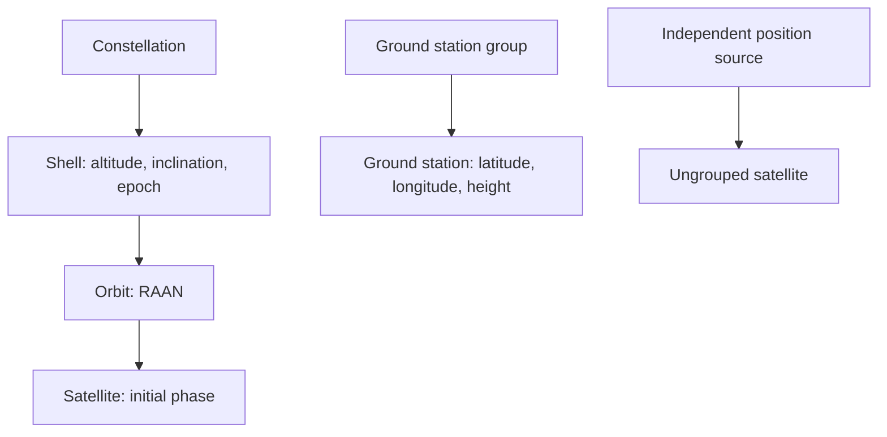

# Scene inspection

[中文](README.zh-CN.md) · **English**

Scene is an independent class shared by Emulator and Physical. This viewer
inspects its static structure and original inputs, without importing Physical,
propagating positions, or generating candidates.



From the repository root, in `skyseed_dev`:

```bash
python -m tools.observation.scene.inspection --output /tmp/skyseed-scene-view
```

Open `index.html` offline. Add `--scene path/to/input.scene` for a saved Scene.
The default contains four orbital planes, 64 satellites and three ground stations.

- **Overview (default):** orbits, satellites and ground stations in one schematic.
  Selecting a group or node highlights it without hiding the rest; “Overview”
  restores the whole scene after isolation or a view change.
- **Orbits:** faint complete circular outlines, with satellites at their input phases.
  Click a line, node or group to highlight it and see its facts below the globe.
  “Isolate selection” shows just a constellation, shell, orbit or node.
- **Ground:** an optional ground-only geographic view; select groups or individual sites.
- Each source retains its own epoch. The orbital schematic uses the circular-input
  axes and does not imply a simultaneous ECEF snapshot or satellite–ground alignment.
  Ground coordinates are placed on a display sphere, not exported as physical states.
- TLE/custom sources remain inspectable as inputs. The tool does not invent circular
  outlines or initial coordinates for them. Time evolution belongs to
  [Physical inspection](../physical/README.md).

`inspection_data(scene)` exports original inputs plus static `geometry` in
`skyseed.scene-inspection/v2`. `write_inspection(data, output)` writes `scene.json`
and a self-contained page. The previous optional time-preview API and CLI options
have been removed; Scene itself and its persistence format are unchanged.

`inspection.py` owns the CLI/export, `viewer.html` owns selection and presentation.
Shared `../_presentation/scene_display.py` reads Scene inputs and constructs static
circle outlines; it performs no orbital propagation. Page/globe assets are shared
with Physical; Natural Earth coastline provenance remains alongside the asset.
