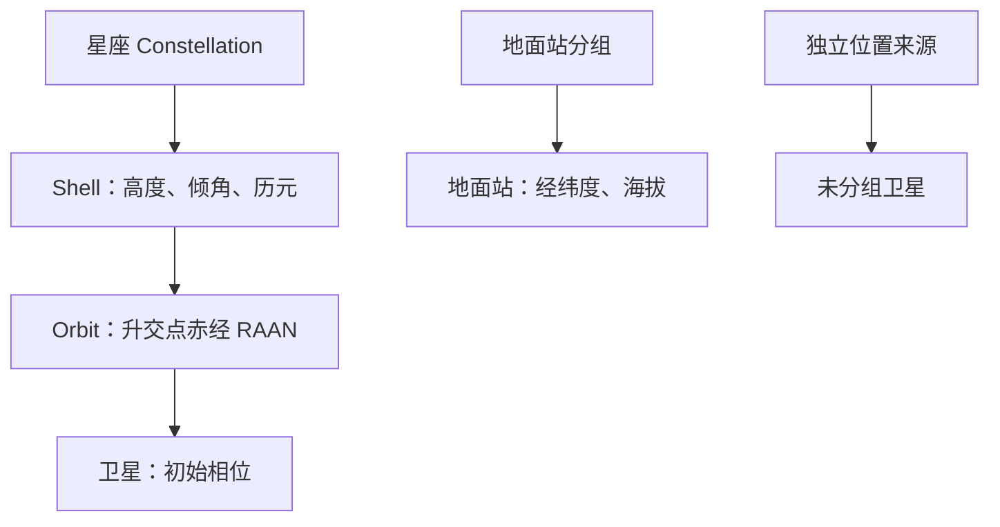

# Scene 场景检查

**中文** · [English](README.md)

Scene 是独立的类，可由 Emulator 和 Physical 共同引用。
本工具查看它的静态组织和原始资料，不导入 Physical，不推进位置，也不生成候选。



在仓库根目录、`skyseed_dev` 环境中运行：

```bash
python -m tools.observation.scene.inspection --scene path/to/input.scene --output /tmp/skyseed-scene-view
```

打开 `index.html` 即可离线查看输入 Scene。

- **全部同图（默认）**：轨道、卫星和地面站共同显示。选中分组或节点只高亮，
  保留其他对象；隔离或切换视图后，点击“全部同图”恢复整个场景。
- **轨道结构**：完整圆轨道以淡线显示，卫星位于输入指定的初始相位。
  点击轨道、节点或分组可高亮，并在图下查看资料；勾选“仅显示所选对象”可单看星座、shell、轨道或节点。
- **地面站**：可切换到只看地面的地理视图，选择站点组或单个站点。
- 各来源保留自己的历元。轨道示意使用圆轨道输入的坐标轴，不表示同刻 ECEF 快照，
  也不表示同刻星地相对位置。地面站放在显示参考球面上，不作为物理状态导出。
- TLE／自定义来源仍可查看原始资料，不虚构圆轨道轮廓或初始坐标。
  时间变化请看 [Physical 检查工具](../physical/README.zh-CN.md)。

`inspection_data(scene)` 导出原始资料和静态 `geometry`，格式为 `skyseed.scene-inspection/v2`。
`write_inspection(data, output)` 写出 `scene.json` 和自包含页面。

`inspection.py` 负责命令入口与导出，`viewer.html` 负责选择和展示。
共享的 `../_presentation/scene_display.py` 读取 Scene 资料并生成静态圆轮廓，不进行轨道传播。
页面／地球资产与 Physical 共用，Natural Earth 海岸线的来源说明仍位于资产旁。
